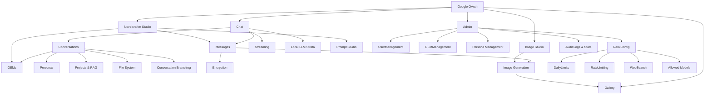

# Features - Vikini

> **Updated**: 2026-11-02

---

## 1. Danh Sách Tính Năng

| Tính năng                 | Trạng thái    | Mô tả                                                                              |
| ------------------------- | ------------- | ---------------------------------------------------------------------------------- |
| **Chat Streaming**        | ✅ Hoàn thành | SSE streaming đa mô hình (Gemini, Claude, DeepSeek, Grok, Groq, GLM, Strata)       |
| **Enhanced Streaming UX** | ✅ Hoàn thành | Typewriter buffer, smart auto-scroll, live thinking telemetry, animations          |
| **Conversations**         | ✅ Hoàn thành | CRUD + auto-title + URL sync + rẽ nhánh (Branching) + đánh dấu yêu thích & gắn thẻ |
| **GEMs System**           | ✅ Hoàn thành | Custom AI system instructions với versioning                                       |
| **Personas System**       | ✅ Hoàn thành | Cá nhân hóa giọng điệu (tone), định dạng trình bày và ngữ cảnh người dùng          |
| **User Prompt Templates** | ✅ Hoàn thành | Lưu trữ mẫu câu lệnh cá nhân & gợi ý prompt thông minh (`/api/prompt-suggest`)     |
| **File System**           | ✅ Hoàn thành | Upload, preview, 30-day TTL, inline-first UX                                       |
| **Image Studio**          | ✅ Hoàn thành | Tạo ảnh, sửa ảnh đa lớp & mô tả ảnh AI (Gemini, DALL-E, Flux)                      |
| **Gallery**               | ✅ Hoàn thành | Image management với infinite scroll                                               |
| **Image Lightbox**        | ✅ Hoàn thành | Fullscreen view + zoom controls                                                    |
| **Image Compare**         | ✅ Hoàn thành | Side-by-side & overlay comparison                                                  |
| **Projects**              | ✅ Hoàn thành | Knowledge Base RAG theo project (`gemini-embedding-2` 3072 chiều)                  |
| **Novelcrafter Studio**   | ✅ Hoàn thành | Không gian sáng tác tiểu thuyết, Story Bible, Rich Manuscript Editor & Export      |
| **Prompt Studio**         | ✅ Hoàn thành | Tùy chỉnh chỉ dẫn gốc, 11 nút ngữ cảnh & Dynamic Source Tooltips cho 37 nút AI     |
| **Local LLM (Strata)**    | ✅ Hoàn thành | 32K Local Inference + Story Sampling + Hàng đợi FIFO                               |
| **Token Count Display**   | ✅ Hoàn thành | Hiển thị token usage (Input / Output / Thinking) per message                       |
| **Message Encryption**    | ✅ Hoàn thành | AES-256-GCM cho cả `content` và `meta.reasoning`                                   |
| **Rate Limiting**         | ✅ Hoàn thành | Redis-based per user / IP                                                          |
| **Daily Message Limits**  | ✅ Hoàn thành | Theo rank (`rank_configs`)                                                         |
| **Web Search**            | ✅ Hoàn thành | Optional, rank-gated (Google Search Grounding + URL Context)                       |
| **Admin Dashboard**       | ✅ Hoàn thành | Quản lý Users, GEMs, Personas, Rank Limits, Audit Logs & Thống kê                  |
| **Google OAuth**          | ✅ Hoàn thành | NextAuth v5                                                                        |
| **Voice Input (STT)**     | ✅ Hoàn thành | Web Speech API + waveform                                                          |
| **TTS Playback**          | ✅ Hoàn thành | Read AI responses aloud                                                            |
| **Bilingual UI**          | ✅ Hoàn thành | Vietnamese/English support                                                         |

---

## 2. Chi Tiết Tính Năng

### 2.1 Chat System

**Luồng xử lý**:

```
User Input → Rate Limit Check → Daily Limit Check → Build Context → AI Provider Stream → Save to DB
```

**Tính năng mở rộng**:

- **Conversation Branching (Rẽ nhánh)**: Tạo cuộc hội thoại nhánh từ bất kỳ tin nhắn nào (`POST /api/conversations/[id]/branch`) kèm ngữ cảnh kế thừa.
- **Message Organization**: Đánh dấu yêu thích (`PATCH /api/messages/[id]/favorite`) và gắn thẻ phân loại (`PATCH /api/messages/[id]/tag`).
- **User Prompt Templates & Suggestions**: Quản lý mẫu prompt cá nhân (`GET/POST/DELETE /api/user-templates`) và gợi ý câu lệnh (`POST /api/prompt-suggest`).
- **Inline Composer Controls**: Bộ chọn Model (`ModelSelector`) và mức độ suy luận (`ThinkingLevelSelector`) tích hợp gọn ngay trong thanh nhập chat (`InputModelControls.tsx` bên trong `InputForm.tsx`).

**Files liên quan**:

- `src/app/api/chat-stream/route.ts` - Entry point
- `src/app/api/chat-stream/chatStreamCore.ts` - Core orchestration logic
- `src/app/api/chat-stream/streaming/` - Multi-provider SSE stream engines (`gemini-stream.ts`, `anthropic-stream.ts`, `deepseek-stream.ts`, `openai-stream.ts`, `strata-stream.ts`, `post-processing.ts`)
- `src/lib/features/chat/conversations.ts` - Conversation CRUD & Branching
- `src/lib/features/chat/messages.ts` - Message CRUD & AES encryption
- `src/app/api/conversations/[id]/branch/route.ts` - Conversation branching API
- `src/app/api/messages/[id]/favorite/route.ts`, `src/app/api/messages/[id]/tag/route.ts` - Message favorites & tags
- `src/app/api/user-templates/route.ts`, `src/app/api/prompt-suggest/route.ts` - Prompt templates & AI suggestions
- `src/lib/core/genaiClient.ts`, `src/lib/core/claudeClient.ts`, `src/lib/core/deepseekClient.ts`, `src/lib/core/openRouterClient.ts`, `src/lib/core/groqClient.ts`, `src/lib/core/strataClient.ts` - AI provider clients

---

### 2.2 GEMs & Personas (AI Assistants & Personalization)

**Mô tả**:

- **GEMs**: Custom system instructions chuyên sâu gắn vào conversation (có lưu lịch sử phiên bản `gem_versions` mỗi khi đổi `instructions` và xem thử qua `POST /api/gems/preview`).
- **Personas**: Cấu hình phong cách giao tiếp cá nhân hóa (`tone`, `useEmojis`, `useHeadersLists`, `userContext`, `customInstructions`) có thể chuyển đổi nhanh trên thanh công cụ chat (`PersonaQuickSwitch.tsx`).

**Phân loại**:

- **Premade**: GEM / Persona hệ thống (read-only với user thường), quản lý qua Admin Dashboard.
- **Custom**: User tự tạo và quản lý.

**Files**:

- `src/app/api/gems/route.ts`, `src/app/api/gems/preview/route.ts` - GEMs API
- `src/lib/features/gems/gems.ts` - GEMs business logic
- `src/app/api/personas/route.ts` - Personas API
- `src/lib/features/personas/personas.ts` - Personas business logic
- `src/app/features/personas/components/PersonaQuickSwitch.tsx`, `src/app/features/personas/components/PersonasModal.tsx` - Personas UI

---

### 2.3 File System

**Quy trình**:

1. Validate MIME type và size (blacklist các định dạng thực thi nguy hiểm)
2. Upload lên Supabase Storage
3. Parse/extract text (PDF, text files)
4. Đếm tokens
5. Đưa vào context khi chat (inline-first UX)

**TTL**: 30 ngày (cleanup qua cron `GET/POST /api/cron/cleanup`)

**Lưu trữ**: Single `files` table (thay thế dual storage cũ)

**Files**:

- `src/app/api/files/upload/route.ts`, `src/app/api/files/route.ts`, `src/app/api/files/[id]/url/route.ts`
- `src/app/api/cron/cleanup/route.ts`
- `src/lib/features/files/fileService.server.ts`
- `src/lib/features/files/fileValidation.ts`
- Components: `FilePreviewCard`, `FilePreviewArea`, `FileLightbox`, `FileInMessage`

---

### 2.4 Admin Dashboard

**Mô tả**: Bảng điều khiển quản trị hệ thống, truy cập tại `/admin` (chỉ user rank `admin`).

**Capabilities (trong Admin panel)**:

- Quản lý users: thay đổi rank, block/unblock
- Quản lý premade GEMs & premade Personas: CRUD hệ thống GEMs và Personas mẫu
- Cấu hình rank limits: daily messages, max file size, features (`web_search`, `unlimited_gems`), allowed models
- Xem nhật ký kiểm toán quản trị (`AuditLogViewer`) và tổng quan thống kê hệ thống (`StatisticsOverview`)
- Song ngữ VN/EN
- Nút quay lại trang chủ Vikini

**Managed ngoài Admin panel**:

| Cấu hình                                               | Quản lý tại                  | Lý do                                           |
| ------------------------------------------------------ | ---------------------------- | ----------------------------------------------- |
| API Keys (Gemini, Claude, OpenRouter, DeepSeek, Groq)  | Vercel Dashboard             | Bảo mật, không expose trên UI                   |
| Rate Limiting (`RATE_LIMIT_MAX`)                       | Vercel Environment Variables | Áp dụng global, không cần thay đổi thường xuyên |
| File size limits (`FILE_MAX_SIZE_MB` / `rank_configs`) | Vercel Env / Admin Dashboard | Theo rank trong `rank_configs`                  |
| Whitelist emails                                       | Vercel Environment Variables | Quyết định ai được đăng ký                      |
| Database schema, RLS policies                          | Supabase Dashboard           | DBA level                                       |
| Cron jobs (`CRON_SECRET`)                              | Vercel Cron                  | File cleanup (30-day TTL) & stuck RAG docs      |

**Files**:

- `src/app/admin/page.tsx` - Server component với auth guard
- `src/app/admin/components/AdminDashboard.tsx` - Main layout + tabs
- `src/app/admin/components/UserManager.tsx` - User CRUD
- `src/app/admin/components/RankConfigManager.tsx` - Limits config
- `src/app/admin/components/GemsManager.tsx` - System GEMs
- `src/app/admin/components/PersonasManager.tsx` - System Personas
- `src/app/admin/components/AuditLogViewer.tsx` - Admin audit logs
- `src/app/admin/components/StatisticsOverview.tsx` - System statistics
- `src/app/api/admin/users/route.ts` - User API
- `src/app/api/admin/rank-configs/route.ts` - Rank config API
- `src/app/api/admin/gems/route.ts` - GEMs API
- `src/app/api/admin/personas/route.ts` - Personas API
- `src/app/api/admin/audit-log/route.ts` - Audit log API
- `src/app/api/admin/stats/route.ts` - Stats API

**Route**: `/admin`

---

### 2.5 Image Studio

**Mô tả**: Công cụ tạo ảnh, chỉnh sửa ảnh đa lớp và phân tích ảnh AI với nhiều model và style.

**Models hỗ trợ**:

- **Gemini Image Flash (Nano Banana 2) & Gemini 3 Pro Image**: Default, tích hợp trực tiếp
- **DALL-E 3**: Yêu cầu OpenAI API key (BYOK)
- **Flux Pro**: Yêu cầu Replicate API key (BYOK)

**Tính năng**:

- Style presets (Anime, Photorealistic, Watercolor, etc.)
- Aspect ratio controls (1:1, 16:9, 9:16, etc.)
- Prompt enhancement (AI cải thiện prompt)
- Chỉnh sửa ảnh đơn & đa ảnh tham chiếu (`/api/edit-image`, `/api/edit-image-multi`)
- Phân tích & mô tả ảnh bằng Vision AI (`/api/describe-image`)
- Kiểm tra hạn ngạch tạo ảnh hàng loạt (`/api/batch-gen-quota`)
- Download và remix

**Files**:

- `src/app/features/image-gen/` - UI Components
- `src/app/api/generate-image/route.ts` - Tạo ảnh AI
- `src/app/api/edit-image/route.ts`, `src/app/api/edit-image-multi/route.ts` - Chỉnh sửa ảnh AI
- `src/app/api/describe-image/route.ts` - Mô tả ảnh Vision
- `src/app/api/batch-gen-quota/route.ts` - Quota tạo ảnh

**Route**: `/image-studio`

---

### 2.6 Gallery

**Mô tả**: Quản lý tất cả ảnh đã tạo trong chat và Image Studio.

**Tính năng**:

- Infinite scroll (20 ảnh/lần)
- Search by prompt
- Filter by date/model
- Remix to chat
- Delete với confirmation (`DELETE /api/gallery`, `DELETE /api/gallery/[id]`)
- **Image Lightbox**: Fullscreen view với zoom controls
- **Image Compare**: So sánh 2 ảnh (side-by-side hoặc overlay slider)
- Navigation arrows (prev/next) với keyboard support

**Files**:

- `src/app/features/gallery/` - UI Components
- `src/app/features/gallery/components/ImageCompareModal.tsx` - Compare modal
- `src/app/api/gallery/route.ts`, `src/app/api/gallery/[id]/route.ts` - API

**Route**: `/gallery`

---

### 2.7 Voice Features

**Mô tả**: Speech-to-Text input và Text-to-Speech playback.

**Tính năng**:

- Voice input với waveform indicator
- TTS button trên tất cả AI messages
- Auto language detection (VN/EN/DE)
- Browser compatibility warnings

**Files**:

- `src/app/features/chat/components/VoiceButton.tsx` - Voice input button
- `src/lib/features/voice/useSpeechRecognition.ts` - STT hook
- `src/lib/features/voice/useSpeechSynthesis.ts` - TTS hook

---

### 2.8 Token Count Display

**Mô tả**: Hiển thị token usage từ AI Provider cho mỗi AI message.

**Tính năng**:

- Badge hiển thị total tokens ở góc dưới-phải của message
- Tooltip breakdown: Input (`promptTokenCount`) / Output (`candidatesTokenCount`) / Thinking (`thoughtsTokenCount`)
- Format số lớn (1.2K, 1.5M)
- Lưu vào DB trong `messages.meta`

**Data Flow**:

```
AI Provider Response → usageMetadata → SSE event: meta (type: "usageMetadata") → Save to DB → Load với messages → TokenBadge UI
```

**Token Types**:

- **Input**: Prompt + system instructions + conversation history
- **Output**: Tokens AI đã generate
- **Thinking**: Internal reasoning (Gemini 3 / 3.1 / 4 Argon, Claude 4.5, DeepSeek V4, GLM 5.2, Strata Local)

**Files**:

- `src/app/api/chat-stream/streaming/post-processing.ts`, `src/app/api/chat-stream/streaming/gemini-stream.ts`, `src/app/api/chat-stream/streaming/strata-stream.ts` - Extract & emit `usageMetadata`
- `src/app/features/chat/components/TokenBadge.tsx` - UI component
- `src/app/features/chat/components/ChatBubble.tsx` - Integration
- `src/lib/features/chat/messages.ts` - `MessageMeta` interface

---

### 2.9 Enhanced Streaming UX

**Mô tả**: Cải thiện trải nghiệm streaming để đạt tiêu chuẩn tương tự ChatGPT/Gemini.

#### Typewriter Buffer

Decouple network streaming từ visual rendering để text xuất hiện mượt mà (`useTypewriterBuffer.ts`):

- Buffer tokens từ SSE → drain mượt theo từng frame
- Khi stream xong (`done`), gọi `stopTypewriter(true)` để flush toàn bộ buffer ngay lập tức
- Tự động flush nhanh nếu buffer tích tụ lớn

#### Smart Auto-Scroll

Logic thông minh cho auto-scroll trong chat:

- **Scroll during streaming**: Tự động scroll xuống khi AI đang stream
- **Cancel on user scroll up**: Nếu user scroll lên, auto-scroll bị hủy
- **Re-enable on scroll back**: Khi user scroll lại xuống cuối (within 50px), auto-scroll được bật lại
- **Scroll to bottom when done**: Scroll xuống cuối khi stream hoàn thành (nếu chưa bị cancel)

#### ThinkingBlock Animation

Hiển thị AI thinking process (Gemini 4 Argon, Gemini 3 / 3.1, Claude 4.5, DeepSeek V4 / V4.1, GLM 5.2, Strata Local):

- Default collapsed (click để expand)
- Smooth collapse/expand animation với Framer Motion
- Auto-scroll content khi expanded và đang streaming
- Hiển thị trực tiếp số token suy nghĩ và thời gian suy luận (`thinkingStats`)
- Max height 384px với scroll overflow

#### Typing Cursor

- Blinking cursor ở cuối text khi đang streaming
- Chỉ hiển thị cho message cuối cùng khi streaming

#### Message Entry Animation

- Fade + slide animation khi message xuất hiện trong chat

#### Deep Thinking & Provider Timeouts

Extended timeouts trong `TIMEOUT_CONFIG` (`src/app/api/chat-stream/streaming/types.ts`):

| Model Tier      | Normal | Deep Thinking |
| --------------- | ------ | ------------- |
| Gemini 4 Argon  | 15 min | 15 min        |
| Pro Models      | 5 min  | 10 min        |
| Flash Models    | 4 min  | 8 min         |
| Strata Local    | 5 min  | 5 min         |
| Default / Other | 3 min  | 3 min         |

**Files**:

- `src/app/features/chat/components/hooks/useChatStreamController.ts` - Stream controller
- `src/app/features/chat/components/hooks/useTypewriterBuffer.ts` - Typewriter buffer
- `src/app/features/chat/components/ChatBubble.tsx` - ThinkingBlock, TypingCursor, animations
- `src/app/features/chat/components/ChatApp.tsx` - Smart auto-scroll orchestration
- `src/app/api/chat-stream/streaming/types.ts` - `TIMEOUT_CONFIG`

---

### 2.10 Projects (Knowledge Base)

**Mô tả**: Tổ chức conversations theo project với Knowledge Base riêng được chuẩn hóa hoàn toàn trên mô hình `gemini-embedding-2` (3072 chiều).

**Tính năng**:

- Tạo project với icon/màu tùy chọn (embedding model bất biến `gemini-embedding-2`)
- Upload documents để tạo knowledge base (giới hạn 5MB và tối đa 500 chunks (~350–400 KB text))
- Native Batching qua Google GenAI SDK (`@google/genai` 2.10.0) với định dạng Content objects `{ role: "user", parts: [{ text }] }`
- Pre-insert chunk validation: kiểm tra dung lượng và số chunks trước khi tạo bản ghi DB, tránh rò rỉ quota tài liệu
- Auto-cleanup 15 phút: Dọn dẹp tài liệu kẹt processing qua cron job định kỳ (`/api/cron/cleanup`) và opportunistic cleanup trên API GET
- RAG search trực tiếp qua Postgres RPC `match_project_knowledge` (zero sample chunk overhead)
- Project settings modal với delete confirmation đẹp
- Bilingual support (Vietnamese/English)

**UI Improvements**:

- ChatGPT-style project view layout
- DeleteConfirmModal thay thế native confirm()
- Projects visible trên Chat và Gallery, ẩn trên Image Studio
- Auto-refresh UI sau khi delete chat

**Files**:

- `src/app/features/projects/` - UI Components
- `src/components/features/projects/` - Shared components
- `src/app/api/projects/` - API routes
- `src/lib/features/projects/` - Business logic

**Route**: Click project trong sidebar

---

### 2.11 Local LLM Integration (Strata Engine - 32K Context)

**Mô tả**: Tích hợp mô hình chạy cục bộ `Orcarouter-qwen3.8-flash-next-uncensored-iq3` (`strata-local`) qua bộ máy suy luận Strata (`http://127.0.0.1:8080/v1`) trong mục riêng **Local Models** của `ModelSelector`.

**Tính năng chính**:

- **Kiểm soát Thinking theo Request**: 4 mức `off` (mặc định, `reasoning_effort: "none"`) / `low` (`4,096` tokens) / `medium` (`8,192` tokens) / `high` (`12,288` tokens), tương thích quy tắc dự trữ câu trả lời `#984` của Strata.
- **Popover Thông Số Sinh Văn Bản (`LocalSamplingSettings`)**: 3 chế độ **Mặc định Qwen** (`default`), **Viết truyện** (`creative` — tối ưu viết tiểu thuyết sáng tạo chống lặp từ và chống liệt kê), và **Tùy chỉnh** (`custom` với 5 thanh trượt `temperature`, `top_p`, `top_k`, `min_p`, `presence_penalty`).
- **Quản lý 32K Context & Tái sử dụng KV Cache (`strataContextFit`)**: Cắt tỉa cửa sổ hội thoại theo điểm neo cố định (`FNV-1a hash % 4 === 0`), loại bỏ thẻ `<think>` khỏi lịch sử để giữ tỷ lệ Prompt Reuse > 90%, và đo token chính xác qua `/v1/messages/count_tokens` (tối đa 3 lần gọi).
- **Hàng đợi FIFO Tuần tự (`strataQueue`) & Timeout 300s**: Khóa cứng `concurrency = 1` (`maxPending = 2`) kèm kiểm tra Pre-DB Admission Gate (`getStrataAdmission`) để bảo vệ 12GB VRAM / 64GB RAM.
- **Hiển thị Trạng thái & Tiến độ Thời gian thực**: Đèn báo trạng thái Online/Loading/Offline (`GET /api/local-llm/health`), tiến độ nạp ngữ cảnh & vị trí hàng đợi trong `TypingDots`, và bộ đếm token/thời gian suy nghĩ trực tiếp trong `ThinkingBlock`.

**Files**:

- `src/lib/core/strataConfig.ts`, `src/lib/core/strataClient.ts`, `src/lib/core/strataQueue.ts`
- `src/lib/features/local-llm/strataThinking.ts`, `src/lib/features/local-llm/strataContextFit.ts`, `src/lib/features/local-llm/errors.ts`
- `src/app/api/chat-stream/streaming/strata-stream.ts`, `src/app/api/chat-stream/streaming/strata-stream-reader.ts`
- `src/app/api/local-llm/health/route.ts`
- `src/app/features/chat/components/LocalSamplingSettings.tsx`, `src/app/features/chat/components/LocalLlmStatusDot.tsx`

---

### 2.12 Novelcrafter Studio (Rich Manuscript Editor & 4-Tier Responsive Workspace)

**Mô tả**: Không gian sáng tác tiểu thuyết chuyên biệt tại `/novelcrafter` tích hợp Story Bible (Codex nhân vật, bối cảnh thế giới, dàn ý), các công cụ AI viết/biên tập trực tiếp (First Draft, Write, Rewrite, Expand, Describe, Brainstorm, Feedback), và trình soạn thảo bản thảo đa lớp trang trí.

**Tính năng chính**:

- **Rich Manuscript Editor (`contentEditable="plaintext-only"`)**: Định dạng trực tiếp (`H1`, `H2`, **in đậm**, _in nghiêng_, ~~gạch ngang~~, ngắt cảnh `***`, danh sách), tùy chỉnh kiểu chữ & trang giấy (`serif`/`sans`/`mono`, cỡ chữ, giãn dòng, thụt lề đoạn văn), bảo toàn chỉ số ký tự `1:1` với chuỗi Markdown gốc và hỗ trợ gõ tiếng Việt Telex/VNI + IME.
- **Lớp Trang Trí Nội Tuyến (Inline Decorations)**: Gạch chân màu hổ phách `<mark data-feedback-id>` cho câu trích dẫn nhận xét mở (click để nhảy tới thẻ nhận xét bên lề), tô sáng thực thể `<span data-codex-id>` cho nhân vật và địa danh trong Story Bible kèm popover xem trước (`CodexEntityPreview`), và duy trì vùng bôi đen `.nc-selection` khi thao tác trên thanh công cụ AI.
- **Floating Selection Bubble & Quick Edit (`Ctrl+K`)**: Thanh công cụ nổi ngay trên/dưới đoạn văn bôi đen với menu Rewrite, Describe, Expand, Feedback và ô nhập lệnh sửa nhanh tại chỗ.
- **Bố Cục 4 Tầng Màn Hình (`useDockedPanes` & `studioLayout`)**: Tự động điều phối số lượng bảng điều khiển mở đồng thời (`maxDockedSidePanes`: `0` trên Mobile/Tablet `<1180px`, `1` trên Laptop `1180–1535px`, `2` trên Desktop `1536–1919px`, `3` trên Full HD/QHD `>=1920px`), ẩn Header toàn cục trên desktop và đưa thanh `ChapterAiToolbar` lên toàn chiều rộng.
- **Độ Dài Từ Tùy Chỉnh Khi Viết Tiếp (`writeLength`)**: Các mốc chọn nhanh (`~300`, `~600`, `~1000`, `~2000` từ) kết hợp ô nhập số từ tùy ý (`50–4000` từ) trong menu **Viết tiếp** (`ChapterAiToolMenus.tsx`), tự động kẹp biên an toàn qua `clampWriteLengthWords`.
- **Prompt Studio IDE (`/novelcrafter/prompts` & tab `Prompt Studio` trong AI Settings)**: Không gian làm việc IDE 2 cột quản lý toàn diện **37 nút/chế độ AI** thuộc 6 nhóm tính năng (`bible`, `write`, `rewrite`, `feedback`, `expand`, `brainstorm`):
  - Thanh điều hướng dùng chung trên đỉnh `NovelcrafterAiSettingsWorkspace` hiển thị xuyên suốt nút **Quay lại Studio** (`onClose` / `backHref="/novelcrafter"`), tên truyện và menu `PromptStudioPresetBar` gọn gàng không tràn ở `375px`; cột bên trái (`md:w-64 lg:w-72`) gom 6 nhóm accordion thu/mở chuẩn ARIA kèm nhãn ngắn gọn không cắt chữ và điều hướng bàn phím roving `tabIndex`.
  - Cột giữa/trái trên `lg+` chỉnh sửa chỉ dẫn gốc (`promptDirectiveOverride`) với biến động (`{{tone}}`, `{{criteria}}`, `{{senses}}`, `{{category}}`) và khóa cứng đuôi định dạng bắt buộc (`FEEDBACK_FORMAT_CONTRACT`, `=== OPENING 1/2/3 ===`, `<current_<target>>`), kết hợp lưới **2 cột thẻ ngữ cảnh** Story Bible & Chương (`11` nút) hiển thị huy hiệu `<tag>` khớp màu và nút định vị nhanh `Crosshair` (chỉ bật khi khối `<tag>` thực sự hiện diện trong XML).
  - Cột phải trên `lg+` là **Live XML Inspector** cao toàn phần (`PromptStudioXmlPreview` + `xmlPreviewHighlighter.ts`) tự động tô màu cặp thẻ mở/đóng theo **4 nhóm màu ngữ nghĩa theo theme** (`bible`, `style`, `chapter`, `directive` đạt tương phản WCAG AA `>= 4.5` trên cả 10 tổ hợp Dark/Light), vẽ đường kẻ dọc dẫn hướng thụt lề (`border-l` indent guides) kiểu VS Code và đồng bộ sáng vùng hai chiều khi rê chuột/định vị thẻ.
  - Hỗ trợ **3 Bộ mẫu tích hợp** (`default`, `lean_context`, `deep_continuity`) và lưu tối đa **20 Bộ mẫu cá nhân** trong `localStorage` (`vikini:novelcrafter:prompt-studio`).
- **Dynamic Prompt Source Tooltips (`PromptSourceTooltip` & `promptSourceSummary`)**: Khi hover hoặc focus vào bất kỳ nút AI sinh/biên tập văn bản nào trong Studio (Story Bible cards, `ChapterAiToolbar`, `ChapterAiToolMenus`, `ChapterAiBrainstormMenu`, `ChapterDraftBeatsCard`, `ChapterEmptyStateActions`, `ChapterSelectionToolbar`), hiển thị thẻ tooltip động qua Radix Portal liệt kê chính xác các nguồn đầu vào (`<story_bible>`, `<chapter_context>`, và các đầu vào trực tiếp như `<braindump>`, `<selected_text>`, `<current_section>`, `<key_details>`) theo cấu hình thời gian thực của **Prompt Studio**.

**Files**:

- `src/lib/features/novelcrafter/manuscriptMarkup.ts`, `src/lib/features/novelcrafter/manuscriptDecorations.ts`, `src/lib/features/novelcrafter/manuscriptHistory.ts`, `src/lib/features/novelcrafter/manuscriptTypography.ts`, `src/lib/features/novelcrafter/selectionBubblePlacement.ts`, `src/lib/features/novelcrafter/studioLayout.ts`
- `src/lib/features/novelcrafter/contextNodes.ts`, `src/lib/features/novelcrafter/writeLength.ts`, `src/lib/features/novelcrafter/promptActions.ts`, `src/lib/features/novelcrafter/promptDirectiveDefaults.ts`, `src/lib/features/novelcrafter/storyBibleDependencies.ts`, `src/lib/features/novelcrafter/promptStudioPresets.ts`, `src/lib/features/novelcrafter/promptStudioSettings.ts`, `src/lib/features/novelcrafter/promptStudioStore.ts`, `src/lib/features/novelcrafter/promptStudioPreview.ts`, `src/lib/features/novelcrafter/xmlPreviewHighlighter.ts`, `src/lib/features/novelcrafter/promptSourceSummary.ts`, `src/lib/features/novelcrafter/streamRequestBody.ts`
- `src/app/features/novelcrafter/components/NovelcrafterStudioApp.tsx`, `src/app/features/novelcrafter/components/ChapterEditorWorkspace.tsx`, `src/app/features/novelcrafter/components/ChapterManuscriptEditor.tsx`, `src/app/features/novelcrafter/components/ChapterSelectionToolbar.tsx`, `src/app/features/novelcrafter/components/ChapterAiToolbar.tsx`, `src/app/features/novelcrafter/components/ChapterAiBrainstormMenu.tsx`, `src/app/features/novelcrafter/components/PromptSourceTooltip.tsx`, `src/app/features/novelcrafter/components/prompt-studio/PromptStudioApp.tsx`
- `src/app/features/novelcrafter/hooks/useManuscriptEditor.ts`, `src/app/features/novelcrafter/hooks/useChapterEditorController.ts`, `src/app/features/novelcrafter/hooks/useDockedPanes.ts`, `src/app/features/novelcrafter/hooks/usePromptStudioController.ts`
- `src/app/novelcrafter/prompts/page.tsx`

**Route**: `/novelcrafter`, `/novelcrafter/prompts`

## 3. Roadmap (Dự kiến)

| Tính năng               | Priority | Effort    | Notes                                                                    |
| ----------------------- | -------- | --------- | ------------------------------------------------------------------------ |
| ~~Multi-model support~~ | ~~Done~~ | ~~Done~~  | ✅ Implemented (Gemini, Claude, DeepSeek, Grok, Groq, GLM, Strata Local) |
| ~~Knowledge Base~~      | ~~Done~~ | ~~Done~~  | ✅ Implemented via Projects (`gemini-embedding-2`)                       |
| ~~Creative Writing~~    | ~~Done~~ | ~~Done~~  | ✅ Implemented via Novelcrafter Studio & Prompt Studio                   |
| Code Artifacts          | High     | High      | Render HTML/React real-time                                              |
| Plugin System           | Low      | Very High | Extensibility                                                            |

---

## 4. Dependencies Giữa Các Tính Năng


