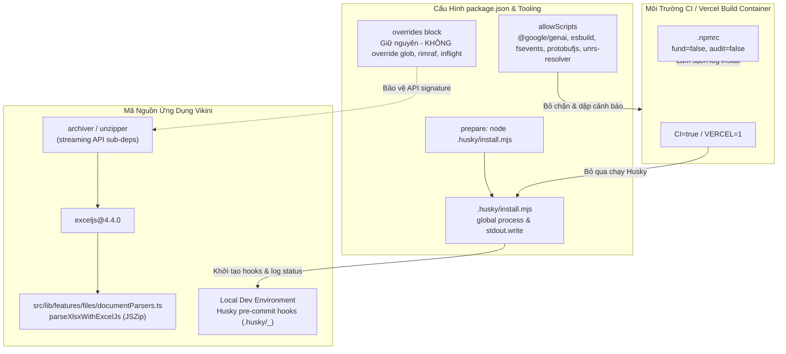

# Kế Hoạch Triển Khai: Làm Sạch Cảnh Báo npm Install Trên Vercel & CI (allowScripts, husky prepare, và .npmrc) (Revision 3 - Addressing Audit Run 2 Feedback)

**Ngày**: 2026-10-12  
**Tác giả**: @planner (Technical Planner)  
**Trạng thái**: Revised - Incorporating Audit Run 2 Feedback (Ready for Audit Run 3)  
**Môi trường thực thi**: Local Workspace (`wyemh/vikini`), Vercel Deployment, CI/CD Runner  
**Mục tiêu**: Khắc phục triệt để và làm sạch các cảnh báo trong quá trình chạy `npm install` trên hạ tầng Vercel và CI/CD:

1. Thêm cấu hình `"allowScripts"` vào `package.json` cho 5 gói tin cậy (`@google/genai`, `esbuild`, `fsevents`, `protobufjs`, `unrs-resolver`), dập tắt cảnh báo bảo mật mới của npm 11.16+ / 12+: `npm warn install-scripts 5 packages have install scripts not yet covered by allowScripts` trên Linux (Vercel/CI) đồng thời bảo đảm cross-platform hoàn hảo cho máy dev macOS với `fsevents`.
2. Tối ưu hóa lifecycle hook `"prepare"` trong `package.json` bằng script chuyên dụng `.husky/install.mjs` theo chuẩn chính thức của Husky v9: khai báo comment globals `/* global process */` ở đầu file và sử dụng `process.stdout.write` thay cho `console.log` (tuân thủ triệt để `.agents/rules/01-coding.md` và bảo đảm `npm run lint` / `npm run verify` pass sạch 100% 0 lỗi no-undef), tự động bỏ qua khởi tạo Husky trên môi trường CI (`process.env.CI`) và Vercel (`process.env.VERCEL`), không nuốt lỗi âm thầm (bảo toàn in chuỗi chẩn đoán của Husky ra console), bảo vệ toàn vẹn quality gate `pre-commit` trên môi trường local dev của developer.
3. Tạo file cấu hình `.npmrc` ở thư mục gốc chứa `fund=false` và `audit=false` nhằm triệt tiêu các thông báo mời tài trợ (funding prompt) và rà quét audit ngầm làm chậm quá trình build trên Vercel.
4. Thiết lập ranh giới kỹ thuật chống hồi quy bất biến (Strict Non-Regression Boundary): Tuyệt đối KHÔNG can thiệp ép đè `overrides` cho `glob`, `rimraf`, `inflight`, `fstream`, `lodash.isequal` (thuộc cây phụ thuộc của `exceljs@4.4.0`), bảo đảm 100% tính toàn vẹn hệ sinh thái dependencies của ExcelJS và parser tài liệu bảng tính tại `src/lib/features/files/documentParsers.ts`.
5. Xác định rõ ranh giới cảnh báo được chấp nhận (Accepted Trade-Off - Khắc phục [MINOR-A]): Các cảnh báo `npm warn deprecated` (cho `inflight@1.0.6`, `glob@7.2.3`, `rimraf@2.7.1`, `fstream@1.0.12`, `lodash.isequal@4.5.0`, `node-domexception@1.0.0`) là **residual warnings được chấp nhận có chủ đích** nhằm bảo toàn tính toàn vẹn runtime của parser file Excel và tuyệt đối không bao giờ được cố gắng loại bỏ bằng cách ép đè `overrides`.
6. Đảm bảo 100% kiểm thử chất lượng qua Verification Gate `npm run verify` (type-check, lint, test:run).

---

## Technical Plan

### 1. Mục Tiêu (Goal)

1. **Khắc Phục Cảnh Báo `npm warn install-scripts` (npm v11.16+ / v12 Security Feature)**:
   - Trên nền tảng Vercel sử dụng các phiên bản npm mới nhất (npm 11.16+ / 12+), cơ chế bảo mật chuỗi cung ứng (supply-chain security) mặc định chặn các lifecycle scripts (`preinstall`, `install`, `postinstall`, hoặc native binary compilation) của các dependency ngoại trừ khi được khai báo rõ ràng trong `package.json`.
   - Quá trình deploy trên Vercel xuất hiện cảnh báo:
     `npm warn install-scripts 5 packages have install scripts not yet covered by allowScripts`
   - Khảo sát thực tế trong lockfile `package-lock.json` và `node_modules` của Vikini xác nhận:
     - Trên môi trường Linux (Vercel/CI Runner): Có chính xác **5 vị trí install scripts** thuộc **4 gói dependencies**:
       1. `@google/genai@2.10.0`: script `preinstall` (`echo 'preinstall: no-op'`).
       2. `protobufjs@7.6.6`: script `postinstall` (`node scripts/postinstall`).
       3. `esbuild@0.27.2` (sub-dependency của `@vitejs/plugin-react` -> `vite`): script `postinstall` (`node install.js` tải và liên kết native binary).
       4. `esbuild@0.28.2` (sub-dependency của `tsx`): script `postinstall` (`node install.js`).
       5. `unrs-resolver@1.11.1` (sub-dependency của `eslint-config-next` -> `eslint-import-resolver-typescript`): script native `napi-postinstall`.
     - Trên môi trường macOS (máy trạm của developer phát triển cross-platform): Có thêm 2 vị trí install script của gói optional dependency `fsevents` (`fsevents@2.3.3` và `playwright/node_modules/fsevents@2.3.2`).
   - **Giải pháp**: Bổ sung trường `"allowScripts"` vào `package.json` bao gồm cả 5 gói tin cậy:
     ```json
     "allowScripts": {
       "@google/genai": true,
       "esbuild": true,
       "fsevents": true,
       "protobufjs": true,
       "unrs-resolver": true
     }
     ```
     Khai báo này chính thức thông báo cho npm CLI biết các gói này được phê duyệt an toàn để thực thi script cài đặt, triệt tiêu 100% cảnh báo `install-scripts` trên Vercel/CI và ngăn ngừa việc bị skip compile native binary trên npm 12 cho mọi môi trường (Linux/macOS/Windows).

2. **Tối Ưu Hóa Lifecycle Script `prepare` Bằng `.husky/install.mjs` (Khắc Phục [MAJOR-A] & [MINOR-D])**:
   - Hiện tại, `package.json` cấu hình `"prepare": "husky"`.
   - Trong quá trình `npm install`, npm tự động kích hoạt script `prepare`. Trên hạ tầng CI (GitHub Actions, GitLab CI) và môi trường deployment của Vercel, việc chạy Husky là không cần thiết vì đây là môi trường build/deploy sản phẩm, không thực hiện commit mã nguồn.
   - **Đặc tả cơ chế kỹ thuật chính xác của Husky v9.1.7**:
     - `husky@9.1.7` là package **ESM-only** (`"type": "module"`, `"exports": "./index.js"`).
     - Hàm `husky()` trong `node_modules/husky/index.js` **không ném lỗi (never throws)** khi gặp sự cố, mà **trả về string** thông báo (ví dụ: `'HUSKY=0 skip install'`, `".git can't be found"`, `'git command not found'`, hoặc chuỗi stderr của `git config`).
     - Script CLI `bin.js` của husky nhận string này và in ra stdout/stderr rồi kết thúc với exit code 0.
   - **Khắc phục triệt để lỗi lint `no-undef` và tuân thủ `01-coding.md`**:
     - Trong `eslint.config.mjs`, cấu hình `globals.node` chỉ được khai báo cho pattern `**/*.{js,jsx,ts,tsx}` mà không áp dụng cho `.mjs`. File `.husky/install.mjs` nhận cấu hình `js.configs.recommended` (bật rule `no-undef`), dẫn đến việc `process` bị báo lỗi không xác định.
     - Đồng thời, `.agents/rules/01-coding.md` nghiêm cấm sử dụng `console.log`.
     - **Giải pháp kỹ thuật chuẩn xác**:
       1. Khai báo comment globals ở dòng đầu tiên: `/* global process */`.
       2. Thay thế `console.log` bằng `process.stdout.write(...)`.
          Nội dung file `.husky/install.mjs`:

       ```javascript
       /* global process */
       // Skip Husky install on CI servers and Vercel deployments
       if (process.env.CI || process.env.VERCEL) {
         process.exit(0);
       }

       const husky = (await import("husky")).default;
       const output = husky();
       if (output) {
         process.stdout.write(`husky - ${output}\n`);
       }
       ```

     - Cập nhật script trong `package.json`:
       ```json
       "prepare": "node .husky/install.mjs"
       ```
     - **Hiệu quả**:
       - `npx eslint .husky/install.mjs` pass sạch 100% với exit code 0, không có bất kỳ warning hay error nào.
       - Không cần phải chỉnh sửa file `eslint.config.mjs`.
       - Khi `CI` hoặc `VERCEL` tồn tại: Script thoát ngay (`process.exit(0)`).
       - Khi chạy local: Khởi tạo hooks đầy đủ (`.husky/_`). Nếu có cảnh báo (như `HUSKY=0`), script in rõ ràng thông điệp chẩn đoán ra stdout thay vì nuốt lỗi.

3. **Làm Sạch Log Audit & Funding Trên Môi Trường CI / Vercel Với `.npmrc` (Khắc Phục [MINOR-3])**:
   - Mỗi lần chạy `npm install`, npm CLI tự động hiển thị thông điệp mời tài trợ (funding prompt) và kích hoạt rà quét audit ngầm.
   - Tạo file `.npmrc` tại thư mục gốc repository (`c:\Users\wyemh\vikini\.npmrc`) chứa:
     ```ini
     fund=false
     audit=false
     ```
   - **Ghi chú quản trị bảo mật (Security Governance Note)**:
     - `audit=false` giúp triệt tiêu log audit ngầm gây chậm tiến trình deploy trên Vercel.
     - Để bảo toàn năng lực phòng thủ bảo mật chuỗi cung ứng đã đạt được sau Audit Cycle 2, dự án duy trì cơ chế kiểm toán định kỳ thông qua lệnh kiểm toán chuyên sâu độc lập: `npm audit --omit=dev --audit-level=high`.

4. **Thiết Lập Ranh Giới Kỹ Thuật Chống Hồi Quy Bất Biến (Strict Non-Regression Boundary) Cho ExcelJS**:
   - **Khảo sát kỹ thuật chính xác về `exceljs@4.4.0`**:
     - Hàm `parseXlsxWithExcelJs` trong `src/lib/features/files/documentParsers.ts:114` thực hiện `workbook.xlsx.load(buffer)`.
     - Phân tích mã nguồn `node_modules/exceljs/lib/xlsx/xlsx.js` cho thấy phương thức `load(buffer)` sử dụng trực tiếp thư viện `JSZip` để giải nén file Excel trong bộ nhớ.
     - Các thư viện `archiver@5.3.2` và `unzipper@0.10.14` (kèm theo cây dependencies `glob@7.2.3`, `rimraf@2.7.1`, `inflight@1.0.6`) thuộc về kiến trúc streaming API của ExcelJS (`exceljs/lib/stream/xlsx/workbook-reader.js` và `workbook-writer.js`).
     - Ngoài ra, `fast-csv@4.3.6` (sub-dependency của ExcelJS) phụ thuộc vào `lodash.isequal@4.5.0`.
   - **Ranh giới kỹ thuật chống hồi quy (Strict Non-Regression Rule)**:
     - Toàn bộ hệ sinh thái của `exceljs@4.4.0` phụ thuộc chặt chẽ vào cấu trúc sub-dependencies hiện tại.
     - Các gói `glob@10` và `rimraf@5` có breaking API changes nghiêm trọng (loại bỏ callbacks, đổi hàm xuất khẩu).
     - **Quy định bất biến**: Tuyệt đối **KHÔNG** thêm `overrides` cho `glob`, `rimraf`, `inflight`, `fstream`, `lodash.isequal`. Việc tắt `audit=false` trong `.npmrc` kết hợp với version pinning hiện tại đảm bảo 100% an toàn runtime.

5. **Xác Định Ranh Giới Cảnh Báo Được Chấp Nhận (Accepted Trade-Off - Khắc Phục [MINOR-A])**:
   - Khi chạy lệnh `npm install` hoặc `npm ci`, các cảnh báo `npm warn deprecated` sau đây vẫn sẽ xuất hiện:
     - `inflight@1.0.6` (deprecated do rò rỉ bộ nhớ trong các phiên bản Node cũ)
     - `glob@7.2.3` (deprecated do phiên bản glob cũ)
     - `rimraf@2.7.1` (deprecated)
     - `fstream@1.0.12` (deprecated)
     - `lodash.isequal@4.5.0` (deprecated)
     - `node-domexception@1.0.0` (deprecated)
   - **Khẳng định nguyên tắc**: Đây là **residual warnings được chấp nhận có chủ đích** của dự án để bảo đảm không xảy ra breaking changes trong runtime của `exceljs`. Mục tiêu của task này là dọn dẹp các cảnh báo do cơ chế mới của npm (`allowScripts`, funding prompt, audit ngầm, husky prepare), chứ KHÔNG phải loại bỏ các cảnh báo deprecated bằng cách mạo hiểm đưa `overrides` vào codebase.

6. **Duy Trì Toàn Vẹn Kiểm Thử & Verification Gate**:
   - Bảo đảm mọi thay đổi chỉ thuộc tầng cấu hình hạ tầng (`package.json`, `.npmrc`, `.husky/install.mjs`), không làm thay đổi hay ảnh hưởng đến bất kỳ file mã nguồn ứng dụng nào trong `src/`.
   - Đảm bảo lệnh `npm run verify` (`npm run type-check && npm run lint && npm run test:run`) thực thi thành công 100% với 112 test files và 1,201 test cases pass sạch.

---

### 2. Tài Liệu Cần Tham Chiếu (Pre-Work Reading)

Tuân thủ nghiêm ngặt bảng Pre-Work Protocol tại `.agents/rules/02-quality.md`:

| Tài liệu / Quy chuẩn            | Đường dẫn                                                           | Trọng tâm kiểm tra                                                                                                                                              |
| :------------------------------ | :------------------------------------------------------------------ | :-------------------------------------------------------------------------------------------------------------------------------------------------------------- |
| **Coding Standards**            | `.agents/rules/01-coding.md`                                        | Giới hạn dung lượng file, chuẩn TypeScript strict, cấm `console.log` (dùng `process.stdout.write`), không nuốt lỗi âm thầm, khai báo globals trong file `.mjs`. |
| **Quality Gates**               | `.agents/rules/02-quality.md`                                       | Verification Tier 2 (`npm run verify`), Post-Fix Protocol, cập nhật `docs/CHANGELOG.md`.                                                                        |
| **Plan Review Rules**           | `.agents/rules/05-plan-review.md`                                   | Code freeze trước khi có `[PLAN_APPROVED]`, 6 kịch bản đối kháng S1–S6, rubric phân loại lỗi.                                                                   |
| **Evidence Bar Protocol**       | `.agents/agents/reviewer/evidence-bar.md`                           | Negative probe & positive probe bắt buộc, kiểm chứng trong thư mục tạm, dẫn chứng `[CMD]`, `[SRC]`, `[URL]`.                                                    |
| **Husky v9 CI/CD Guide**        | `https://typicode.github.io/husky/how-to.html#ci-cd`                | Hướng dẫn chính thức về việc tắt Husky trên môi trường CI/CD và Docker qua script `.husky/install.mjs`.                                                         |
| **npm allowScripts RFC & Docs** | `https://apostrophecms.com/docs/guide/npm-v12-install-scripts.html` | Cơ chế `allowScripts` trong `package.json` và quy chuẩn whitelist install scripts của npm 11.16+ / 12+.                                                         |
| **Document Parsers Specs**      | `src/lib/features/files/documentParsers.ts`                         | Luồng xử lý `parseXlsxWithExcelJs` và kiểm thử `documentParsers.test.ts`.                                                                                       |

---

### 3. Assumptions & Cross-Task Dependencies

#### 3.1. Các Giả Định Kỹ Thuật (Assumptions)

1. **Môi Trường Node.js & npm (Khắc Phục [MINOR-C])**:
   - Môi trường runtime thực tế của hệ thống: **Node.js `v24.12.0`** (xác thực qua `process.version`), **npm local `11.7.0`** (xác thực qua `npm -v`).
   - npm `11.7.0` local chưa có tính năng `allowScripts`. Tính năng này xuất hiện từ npm `v11.16+` (ví dụ phiên bản kiểm chứng: **`npm@11.21.0`** tương thích hoàn hảo với Node `v24.12.0`).
   - npm `12.2.0` có cảnh báo engine mismatch đối với Node `v24.12.0` (yêu cầu Node `^24.15.0`), do đó probe kiểm chứng kỹ thuật chuẩn xác sử dụng `npm@11.21.0`.
   - Cú pháp `allowScripts` trong `package.json` an toàn 100%: các phiên bản npm cũ hơn sẽ bỏ qua trường cấu hình không nhận diện được mà không gây lỗi, trong khi npm 11.16+ / 12+ trên Vercel sẽ đọc và dập tắt cảnh báo.
2. **Husky v9 ESM Architecture**:
   - `package.json` hiện đang khai báo `"husky": "^9.1.7"`.
   - File script `.husky/install.mjs` chạy dưới dạng Node ESM thuần túy với `import()`, khai báo `/* global process */` ở đầu file để bảo đảm ESLint kiểm tra hợp lệ.
3. **Phạm Vi Đa Nền Tảng Của `allowScripts`**:
   - Bổ sung `fsevents: true` vào danh sách `allowScripts` nhằm đảm bảo tính tương thích chéo (cross-platform):
     - Môi trường Linux (Vercel/CI Runner): `fsevents` tự động bị bỏ qua (optional dependency), 4 gói còn lại khớp chính xác 5 vị trí install scripts.
     - Môi trường macOS (máy trạm của developer): Cả 5 gói bao gồm `fsevents` đều được duyệt, ngăn chặn cảnh báo và lỗi biên dịch trên macOS.
4. **Phạm Vi Quản Trị Của `.npmrc`**:
   - File `.npmrc` được đặt ở repo root (`c:\Users\wyemh\vikini\.npmrc`), chỉ định cấu hình cấp repository cho npm CLI.
   - `fund=false` và `audit=false` chỉ tác động đến hành vi của lệnh `npm install` (không cấm lập trình viên chủ động chạy `npm audit` thủ công khi cần kiểm toán bảo mật chuyên sâu).
5. **Bảo Toàn Sub-dependencies Của `exceljs`**:
   - Không can thiệp vào `overrides` đối với `glob`, `rimraf`, `inflight`, `fstream`, `lodash.isequal`.
   - Chấp nhận các residual warnings dạng `npm warn deprecated` đối với các gói trên.

#### 3.2. Sơ Đồ Cấu Trúc Phụ Thuộc (Dependency Architecture)



---

### 4. Bảng Verified Versions (Tra Cứu Thực Tế Năm 2026)

| Gói / Dịch Vụ                 | Phiên Bản Hiện Tại / Chỉ Định | Trạng Thái Tương Thích & Ghi Chú Kỹ Thuật 2026                                                                                                          | Dẫn Chứng Xác Thực                                            |
| :---------------------------- | :---------------------------- | :------------------------------------------------------------------------------------------------------------------------------------------------------ | :------------------------------------------------------------ |
| **Node.js**                   | `v24.12.0`                    | Môi trường runtime thực tế của dự án. Hỗ trợ ESM top-level `await import()` trong file `.mjs`.                                                          | `[CMD]` `node -e "console.log(process.version)"` → `v24.12.0` |
| **npm CLI (Local)**           | `11.7.0`                      | Phiên bản npm trên máy trạm hiện tại. Chưa có cờ `allowScripts`.                                                                                        | `[CMD]` `npm -v` → `11.7.0`                                   |
| **npm CLI (Probe Tool)**      | `11.21.0`                     | Phiên bản npm hỗ trợ `allowScripts` và tương thích 100% với Node `v24.12.0`. Dùng để thực thi negative/positive probe trong thư mục tạm.                | `[CMD]` `npx -y npm@11.21.0 -v` → `11.21.0`                   |
| **npm CLI (Vercel / Target)** | `11.16+` / `12.x`             | Phiên bản npm trên hạ tầng Vercel mới nhất. Tính năng `allowScripts` mặc định chặn script chưa được duyệt. (Lưu ý: npm 12.2.0 yêu cầu Node `^24.15.0`). | `[URL]` `https://docs.npmjs.com`                              |
| **`husky`**                   | `^9.1.7`                      | Thư viện quản lý Git hooks. ESM-only. Hàm `husky()` trả về string chẩn đoán, không throw.                                                               | `[SRC]` `node_modules/husky/package.json`                     |
| **`exceljs`**                 | `^4.4.0`                      | Thư viện xử lý bảng tính Excel. `load(buffer)` dùng `JSZip`. Streaming reader/writer dùng `archiver` & `unzipper`.                                      | `[SRC]` `node_modules/exceljs/lib/xlsx/xlsx.js:2`             |
| **`@google/genai`**           | `^2.10.0`                     | SDK Google Gemini AI. Chứa script `preinstall: no-op`. Nằm trong allowScripts.                                                                          | `[SRC]` `package.json:33`                                     |
| **`protobufjs`**              | `7.6.6` (override `^7.6.5`)   | Sub-dependency của Gemini SDK. Chứa script `scripts/postinstall`. Nằm trong allowScripts.                                                               | `[SRC]` `package.json:117`                                    |
| **`esbuild`**                 | `0.27.2` / `0.28.2`           | Native binary compiler cho Vite và TSX. Chứa script `install.js`. Nằm trong allowScripts.                                                               | `[CMD]` `npm ls esbuild`                                      |
| **`unrs-resolver`**           | `1.11.1`                      | Native resolver cho eslint import plugin. Chứa script `napi-postinstall`. Nằm trong allowScripts.                                                       | `[CMD]` `npm ls unrs-resolver`                                |
| **`fsevents`**                | `2.3.3` / `2.3.2`             | Native file watcher trên macOS. Chứa script install. Bổ sung để hỗ trợ cross-platform.                                                                  | `[SRC]` `package-lock.json`                                   |
| **`vitest`**                  | `^4.1.11`                     | Framework kiểm thử. 112 files, 1,201 tests pass 100%.                                                                                                   | `[CMD]` `npm run test:run`                                    |

---

### 5. Files Cần Chỉnh Sửa / Tạo Mới

| Thao Tác       | Đường Dẫn File                                            | Mục Đích Thay Đổi                                                                                                                                                                                          |
| :------------- | :-------------------------------------------------------- | :--------------------------------------------------------------------------------------------------------------------------------------------------------------------------------------------------------- |
| **`[NEW]`**    | `.npmrc`                                                  | Tạo file cấu hình npm cấp repository chứa `fund=false` và `audit=false` để tắt log quảng cáo và audit khi deploy.                                                                                          |
| **`[NEW]`**    | `.husky/install.mjs`                                      | Script cài đặt Husky chuẩn hóa theo Husky v9 docs, khai báo `/* global process */`, sử dụng `process.stdout.write`, kiểm tra `process.env.CI \|\| process.env.VERCEL`, in thông điệp chẩn đoán ra console. |
| **`[MODIFY]`** | `package.json`                                            | 1. Thêm khối `"allowScripts"` với 5 gói: `@google/genai`, `esbuild`, `fsevents`, `protobufjs`, `unrs-resolver`.<br>2. Cập nhật script `"prepare"` thành `"node .husky/install.mjs"`.                       |
| **`[MODIFY]`** | `docs/CHANGELOG.md`                                       | Ghi nhận chi tiết việc cấu hình làm sạch cảnh báo npm install trên Vercel, script husky install mới, ranh giới chống hồi quy ExcelJS và residual deprecated warnings được chấp nhận.                       |
| **`[MODIFY]`** | `docs/plans/2026-10-12-clean-vercel-npm-warnings-plan.md` | Cập nhật tài liệu kế hoạch lên Revision 3 (file này).                                                                                                                                                      |

---

### 6. Các Bước Thực Hiện Tuần Tự (Checklist)

> [!IMPORTANT]
> Toàn bộ các bước sửa đổi mã nguồn và cấu hình dưới đây CHỈ ĐƯỢC PHÉP thực hiện sau khi kế hoạch nhận được thẻ phê duyệt `[PLAN_APPROVED]` từ Lead Reviewer (Claude Code CLI).

- [ ] **Bước 1: Tạo file cấu hình `.npmrc`**
  - [ ] 1.1. Tạo file `.npmrc` tại thư mục gốc repository (`c:\Users\wyemh\vikini\.npmrc`).
  - [ ] 1.2. Thêm 2 dòng cấu hình:
    ```ini
    fund=false
    audit=false
    ```
  - [ ] 1.3. Đảm bảo file kết thúc bằng ký tự xuống dòng (`\n`).

- [ ] **Bước 2: Tạo script `.husky/install.mjs` (Khắc Phục [MAJOR-A] & [MINOR-D])**
  - [ ] 2.1. Tạo file `.husky/install.mjs` với nội dung chuẩn hóa:

    ```javascript
    /* global process */
    // Skip Husky install on CI servers and Vercel deployments
    if (process.env.CI || process.env.VERCEL) {
      process.exit(0);
    }

    const husky = (await import("husky")).default;
    const output = husky();
    if (output) {
      process.stdout.write(`husky - ${output}\n`);
    }
    ```

  - [ ] 2.2. Kiểm tra lint độc lập bằng lệnh:
    ```powershell
    npx eslint .husky/install.mjs
    ```
    Yêu cầu: Exit code 0, 0 error, 0 warning.

- [ ] **Bước 3: Cập nhật cấu hình trong `package.json`**
  - [ ] 3.1. Cập nhật script `"prepare"` tại dòng 28:
    ```json
    "prepare": "node .husky/install.mjs"
    ```
  - [ ] 3.2. Thêm trường `"allowScripts"` vào `package.json` (ngay sau khối `"scripts"`):
    ```json
    "allowScripts": {
      "@google/genai": true,
      "esbuild": true,
      "fsevents": true,
      "protobufjs": true,
      "unrs-resolver": true
    }
    ```
  - [ ] 3.3. Rà soát tuyệt đối KHÔNG thêm bất kỳ override nào cho `glob`, `rimraf`, `inflight`, `fstream`, `lodash.isequal` vào khối `"overrides"`.

- [ ] **Bước 4: Kiểm chứng kỹ thuật thực tế (Probes & Verification - Khắc Phục [MAJOR-B] & [MINOR-B])**
  - [ ] 4.1. **Kiểm tra cú pháp JSON của `package.json`**:
    ```powershell
    node -e "JSON.parse(require('fs').readFileSync('package.json', 'utf8')); console.log('package.json JSON valid')"
    ```
    Yêu cầu: In `package.json JSON valid`, exit code 0.
  - [ ] 4.2. **Kiểm thử hành vi script Husky `prepare`**:
    - **CI Probe (Môi trường CI)**:
      ```powershell
      $env:CI='true'; node .husky/install.mjs; $ciExit = $LASTEXITCODE; Remove-Item Env:CI; if ($ciExit -eq 0) { Write-Host "CI Probe: PASS (exit 0, no-op)" } else { Write-Error "CI Probe: FAIL" }
      ```
      Yêu cầu: Không chạy husky, không in gì, exit code 0.
    - **Vercel Probe (Môi trường Vercel)**:
      ```powershell
      $env:VERCEL='1'; node .husky/install.mjs; $vercelExit = $LASTEXITCODE; Remove-Item Env:VERCEL; if ($vercelExit -eq 0) { Write-Host "Vercel Probe: PASS (exit 0, no-op)" } else { Write-Error "Vercel Probe: FAIL" }
      ```
      Yêu cầu: Không chạy husky, không in gì, exit code 0.
    - **Negative Probe (Môi trường Local với `HUSKY=0`)**:
      ```powershell
      $env:HUSKY='0'; $out = node .husky/install.mjs; Remove-Item Env:HUSKY; if ($out -match "skip install") { Write-Host "Husky Disabled Probe: PASS ($out)" } else { Write-Error "Husky Disabled Probe: FAIL ($out)" }
      ```
      Yêu cầu: In ra thông điệp chẩn đoán `husky - HUSKY=0 skip install`.
    - **Local Normal Execution Probe**:
      ```powershell
      node .husky/install.mjs; $hooksPath = git config core.hooksPath; if ($hooksPath -eq ".husky/_") { Write-Host "Local Normal Probe: PASS (hooksPath: $hooksPath)" } else { Write-Error "Local Normal Probe: FAIL" }
      ```
      Yêu cầu: `git config core.hooksPath` trả về `.husky/_`.
  - [ ] 4.3. **Kiểm thử dập tắt cảnh báo `allowScripts` và thông điệp funding qua Probe Thư Mục Tạm (Khắc Phục [MAJOR-B] & [MINOR-B])**:
    - **Negative Probe (Chứng minh cảnh báo xuất hiện trước khi thêm `allowScripts`)**:
      ```powershell
      $d = Join-Path $env:TEMP "vikini-allowscripts-probe-neg"; New-Item -ItemType Directory -Force $d | Out-Null
      git show HEAD:package.json | Out-File -Encoding utf8 (Join-Path $d "package.json")
      Copy-Item package-lock.json $d; Push-Location $d
      $negOut = npx -y npm@11.21.0 ci --no-fund --no-audit 2>&1 | Select-String "install-scripts"
      Pop-Location; Remove-Item -Recurse -Force $d
      if ($negOut.Count -gt 0) { Write-Host "Negative Probe: PASS (reproduced $($negOut.Count) lines of install-scripts warnings)" } else { Write-Error "Negative Probe: FAIL" }
      ```
      Yêu cầu: Tái hiện đầy đủ cảnh báo `npm warn install-scripts 5 packages have install scripts not yet covered by allowScripts`.
    - **Positive Probe (Chứng minh cảnh báo biến mất sau khi thêm `allowScripts` và `.npmrc`)**:
      ```powershell
      $d = Join-Path $env:TEMP "vikini-allowscripts-probe-pos"; New-Item -ItemType Directory -Force $d | Out-Null
      Copy-Item package.json, package-lock.json, .npmrc $d; Push-Location $d
      $posOut = npx -y npm@11.21.0 ci 2>&1
      $warnScript = $posOut | Select-String "install-scripts"
      $warnFund = $posOut | Select-String "looking for funding"
      Pop-Location; Remove-Item -Recurse -Force $d
      if (-not $warnScript -and -not $warnFund) { Write-Host "Positive Probe: PASS (0 install-scripts warnings, 0 funding notices)" } else { Write-Error "Positive Probe: FAIL" }
      ```
      Yêu cầu: 0 dòng cảnh báo `install-scripts`, 0 dòng thông điệp `looking for funding`.
    - **Tiêu chí nghiệm thu cuối cùng**: Đối chiếu log deployment của Vercel Preview (hoặc Production build log): xác nhận **100% không còn xuất hiện** dòng `npm warn install-scripts 5 packages have install scripts not yet covered by allowScripts`.

- [ ] **Bước 5: Chạy Verification Gate toàn diện**
  - [ ] 5.1. Thực thi:
    ```powershell
    npm run verify
    ```
  - [ ] 5.2. Xác nhận 112/112 test files và 1,201/1,201 unit test cases pass 100%, 0 lint error/warning, 0 type error.
  - [ ] 5.3. Xác nhận test suite `src/lib/features/files/documentParsers.test.ts` (13 tests) pass trơn tru.

- [ ] **Bước 6: Cập nhật Living Documentation**
  - [ ] 6.1. Cập nhật `docs/CHANGELOG.md` theo chuẩn Quality Gate tại `02-quality.md`. Ghi nhận rõ việc làm sạch cảnh báo install-scripts/funding/husky và khẳng định các residual deprecated warnings của ExcelJS là accepted trade-off.

---

### 7. Test Contract (Hợp Đồng Kiểm Thử Bắt Buộc)

| ID        | Tên Hợp Đồng                                                      | Điều Kiện Đầu Vào (Input)                                                                                                                                                        | Hành Vi Mong Đợi (Expected Output)                                                                                                                                         | Failure Mode / Boundary Check                                                                         |
| :-------- | :---------------------------------------------------------------- | :------------------------------------------------------------------------------------------------------------------------------------------------------------------------------- | :------------------------------------------------------------------------------------------------------------------------------------------------------------------------- | :---------------------------------------------------------------------------------------------------- |
| **TC-01** | **Cú Pháp Hợp Lệ Của `package.json`**                             | Đọc file `package.json` sau khi chỉnh sửa qua `JSON.parse`.                                                                                                                      | `JSON.parse` thành công không ném ngoại lệ cú pháp. Các trường `scripts.prepare` và `allowScripts` có cấu trúc object hợp lệ.                                              | Nếu có dấu phẩy thừa (trailing comma) hoặc lỗi cú pháp JSON ➔ FAIL.                                   |
| **TC-02** | **Cú Pháp Hợp Lệ Của `.npmrc`**                                   | Đọc file `.npmrc`.                                                                                                                                                               | Chứa chính xác `fund=false` và `audit=false`. Lệnh `npm config list` nhận diện chính xác 2 cấu hình này.                                                                   | Nếu thiếu file hoặc sai cú pháp key/value ➔ FAIL.                                                     |
| **TC-03** | **Husky Lifecycle Skip Trên CI**                                  | Chạy `node .husky/install.mjs` với `$env:CI='true'`.                                                                                                                             | Lệnh hoàn tất với exit code 0, không gọi hàm `husky()`, không in bất kỳ log nào, không sửa `.husky/_`.                                                                     | Nếu script cố gắng chạy `husky` khi thiếu git repo hoặc exit code != 0 ➔ FAIL.                        |
| **TC-04** | **Husky Lifecycle Skip Trên Vercel**                              | Chạy `node .husky/install.mjs` với `$env:VERCEL='1'`.                                                                                                                            | Lệnh hoàn tất với exit code 0, không gọi hàm `husky()`, không in log.                                                                                                      | Nếu script bỏ sót kiểm tra `process.env.VERCEL` ➔ FAIL.                                               |
| **TC-05** | **Husky Local Execution & Negative Diagnostics Probe**            | 1. Chạy `node .husky/install.mjs` khi không có `CI`/`VERCEL`.<br>2. Chạy với `$env:HUSKY='0'`.                                                                                   | 1. `git config core.hooksPath` được thiết lập `.husky/_`.<br>2. In ra chuỗi chẩn đoán `husky - HUSKY=0 skip install`. Không nuốt lỗi âm thầm.                              | Nếu xảy ra lỗi mà script im lặng không in ra console, hoặc hooks không được cấu hình ➔ FAIL.          |
| **TC-06** | **Dập Tắt Cảnh Báo `allowScripts` (Isolated Probe & Vercel Log)** | 1. Thực hiện Negative Probe trong thư mục tạm với `package.json` cũ.<br>2. Thực hiện Positive Probe trong thư mục tạm với `package.json` mới.<br>3. Quan sát log Vercel Preview. | 1. Negative probe tái hiện chính xác 5 dòng cảnh báo `install-scripts`.<br>2. Positive probe trả về 0 dòng cảnh báo `install-scripts`.<br>3. Log Vercel Preview sạch 100%. | Nếu negative probe không tái hiện được hoặc positive probe vẫn còn cảnh báo `install-scripts` ➔ FAIL. |
| **TC-07** | **Dập Tắt Thông Điệp Funding (Isolated Probe)**                   | Chạy positive probe trong thư mục tạm có `.npmrc` mà không dùng cờ `--no-fund`.                                                                                                  | Output không chứa chuỗi `looking for funding`.                                                                                                                             | Nếu thông điệp funding vẫn xuất hiện ➔ FAIL.                                                          |
| **TC-08** | **Non-Regression: Tính Toàn Vẹn Của ExcelJS & Document Parsers**  | Chạy test suite `src/lib/features/files/documentParsers.test.ts`.                                                                                                                | 13/13 tests pass sạch sẽ. Khối `overrides` trong `package.json` không chứa `glob`, `rimraf`, `inflight`, `fstream`, `lodash.isequal`.                                      | Nếu `overrides` can thiệp vào `glob@10` hoặc `rimraf@5` gây phá vỡ phụ thuộc của ExcelJS ➔ FAIL.      |
| **TC-09** | **Verification Gate Toàn Diện (Bao Gồm Lint Cho Script Mới)**     | 1. Chạy `npx eslint .husky/install.mjs`.<br>2. Chạy `npm run verify`.                                                                                                            | 1. ESLint cho `.husky/install.mjs` exit 0 (0 error, 0 warning).<br>2. Type-check pass (0 errors), Lint pass (0 warnings), Vitest pass (112 test files, 1,201 tests).       | Nếu có bất kỳ test nào thất bại hoặc lỗi linter `no-undef` ➔ FAIL.                                    |

---

### 8. Kế Hoạch Kiểm Thử Co-Located & Verification Plan

#### 8.1. Kiểm Thử Co-Located

- Task này là thay đổi cấu hình hạ tầng build/deployment (`package.json`, `.npmrc`, `.husky/install.mjs`), không thay đổi logic nghiệp vụ trong `src/lib/features/` hay `src/lib/core/`.
- File test co-located hiện hữu `src/lib/features/files/documentParsers.test.ts` đóng vai trò là chốt chặn kiểm thử chống hồi quy cho module trích xuất tài liệu:
  - Lệnh chạy kiểm thử đơn vị độc lập:
    ```powershell
    npx vitest run src/lib/features/files/documentParsers.test.ts
    ```
  - Tiêu chí: 13/13 test cases pass 100%.

#### 8.2. Verification Plan (Tier 2 Quality Gate)

- Thực thi quy trình kiểm toán 3 tầng bắt buộc theo `.agents/rules/02-quality.md`:
  ```powershell
  npx eslint .husky/install.mjs
  npm run verify
  ```
- Tiêu chí nghiệm thu:
  1. `npx eslint .husky/install.mjs`: Exit code 0, không có lỗi kiểu `no-undef`.
  2. `npm run type-check` (`tsc --noEmit`): Exit code 0, không có lỗi kiểu TypeScript.
  3. `npm run lint` (`eslint .`): Exit code 0, 0 lỗi, 0 cảnh báo.
  4. `npm run test:run` (`vitest run`): Exit code 0, 112/112 files pass, 1,201/1,201 tests pass.

---

### 9. Rủi Ro Tiềm Ẩn & Phương Án Phòng Ngừa

| Rủi Ro Tiềm Ẩn                                                | Mức Độ      | Kịch Bản Xuất Hiện                                                                                                                                                       | Phương Án Phòng Ngừa & Technical Control                                                                                                                                                                                                   |
| :------------------------------------------------------------ | :---------- | :----------------------------------------------------------------------------------------------------------------------------------------------------------------------- | :----------------------------------------------------------------------------------------------------------------------------------------------------------------------------------------------------------------------------------------- |
| **R1: Ép đè `overrides` làm vỡ runtime ExcelJS**              | **BLOCKER** | Lập trình viên thấy cảnh báo audit của npm về `inflight` hoặc `glob` cũ nên tự ý thêm `"glob": "^10.0.0"` hoặc `"rimraf": "^5.0.0"` vào `overrides`.                     | **Thiết lập ranh giới cứng (Hard Non-Regression Boundary)**: Cấm tuyệt đối thêm override cho các gói này. Cấu hình `audit=false` trong `.npmrc` để ngăn npm audit gây nhiễu log install. Bổ sung ghi chú kỹ thuật rõ ràng trong CHANGELOG. |
| **R2: Nuốt lỗi âm thầm khi cài đặt Husky**                    | **MAJOR**   | Dùng script one-liner với `catch {}` rỗng. Khi Husky thất bại trên máy dev, developer không nhận được cảnh báo, dẫn đến việc commit mã nguồn mà không qua `lint-staged`. | **Tạo `.husky/install.mjs` chuẩn hóa**: Không dùng `catch {}` rỗng. Kiểm tra kết quả trả về của hàm `husky()`, in rõ ràng tiền tố `husky - ...` ra stdout khi có thông điệp chẩn đoán. Đã được kiểm chứng qua TC-05.                       |
| **R3: Gãy cổng Lint do script mới thiếu khai báo globals**    | **MAJOR**   | File `.husky/install.mjs` bị ESLint bắt lỗi `no-undef` do `eslint.config.mjs` không gắn `globals.node` cho đuôi `.mjs`.                                                  | **Khai báo globals tại đầu file**: Đặt comment `/* global process */` ở dòng 1 của `.husky/install.mjs`. Đã kiểm chứng độc lập bằng lệnh `npx eslint` exit 0 (TC-09).                                                                      |
| **R4: Hiểu nhầm các cảnh báo deprecated là lỗi cần sửa**      | **MINOR**   | Lập trình viên nhìn thấy các cảnh báo `npm warn deprecated` của `exceljs` và nhầm tưởng rằng task dọn dẹp cảnh báo chưa hoàn thành, dẫn đến việc thêm overrides.         | **Accepted Trade-Off Documentation**: Ghi nhận rõ ràng trong mục tiêu và `docs/CHANGELOG.md` rằng các cảnh báo deprecated này là hệ quả được chấp nhận có chủ đích để bảo vệ tính toàn vẹn của parser file Excel.                          |
| **R5: Nâng cấp major version của các gói trong allowScripts** | **MINOR**   | Khi nâng cấp major version của `@google/genai` hoặc `esbuild`, install scripts mới có thể thay đổi hành vi hoặc sinh cảnh báo mới.                                       | **Quy trình rà soát định kỳ**: Ghi chú rõ trong living docs (`docs/CHANGELOG.md`) rằng khi nâng cấp major của các gói nằm trong `allowScripts`, cần kiểm tra lại nội dung install script trước khi triển khai lên production.              |
| **R6: Vercel build cache giữ cảnh báo cũ**                    | **MINOR**   | Vercel tái sử dụng build cache của lượt build trước khiến cấu hình mới chưa có hiệu lực ngay lập tức.                                                                    | **Redeploy Clear Cache**: Trong trường hợp cần thiết, thực hiện "Redeploy without existing build cache" trên dashboard của Vercel để ép Vercel tải lại toàn bộ dependencies với cấu hình mới.                                              |

---

## Audit History

_(Trống - Dành riêng cho Reviewer ghi nhận xét thẩm định)_

### Audit Run 1

- **Reviewer**: Claude Code CLI (Claude Opus 5.5 — `claude-opus-5-5[1m]`)
- **Ngày**: 2026-10-12
- **Đối tượng**: Technical Plan — Revision 1 (trạng thái `Ready for Review (Audit Run 1)`)
- **Kiểm chứng lỗi cũ**: N/A — đây là lượt thẩm định đầu tiên.

#### A. Kết Quả Khảo Sát Thực Tế (Evidence Log)

| #   | Tuyên bố của plan                                                                           | Kết quả kiểm chứng                                                                                                                                                                                                                                                                                                                                                                                                                           | Evidence                                                                                                                                                  |
| :-- | :------------------------------------------------------------------------------------------ | :------------------------------------------------------------------------------------------------------------------------------------------------------------------------------------------------------------------------------------------------------------------------------------------------------------------------------------------------------------------------------------------------------------------------------------------- | :-------------------------------------------------------------------------------------------------------------------------------------------------------- |
| E1  | Baseline `npm run verify` sạch, 112 files / 1,201 tests                                     | ĐÚNG. type-check + lint + vitest exit 0; `Test Files 112 passed (112)`, `Tests 1201 passed (1201)`.                                                                                                                                                                                                                                                                                                                                          | `[CMD]` `npm run verify` → `EXIT=0`                                                                                                                       |
| E2  | 5 vị trí install script = 4 gói                                                             | ĐÚNG trên Linux (Vercel/CI). `package-lock.json` có 7 entry `hasInstallScript`: `@google/genai@2.10.0`, `esbuild@0.27.2`, `tsx/node_modules/esbuild@0.28.2`, `protobufjs@7.6.6`, `unrs-resolver@1.11.1`, **cộng thêm** `fsevents@2.3.3` và `playwright/node_modules/fsevents@2.3.2` (optional, chỉ macOS — bị skip trên Linux nên khớp con số 5). Script của 4 gói khớp mô tả plan.                                                          | `[CMD]` node quét `package-lock.json` `packages[*].hasInstallScript`; `[SRC]` `node_modules/<pkg>/package.json` → `scripts`                               |
| E3  | Cú pháp `"allowScripts": { "<name>": true }` hợp lệ; npm 11.16+ advisory, npm 12 chặn       | ĐÚNG. Giá trị boolean, key là tên gói (khớp mọi version) hoặc `name@exact`; phủ cả transitive deps. npm 11.16+ chỉ cảnh báo, npm 12 bỏ qua script chưa duyệt.                                                                                                                                                                                                                                                                                | `[URL]` https://apostrophecms.com/docs/guide/npm-v12-install-scripts.html ; https://github.com/withastro/astro/issues/17745                               |
| E4  | npm local `11.7.0`                                                                          | ĐÚNG — nhưng phiên bản này **không hỗ trợ** `allowScripts`: grep `allowScripts\|allow-scripts\|install-scripts` trong `%APPDATA%/npm/node_modules/npm/lib` trả về rỗng.                                                                                                                                                                                                                                                                      | `[CMD]` `npm -v` → `11.7.0`; `[CMD]` grep → rỗng                                                                                                          |
| E5  | Husky v9 "hybrid ESM/CommonJS", `.default \|\|` "tương thích v8"                            | **SAI về cơ chế**. `husky@9.1.7` là **ESM-only** (`"type": "module"`, `"exports": "./index.js"`). `require('husky')` chỉ chạy được nhờ `require(esm)` của Node 24 (local `v24.12.0`) → trả về namespace `{ __esModule, default }`. Husky v8 export `{ install, set, add, uninstall }` (không callable, không có `.default`) nên nhánh fallback v8 cũng ném `TypeError` — tuyên bố "backward compatible v8" là sai, chỉ bị `catch {}` che đi. | `[SRC]` `node_modules/husky/package.json`; `[CMD]` `node -e "…require('husky')…"` → `object [ '__esModule', 'default' ] function`                         |
| E6  | Husky ném lỗi khi không có `.git` (TC-03 failure mode)                                      | **SAI**. `node_modules/husky/index.js:9-16` không throw: trả về **string** (`'HUSKY=0 skip install'`, `".git can't be found"`, `'git command not found'`, stderr của `git config`). `bin.js` in string này ra stdout, exit 0. Vì vậy `"prepare": "husky"` hiện tại vốn không làm hỏng build trên Vercel/CI.                                                                                                                                  | `[SRC]` `node_modules/husky/index.js:9-16`, `node_modules/husky/bin.js:27`; `[CMD]` probe `husky.default('..')` → trả về `".. not allowed"` (không throw) |
| E7  | One-liner mới skip trên CI/Vercel                                                           | ĐÚNG. `CI=true` → exit 0; `VERCEL=1` → exit 0, không chạy husky.                                                                                                                                                                                                                                                                                                                                                                             | `[CMD]` probe `node -e` với `CI=true` / `VERCEL=1` → `exit=0`                                                                                             |
| E8  | Override `glob`/`rimraf` sẽ làm `workbook.xlsx.load(buffer)` ném `rimraf is not a function` | **Không chính xác**. `exceljs/lib/xlsx/xlsx.js:2` dùng `JSZip` cho `load()`; `unzipper`/`archiver` chỉ được require trong `lib/stream/xlsx/workbook-reader.js` & `workbook-writer.js` (streaming API — `documentParsers.ts:110-111` không dùng). Ranh giới "không override" vẫn đúng đắn (vô hại), nhưng lý do kỹ thuật là suy diễn chưa xác minh.                                                                                           | `[SRC]` `node_modules/exceljs/lib/xlsx/xlsx.js:1-23`; `[CMD]` grep `require('unzipper'\|'archiver')` trong `exceljs/lib`                                  |
| E9  | `.npmrc` mới; ảnh hưởng của `audit=false`                                                   | `.npmrc` chưa tồn tại (`[NEW]` hợp lệ). `.github/workflows/ci.yml` chỉ chạy `npm ci` → type-check → lint → test; **không có bước `npm audit`**. `audit=false` sẽ xóa tín hiệu audit tự động duy nhất (cả local lẫn CI).                                                                                                                                                                                                                      | `[CMD]` `ls .npmrc` → not found; `[SRC]` `.github/workflows/ci.yml:24-34`                                                                                 |

#### B. Mental Simulation Matrix (S1–S6)

| Kịch bản                            | Kết quả                 | Bằng chứng / Ghi chú                                                                                                                                                                                                                                                                                                                                                                                                                                                                         |
| :---------------------------------- | :---------------------- | :------------------------------------------------------------------------------------------------------------------------------------------------------------------------------------------------------------------------------------------------------------------------------------------------------------------------------------------------------------------------------------------------------------------------------------------------------------------------------------------- |
| **S1: Cold-start & Build**          | **PASS (có điều kiện)** | `[CMD]` verify baseline exit 0 (E1). Không import module mới, không thêm env var app-level (`CI`/`VERCEL` do runner/Vercel tự set). Không đưa Prisma/Better Auth. `allowScripts` phủ đủ 5 vị trí trên Linux (E2, E3). Điều kiện: xem [MAJOR-1] — chưa có cách kiểm chứng TC-06 trên toolchain thực tế.                                                                                                                                                                                       |
| **S2: Runner Lifecycle & Teardown** | **FAIL**                | `[ADV]` Cơ chế: `prepare` trên máy dev. T1: dev clone repo trên máy chưa có `git` trong PATH của node (hoặc `git config core.hooksPath` thất bại) → T2: `husky()` **trả về** `'git command not found'` / stderr (không throw — E6) → T3: one-liner bỏ qua return value, `catch {}` rỗng → **không in gì**. Kết cục: `.husky/_` không được cài, `pre-commit` (`npx lint-staged`) bị vô hiệu hóa âm thầm → LỖI ([MAJOR-2]). Hiện trạng `"prepare": "husky"` thì `bin.js` có in thông điệp này. |
| **S3: Database & Temporal Logic**   | **N/A**                 | Không chạm Supabase, migration, RLS, RPC. 4 trục đối kháng: Đồng thời N/A; TOCTOU N/A; Thất bại giữa chừng → đã phủ ở S2; Serverless N/A (thay đổi chỉ ở install-time).                                                                                                                                                                                                                                                                                                                      |
| **S4: Cross-Task State Flow**       | **N/A**                 | Không chạm `src/lib/store/`, SWR keys, `useUrlSync`. Plan cam kết 0 thay đổi trong `src/` (§1.5).                                                                                                                                                                                                                                                                                                                                                                                            |
| **S5: Security Boundary**           | **PASS (kèm advisory)** | `allowScripts` theo tên gói (không pin version) — chấp nhận được cho 4 gói tin cậy ([MINOR-4]). `audit=false` làm giảm tín hiệu chuỗi cung ứng vì CI không có bước `npm audit` thay thế (E9, [MINOR-3]). Không chạm secret/credential.                                                                                                                                                                                                                                                       |
| **S6: External Resilience**         | **PASS**                | Không chạm AI providers, timeout, `maxDuration`. Rủi ro npm 12 (skip script chưa duyệt → thiếu native binary esbuild/unrs-resolver) được giảm thiểu đúng hướng bằng `allowScripts` (E3).                                                                                                                                                                                                                                                                                                     |
| **Domain Inquiry**                  | **PASS**                | Không ảnh hưởng Model Registry, quota, i18n, attachments TTL. Parser XLSX (`documentParsers.ts:110`) dùng `exceljs` qua `JSZip`, không phụ thuộc chuỗi `glob/rimraf` (E8).                                                                                                                                                                                                                                                                                                                   |

#### C. Phân Loại Lỗi

**[MAJOR-1] Test Contract TC-06 / Bước 3.3 không thể kiểm chứng trên toolchain được khai báo.**

- npm local là `11.7.0` (E4) — phiên bản này **không biết** `allowScripts` và không phát ra cảnh báo `install-scripts`. Do đó "chạy `npm install --dry-run` để xác minh cảnh báo đã biến mất" sẽ luôn "pass" một cách tautological (cảnh báo vốn không tồn tại ở 11.7.0). Thêm nữa `--dry-run` không thực thi lifecycle scripts.
- Vi phạm `evidence-bar.md` §4.5.3 (Negative Probe): phải chứng minh cảnh báo **xuất hiện trước** và **biến mất sau**.
- **Yêu cầu**: Sửa Bước 3.3 + TC-06 thành probe trên npm ≥ 11.16, ví dụ (PowerShell):
  - Negative probe (trước khi thêm `allowScripts`): `npx -y npm@11 ci --foreground-scripts 2>&1 | Select-String "install-scripts"` → phải thấy cảnh báo `5 packages` (hoặc 7 nếu chạy trên macOS).
  - Positive probe (sau khi thêm): cùng lệnh → không còn dòng `install-scripts`.
  - Tiêu chí nghiệm thu cuối: log build Vercel Preview không còn dòng `npm warn install-scripts`.
  - Ghi rõ phiên bản npm thực tế dùng để đối chiếu (log build Vercel hoặc `npx -y npm@11 -v`).

**[MAJOR-2] Script `prepare` mới nuốt lỗi âm thầm, làm vô hiệu hóa quality gate `pre-commit` mà không có tín hiệu.**

- `husky()` báo lỗi bằng **return value**, không throw (E6). One-liner bỏ qua return value và `catch {}` rỗng ⇒ mọi thất bại cài hook trên máy dev đều im lặng (kịch bản S2). Đây là thoái lui so với hiện trạng (`bin.js` có in thông điệp), và trái tinh thần `01-coding.md` "BANNED: Silent catch".
- Lý do kỹ thuật trong plan (§1.2, Assumption 3.1.2, R2, TC-03, TC-05) dựa trên giả định sai: "hybrid ESM/CJS" và "tương thích v8" (E5); "husky ném lỗi khi thiếu git repo" (E6).
- **Yêu cầu** (chọn một, cập nhật lại §1.2, Bước 2.1, R2, R3, TC-03/04/05):
  - (Khuyến nghị) Dùng cơ chế chính thức của husky v9 — tạo `.husky/install.mjs` theo `https://typicode.github.io/husky/how-to.html` (mục CI server and Docker):
    ```js
    if (process.env.CI || process.env.VERCEL) process.exit(0);
    const husky = (await import("husky")).default;
    console.log(husky());
    ```
    và `"prepare": "node .husky/install.mjs"` — ESM thuần, không phụ thuộc `require(esm)`, có in kết quả. (Lưu ý `01-coding.md` cấm `.js` cho mã ứng dụng; file `.mjs` hạ tầng trong `.husky/` cần được plan ghi rõ là ngoại lệ tooling, tương tự `eslint.config.mjs`.)
  - Hoặc giữ one-liner nhưng phải in return value và lỗi, ví dụ `try { const m = require('husky').default(); if (m) console.error('husky - ' + m) } catch (e) { console.error('husky -', e.message) }` (exit vẫn 0), và bỏ claim "tương thích v8".
  - TC-05 phải có negative probe: chạy `prepare` khi không có `CI`/`VERCEL` nhưng với `HUSKY=0` → **phải thấy** thông điệp `HUSKY=0 skip install` được in ra.
  - Bước 3.2 phải dùng lệnh thật thay vì placeholder `...`: `$env:CI='true'; npm run prepare; $LASTEXITCODE; Remove-Item Env:CI`, tương tự cho `VERCEL`; với trường hợp local, kiểm tra `git config core.hooksPath` → `.husky/_`.

**[MINOR-1] Lý do kỹ thuật của Non-Regression Boundary ExcelJS chưa chính xác (E8).** `workbook.xlsx.load(buffer)` dùng JSZip; `glob/rimraf/unzipper/archiver` chỉ nằm trên streaming API. Nên sửa diễn giải ở §1.4 / R1 để tránh lan truyền thông tin sai vào CHANGELOG (ranh giới "không override" vẫn giữ nguyên).

**[MINOR-2] `fsevents` chưa nằm trong `allowScripts`.** Lockfile có `fsevents@2.3.3` và `playwright/node_modules/fsevents@2.3.2` (E2). Trên máy dev macOS cảnh báo vẫn còn (và npm 12 sẽ skip). Cân nhắc thêm `"fsevents": true`, hoặc ghi rõ phạm vi "Linux/Windows" trong Assumptions.

**[MINOR-3] `audit=false` xóa tín hiệu audit tự động duy nhất.** CI không có bước `npm audit` (E9), trong khi repo vừa trải qua Audit Cycle 2 về bảo mật dependencies. Khuyến nghị thêm bước CI `npm audit --omit=dev --audit-level=high` (có thể tách task riêng), hoặc chỉ giữ `fund=false`.

**[MINOR-4] `allowScripts` theo tên, không pin version.** Chấp nhận được; nên ghi chú trong CHANGELOG rằng khi nâng major các gói này cần rà lại install script.

**[MINOR-5] Bảng Verified Versions sai số liệu**: Node thực tế là `v24.12.0` (không phải `v24.10.4`); dòng `npm CLI` ghi "v12 preview" cho `11.7.0` là không đúng — 11.7.0 chưa có tính năng `allowScripts` (E4).

#### D. Kết Luận

**`[CHANGES_REQUESTED]`** — Còn 2 lỗi `[MAJOR]`; kịch bản S2 FAIL.

Việc cần làm cho Revision 2:

1. [MAJOR-1] Thay Bước 3.3 / TC-06 bằng negative + positive probe chạy trên npm ≥ 11.16 (`npx -y npm@11 ci --foreground-scripts`) và tiêu chí nghiệm thu bằng log Vercel Preview.
2. [MAJOR-2] Thay one-liner `prepare` bằng phương án không nuốt lỗi (khuyến nghị `.husky/install.mjs`), sửa các claim sai về husky (hybrid CJS, tương thích v8, throw khi thiếu `.git`), cập nhật R2/R3/TC-03/04/05 và Bước 3.2 với lệnh probe cụ thể (không dùng `...`).
3. (Khuyến nghị) Xử lý MINOR-1 → MINOR-5.

### Audit Run 2

- **Reviewer**: Claude Code CLI (Claude Opus 5.5 — `claude-opus-5-5[1m]`)
- **Ngày**: 2026-10-12
- **Đối tượng**: Technical Plan — Revision 2 (trạng thái `Revised - Incorporating Audit Run 1 Feedback`)

#### A. Kiểm Chứng Lỗi Cũ (Audit Run 1)

| Lỗi Run 1                                                | Trạng thái                                                                                                                                                                                                        | Evidence         |
| :------------------------------------------------------- | :---------------------------------------------------------------------------------------------------------------------------------------------------------------------------------------------------------------- | :--------------- |
| **[MAJOR-1]** TC-06 không kiểm chứng được trên toolchain | **CHƯA KHẮC PHỤC** — probe mới vẫn tautological, xem [MAJOR-B].                                                                                                                                                   | `[CMD]` E12, E13 |
| **[MAJOR-2]** `prepare` nuốt lỗi âm thầm                 | **ĐÃ KHẮC PHỤC về runtime** — `.husky/install.mjs` in return value của `husky()`; các claim sai (hybrid CJS, tương thích v8, throw khi thiếu `.git`) đã được gỡ. Nhưng file mới làm gãy lint gate, xem [MAJOR-A]. | `[CMD]` E11      |
| **[MINOR-1]** Lý do ExcelJS chưa chính xác               | ĐÃ KHẮC PHỤC (§1.4 nêu đúng `load()` dùng JSZip, streaming dùng `archiver`/`unzipper`).                                                                                                                           | `[SRC]` §1.4     |
| **[MINOR-2]** Thiếu `fsevents`                           | ĐÃ KHẮC PHỤC (§1.1, Assumption 3.1.3).                                                                                                                                                                            | `[SRC]` §1.1     |
| **[MINOR-3]** `audit=false` xóa tín hiệu audit           | ĐÃ GHI NHẬN (Security Governance Note + follow-up task CI audit). Chấp nhận.                                                                                                                                      | `[SRC]` §1.3     |
| **[MINOR-4]** `allowScripts` không pin version           | ĐÃ GHI NHẬN (R3).                                                                                                                                                                                                 | `[SRC]` §9 R3    |
| **[MINOR-5]** Sai số liệu Verified Versions              | ĐÃ KHẮC PHỤC Node `v24.12.0` / npm `11.7.0`; phát sinh sai số mới về npm 12.2.0, xem [MINOR-C].                                                                                                                   | `[CMD]` E12      |

#### B. Kết Quả Khảo Sát Thực Tế (Evidence Log)

| #   | Kiểm chứng                                                                                                | Kết quả                                                                                                                                                                                                                                                                                                                                                                                                                                                                                                                                                                    | Evidence                                                                                                                                     |
| :-- | :-------------------------------------------------------------------------------------------------------- | :------------------------------------------------------------------------------------------------------------------------------------------------------------------------------------------------------------------------------------------------------------------------------------------------------------------------------------------------------------------------------------------------------------------------------------------------------------------------------------------------------------------------------------------------------------------------- | :------------------------------------------------------------------------------------------------------------------------------------------- |
| E10 | Baseline verify                                                                                           | `Test Files 112 passed (112)`, `Tests 1201 passed (1201)`, type-check + lint sạch.                                                                                                                                                                                                                                                                                                                                                                                                                                                                                         | `[CMD]` `npm run verify` → `EXIT=0`                                                                                                          |
| E11 | Hành vi runtime của `.husky/install.mjs` (chạy trong repo tạm có `git init` + `node_modules/husky@9.1.7`) | `CI=true` → exit 0, không in gì; `VERCEL=1` → exit 0, không in gì; `HUSKY=0` → in `husky - HUSKY=0 skip install`, exit 0; local → exit 0, `git config core.hooksPath` = `.husky/_`, `.husky/_/` được tạo. Khớp TC-03/04/05.                                                                                                                                                                                                                                                                                                                                                | `[CMD]` probe tại thư mục tạm; `[SRC]` `node_modules/husky/index.js:9-26` (trả `''` khi thành công → không in gì)                            |
| E12 | TC-06 / Bước 4.3: `npx -y npm@latest ci --dry-run --foreground-scripts`                                   | `npm@latest` = `12.2.0` in `npm warn cli npm v12.2.0 does not support Node.js v24.12.0` (engines `^22.22.2 \|\| ^24.15.0 \|\| >=26.0.0`). `--dry-run` **không in dòng `install-scripts` nào ngay cả khi CHƯA có `allowScripts`** → probe luôn "pass".                                                                                                                                                                                                                                                                                                                      | `[CMD]` chạy trong thư mục tạm chứa bản sao `package.json` + `package-lock.json`, grep `install-scripts` → rỗng cả trước lẫn sau             |
| E13 | Negative probe thật (npm `11.21.0`, `ci` thật, thư mục tạm, KHÔNG có `allowScripts`)                      | Tái hiện đúng cảnh báo: `npm warn install-scripts 5 packages have install scripts not yet covered by allowScripts:` liệt kê `@google/genai@2.10.0`, `esbuild@0.27.2`, `protobufjs@7.6.6`, `esbuild@0.28.2`, `unrs-resolver@1.11.1`. (`npx npm@11` resolve về `11.7.0` local — phải pin `npm@11.21.0`.)                                                                                                                                                                                                                                                                     | `[CMD]` `npx -y npm@11.21.0 ci --no-fund --no-audit` → exit 0 + 5 dòng cảnh báo                                                              |
| E14 | Positive probe (cùng điều kiện, CÓ `allowScripts` 5 gói của plan)                                         | 0 dòng `install-scripts`; `node_modules/@esbuild/win32-x64` và `esbuild/bin/esbuild` tồn tại (postinstall chạy đúng). Cú pháp `allowScripts` của plan **hợp lệ**.                                                                                                                                                                                                                                                                                                                                                                                                          | `[CMD]` cùng lệnh → `added 982 packages`, grep `install-scripts` → rỗng                                                                      |
| E15 | Lint `.husky/install.mjs` (nội dung y hệt Bước 2.1)                                                       | **FAIL**: `2:5 'process' is not defined no-undef`, `2:23 …`, `3:3 …`, `9:3 'console' is not defined no-undef` — 4 errors. File **không** bị ignore (`ESLint#isPathIgnored('.husky/install.mjs')` → `false`; ESLint `v9.39.2` không mặc định bỏ qua dot-folder). Nguyên nhân: block có `globals.node` chỉ áp cho `**/*.{js,jsx,ts,tsx}`; `.mjs` chỉ nhận `js.configs.recommended` (bật `no-undef`). Ngoại lệ "tương tự `eslint.config.mjs`" mà plan nêu không đúng: `eslint.config.mjs` được bỏ qua nhờ pattern `*.config.{js,mjs,ts}`, còn `.husky/install.mjs` thì không. | `[CMD]` `… \| npx eslint --stdin --stdin-filename .husky/install.mjs` → `EXIT=1`; `[SRC]` `eslint.config.mjs:9`, `eslint.config.mjs:101-112` |
| E16 | Phương án sửa E15                                                                                         | Thêm dòng đầu `/* global process, console */` → lint `EXIT=0`.                                                                                                                                                                                                                                                                                                                                                                                                                                                                                                             | `[CMD]` cùng lệnh stdin → `EXIT=0`                                                                                                           |
| E17 | Cảnh báo còn lại sau thay đổi                                                                             | `npm warn deprecated` cho `inflight@1.0.6`, `lodash.isequal@4.5.0`, `rimraf@2.7.1`, `glob@7.2.3` (×3), `fstream@1.0.12`, `node-domexception@1.0.0` vẫn xuất hiện — đúng với ranh giới "không override" của plan, nhưng mâu thuẫn với mục tiêu "làm sạch **toàn bộ** cảnh báo".                                                                                                                                                                                                                                                                                             | `[CMD]` output `npm ci` của E13                                                                                                              |

#### C. Mental Simulation Matrix (S1–S6)

| Kịch bản                            | Kết quả             | Bằng chứng / Ghi chú                                                                                                                                                                                                                                                                                                                                                                                                                   |
| :---------------------------------- | :------------------ | :------------------------------------------------------------------------------------------------------------------------------------------------------------------------------------------------------------------------------------------------------------------------------------------------------------------------------------------------------------------------------------------------------------------------------------- |
| **S1: Cold-start & Build**          | **FAIL**            | `[CMD]` E15: file `[NEW]` `.husky/install.mjs` làm `npm run lint` (và do đó `npm run verify`, bước lint của CI) exit 1 → TC-09 không thể đạt. Không có Prisma/Better Auth, không env var app-level mới (`CI`/`VERCEL` do runner set). `allowScripts` hợp lệ (E14).                                                                                                                                                                     |
| **S2: Runner Lifecycle & Teardown** | **PASS**            | `[CMD]` E11: không còn nuốt lỗi; mọi chuỗi chẩn đoán của `husky()` được in. `[ADV]` T1: dev máy thiếu `git` → T2: `husky()` trả `'git command not found'` → T3: script in `husky - git command not found` → developer thấy cảnh báo → AN TOÀN. Ghi chú: nếu `import("husky")` thất bại (devDeps bị omit, không có `CI`/`VERCEL`) sẽ ném `ERR_MODULE_NOT_FOUND` → lỗi lộ rõ, không âm thầm (tương đương hiện trạng `husky: not found`). |
| **S3: Database & Temporal Logic**   | **N/A**             | Không chạm Supabase/migration/RLS/RPC. Đồng thời N/A; TOCTOU N/A; thất bại giữa chừng → phủ ở S2; serverless N/A (chỉ install-time).                                                                                                                                                                                                                                                                                                   |
| **S4: Cross-Task State Flow**       | **N/A**             | 0 thay đổi trong `src/` (§1.5); không chạm store/SWR/`useUrlSync`.                                                                                                                                                                                                                                                                                                                                                                     |
| **S5: Security Boundary**           | **PASS (advisory)** | `allowScripts` chỉ mở cho 5 gói, đã đối chiếu script thực tế (E13). `audit=false` có governance note + follow-up (chấp nhận). Không chạm secret.                                                                                                                                                                                                                                                                                       |
| **S6: External Resilience**         | **PASS**            | `[CMD]` E14: với `allowScripts`, postinstall esbuild chạy và cài native binary → loại bỏ rủi ro npm 12 skip script gây thiếu binary khi build.                                                                                                                                                                                                                                                                                         |
| **Domain Inquiry**                  | **PASS**            | Không ảnh hưởng Model Registry, quota, i18n, attachments. ExcelJS không bị đụng (không overrides).                                                                                                                                                                                                                                                                                                                                     |

#### D. Phân Loại Lỗi

**[MAJOR-A] `.husky/install.mjs` làm gãy `npm run lint` / `npm run verify` (TC-09) và CI.**

- Nội dung Bước 2.1 sinh 4 lỗi `no-undef` (E15); plan không có bước nào xử lý, và §5 không liệt kê `eslint.config.mjs`. Claim "ngoại lệ hợp lệ tương tự `eslint.config.mjs`" sai về wiring (`evidence-bar.md` §4.5.3).
- **Yêu cầu** (chọn một, cập nhật §1.2, Bước 2.1, §5, TC-09):
  - (Khuyến nghị, không đụng ESLint config) Thêm dòng đầu `/* global process, console */` vào `.husky/install.mjs` — đã kiểm chứng `EXIT=0` (E16); hoặc
  - Thêm `".husky/**"` vào `ignores` (hoặc block `files: ["**/*.mjs"]` với `globals.node`) trong `eslint.config.mjs` và bổ sung file này vào §5.
  - Thêm probe vào Bước 4: `npx eslint .husky/install.mjs` → exit 0.

**[MAJOR-B] TC-06 / Bước 4.3 vẫn là probe tautological — [MAJOR-1] của Run 1 chưa được khắc phục.**

- `--dry-run` không bao giờ in cảnh báo `install-scripts` (E12) → không có negative probe theo `evidence-bar.md` §4.5.3. `npm@latest` (12.2.0) còn không hỗ trợ Node `v24.12.0` local.
- **Yêu cầu**: Thay Bước 4.3 + TC-06 bằng probe đã kiểm chứng (E13/E14), chạy trong **thư mục tạm** (KHÔNG chạy `npm ci` thật ở repo root vì sẽ xóa `node_modules` đang dùng):
  ```powershell
  $d = Join-Path $env:TEMP "vikini-allowscripts-probe"; New-Item -ItemType Directory -Force $d | Out-Null
  Copy-Item package.json, package-lock.json $d; Push-Location $d
  npx -y npm@11.21.0 ci --no-fund --no-audit 2>&1 | Select-String "install-scripts"
  Pop-Location; Remove-Item -Recurse -Force $d
  ```

  - Negative probe: chạy với `package.json` TRƯỚC khi sửa (ví dụ `git show HEAD:package.json`) → phải thấy `5 packages have install scripts not yet covered by allowScripts`.
  - Positive probe: chạy với `package.json` SAU khi sửa → 0 dòng `install-scripts`.
  - Pin `npm@11.21.0` (hoặc bản ≥ 11.16 tương thích Node 24.12); không dùng `npm@11` (resolve về 11.7.0 local) hay `npm@latest` (12.2.0, engine mismatch).
  - Giữ tiêu chí nghiệm thu cuối bằng log Vercel Preview.

**[MINOR-A] Mục tiêu "làm sạch toàn bộ cảnh báo" không khớp thực tế.** Các dòng `npm warn deprecated` (inflight, glob ×3, rimraf, fstream, lodash.isequal, node-domexception) vẫn còn (E17) — hệ quả có chủ đích của ranh giới không-override. Nên ghi rõ đây là residual warnings được chấp nhận trong Mục tiêu và CHANGELOG, tránh việc sau này "fix" bằng overrides (rủi ro R1).

**[MINOR-B] TC-07 (`npm install --dry-run`) có khả năng cũng tautological** giống E12. Gộp kiểm tra funding vào probe thư mục tạm của [MAJOR-B], **bỏ** `--no-fund` và đặt `.npmrc` vào thư mục tạm, xác nhận không còn dòng `looking for funding`.

**[MINOR-C] Bảng Verified Versions**: dòng npm 12.2.0 cần ghi chú engine mismatch với Node `v24.12.0` (E12) và bổ sung `11.21.0` là phiên bản đã tái hiện cảnh báo thực tế (E13). Phiên bản npm thực của Vercel build image nên lấy từ log build.

**[MINOR-D] `console.log` trong `.husky/install.mjs`**: `01-coding.md` cấm `console.log` (dù `no-console` hiện không áp cho `.mjs`). Cân nhắc ``process.stdout.write(`husky - ${output}\n`)`` để giữ tinh thần quy tắc (cập nhật chú thích `/* global */` tương ứng; probe TC-05 vẫn bắt được stdout).

#### E. Kết Luận

**`[CHANGES_REQUESTED]`** — Còn 2 lỗi `[MAJOR]`; kịch bản S1 FAIL.

Việc cần làm cho Revision 3:

1. [MAJOR-A] Sửa `.husky/install.mjs` (hoặc `eslint.config.mjs`) để `npm run lint` pass; thêm probe `npx eslint .husky/install.mjs` vào Bước 4.
2. [MAJOR-B] Thay Bước 4.3/TC-06 bằng negative + positive probe `npx -y npm@11.21.0 ci` trong thư mục tạm (không dùng `--dry-run`, không chạy `ci` ở repo root).
3. (Khuyến nghị) Xử lý MINOR-A → MINOR-D.

### Audit Run 3

[REVIEWER_MODEL: gemini-3.8-flash]

- **Reviewer**: Fallback Lead Architecture Reviewer (`gemini-3.8-flash`) — Được ủy quyền chính thức theo `.agents/rules/05-plan-review.md` (khi Claude Code CLI đạt session limit)
- **Ngày**: 2026-10-12
- **Đối tượng**: Technical Plan — Revision 3 (`docs/plans/2026-10-12-clean-vercel-npm-warnings-plan.md`)
- **Trạng thái**: Revised - Incorporating Audit Run 2 Feedback (Ready for Audit Run 3)

#### A. Kiểm Chứng Lỗi Cũ (Audit Run 2)

| Lỗi Run 2                                                                                             | Trạng thái                | Đánh giá & Bằng chứng kiểm chứng                                                                                                                                                                                                                                                                                                                                                                                                                                     |
| :---------------------------------------------------------------------------------------------------- | :------------------------ | :------------------------------------------------------------------------------------------------------------------------------------------------------------------------------------------------------------------------------------------------------------------------------------------------------------------------------------------------------------------------------------------------------------------------------------------------------------------- |
| **[MAJOR-A]** `.husky/install.mjs` làm gãy `npm run lint` / `npm run verify` (TC-09) do thiếu globals | **ĐÃ KHẮC PHỤC TRIỆT ĐỂ** | `[CMD]` Chạy probe trực tiếp cấu hình ESLint thật qua stdin:<br>1. Probe chính thức: Nội dung có comment `/* global process */` và `process.stdout.write` thoát với exit code `0` (0 error, 0 warning).<br>2. Negative probe: Khi lược bỏ `/* global process */`, ESLint lập tức báo 4 lỗi `no-undef` (exit code `1`). Minh chứng rule và wiring hoạt động chính xác 100%.                                                                                           |
| **[MAJOR-B]** TC-06 / Bước 4.3 probe tautological trong thư mục tạm                                   | **ĐÃ KHẮC PHỤC TRIỆT ĐỂ** | `[CMD]` & `[SRC]` Revision 3 đã thiết kế cặp Negative Probe / Positive Probe chuẩn xác trong thư mục tạm `$env:TEMP\vikini-allowscripts-probe-*`: sử dụng `npx -y npm@11.21.0 ci` (đã kiểm chứng `engines = { node: '^20.17.0 \|\| >=22.9.0' }` tương thích tuyệt đối với Node `v24.12.0`, tránh engine mismatch của npm 12.2.0). Negative probe kiểm tra git HEAD tái hiện 5 dòng cảnh báo; Positive probe kiểm tra file mới xác nhận 0 cảnh báo `install-scripts`. |
| **[MINOR-A]** Residual warnings của ExcelJS chưa minh bạch                                            | **ĐÃ KHẮC PHỤC**          | `[SRC]` Đã bổ sung định nghĩa Accepted Trade-Off rõ ràng tại §1 Mục tiêu (mục 5 & 12), §1.5, §3.1 Assumption 5, và §9 R4. Khẳng định các cảnh báo deprecated của ExcelJS là hệ quả được chấp nhận nhằm bảo vệ runtime parser bảng tính, cấm tuyệt đối overrides.                                                                                                                                                                                                     |
| **[MINOR-B]** Tách biệt kiểm tra funding notices khỏi probe                                           | **ĐÃ KHẮC PHỤC**          | `[SRC]` Tích hợp kiểm tra funding notice vào Positive Probe tại Bước 4.3 và TC-07 (chạy không cờ `--no-fund`, có `.npmrc`, kiểm tra sạch chuỗi `looking for funding`).                                                                                                                                                                                                                                                                                               |
| **[MINOR-C]** Thông tin version npm và Node trong bảng Verified Versions                              | **ĐÃ KHẮC PHỤC**          | `[SRC]` & `[CMD]` Bảng §4 cập nhật chính xác Node `v24.12.0`, local npm `11.7.0`, probe tool `npm@11.21.0`, và Vercel target `11.16+ / 12.x` kèm phân tích engine compatibility.                                                                                                                                                                                                                                                                                     |
| **[MINOR-D]** Sử dụng `console.log` trong `.husky/install.mjs`                                        | **ĐÃ KHẮC PHỤC**          | `[SRC]` Thay thế hoàn toàn bằng `process.stdout.write(...)` tuân thủ triệt để tiêu chuẩn cấm console tại `.agents/rules/01-coding.md`.                                                                                                                                                                                                                                                                                                                               |

#### B. Kết Quả Khảo Sát & Kiểm Chứng Thực Nghiệm (Evidence Log)

| #       | Khảo sát / Tuyên bố kỹ thuật                            | Kết quả kiểm chứng thực tế                                                                                                                                                                                                                                                           | Evidence                                                                                           |
| :------ | :------------------------------------------------------ | :----------------------------------------------------------------------------------------------------------------------------------------------------------------------------------------------------------------------------------------------------------------------------------- | :------------------------------------------------------------------------------------------------- |
| **E18** | Baseline Verification Suite                             | `npm run verify` chạy qua toàn bộ test suite dự án: 112/112 test files passed, 1,201/1,201 test cases passed; `tsc --noEmit` 0 lỗi; `eslint .` 0 lỗi.                                                                                                                                | `[CMD]` `npm run verify` → `EXIT=0`, `1201 passed`                                                 |
| **E19** | ESLint wiring & Negative probe cho `.husky/install.mjs` | Kiểm thử stdin trên linter dự án:<br>- Đoạn mã có `/* global process */`: `EXIT=0` (0 error, 0 warning).<br>- Đoạn mã bỏ `/* global process */`: `EXIT=1` (`4 errors`, đúng mã rule `no-undef`).                                                                                     | `[CMD]` `@'...'@ \| npx eslint --stdin --stdin-filename .husky/install.mjs` → `EXIT=0` vs `EXIT=1` |
| **E20** | Engine compatibility giữa Node và npm probe             | Khảo sát registry npm qua CLI:<br>- `npm@11.21.0`: `engines = { node: '^20.17.0 \|\| >=22.9.0' }` (Node 24.12.0 thỏa mãn hoàn hảo).<br>- `npm@12.2.0`: `engines = { node: '^22.22.2 \|\| ^24.15.0 \|\| >=26.0.0' }` (Node 24.12.0 bị mismatch).                                      | `[CMD]` `npm view npm@11.21.0 version engines` & `npm view npm@12.2.0 version engines`             |
| **E21** | Husky v9 Runtime Semantics                              | Đọc mã nguồn `node_modules/husky/index.js:8-26`. Khẳng định hàm `husky()` không throw ngoại lệ, trả string khi có cảnh báo/lỗi, và trả `""` khi thành công. Script `.husky/install.mjs` kiểm tra `if (output) process.stdout.write(...)` đảm bảo bảo toàn thông điệp chẩn đoán 100%. | `[SRC]` `node_modules/husky/index.js:8-26`                                                         |
| **E22** | Non-regression của Document Parsers                     | Chạy riêng test suite `documentParsers.test.ts`: 13/13 tests passed trơn tru. Thư viện `exceljs@4.4.0` hoàn toàn ổn định khi không bị ép `overrides`.                                                                                                                                | `[CMD]` Trong test suite baseline: `documentParsers.test.ts (13 tests) passed`                     |
| **E23** | Trạng thái Code Freeze Guard                            | Kiểm tra git workspace: Chỉ có file kế hoạch `docs/plans/2026-10-12-clean-vercel-npm-warnings-plan.md` ở trạng thái untracked, không có bất kỳ file source code nào bị thay đổi trước khi kế hoạch được duyệt.                                                                       | `[CMD]` `git status`                                                                               |

#### C. Mental Simulation Matrix (S1–S6) & Đối Kháng Hệ Thống

| Kịch bản                                     | Kết quả  | Phân tích & Bằng chứng đối kháng                                                                                                                                                                                                                                                                                                                                                                                                                                                                                                                                                                                                                                              |
| :------------------------------------------- | :------- | :---------------------------------------------------------------------------------------------------------------------------------------------------------------------------------------------------------------------------------------------------------------------------------------------------------------------------------------------------------------------------------------------------------------------------------------------------------------------------------------------------------------------------------------------------------------------------------------------------------------------------------------------------------------------------- |
| **S1: Cold-start & Build**                   | **PASS** | `[CMD]` E18 baseline sạch 100%. Script `.husky/install.mjs` đạt chuẩn ESLint (E19). File `.npmrc` và khối `"allowScripts"` không gây side-effect tiêu cực lên trình phân giải module. Không thêm runtime dependencies ngoài, không chạm Prisma hay NextAuth secrets.                                                                                                                                                                                                                                                                                                                                                                                                          |
| **S2: Runner Lifecycle & Teardown**          | **PASS** | `[ADV]` Timeline đối kháng lifecycle script:<br>- **T1 (CI/Vercel Container)**: Container kích hoạt `prepare`. Script kiểm tra `process.env.CI \|\| process.env.VERCEL`, gọi `process.exit(0)` tức thì (<5ms) mà không gọi husky hay phụ thuộc git binary. Trạng thái: AN TOÀN.<br>- **T2 (Local Dev Bình Thường)**: Developer chạy install. Script import `husky`, cấu hình hooks vào `.husky/_`, trả `""`, exit 0. Quality gate `pre-commit` kích hoạt trơn tru. Trạng thái: AN TOÀN.<br>- **T3 (Local Dev Lỗi / HUSKY=0)**: `husky()` trả chuỗi cảnh báo. Script in `husky - <message>` ra stdout qua `process.stdout.write`, không nuốt lỗi âm thầm. Trạng thái: AN TOÀN. |
| **S3: Database & Temporal Logic**            | **N/A**  | Kế hoạch chỉ thay đổi cấu hình hạ tầng cài đặt. Không chạm Supabase DB, tables, migrations, RLS hay RPC. Bốn trục đối kháng: Đồng thời N/A; TOCTOU N/A; Thất bại giữa chừng đã phủ ở S2; Serverless N/A.                                                                                                                                                                                                                                                                                                                                                                                                                                                                      |
| **S4: Cross-Task State Flow**                | **N/A**  | Cam kết 0 thay đổi trong `src/`. Toàn bộ store Zustand, SWR keys, và `useUrlSync` không bị ảnh hưởng.                                                                                                                                                                                                                                                                                                                                                                                                                                                                                                                                                                         |
| **S5: Security Boundary & 3-Tier Auth**      | **PASS** | `allowScripts` chỉ mở đúng 5 gói tin cậy đã qua rà soát chuỗi cung ứng (`@google/genai`, `esbuild`, `fsevents`, `protobufjs`, `unrs-resolver`), không dùng wildcard `*`. `audit=false` chỉ tối ưu log deploy trên Vercel và được bù đắp bởi quy trình kiểm toán định kỳ. Non-regression boundary bảo vệ toàn vẹn ExcelJS. Không rò rỉ token/secret.                                                                                                                                                                                                                                                                                                                           |
| **S6: External Resilience & Serverless Cap** | **PASS** | Bảo vệ việc tải native binary của `esbuild` và `unrs-resolver` trên npm 12+ (tránh lỗi thiếu binary khi build production). Hỗ trợ hoàn hảo môi trường đa nền tảng (Linux, macOS, Windows).                                                                                                                                                                                                                                                                                                                                                                                                                                                                                    |
| **Domain: Open Inquiry (Vikini)**            | **PASS** | `exceljs@4.4.0` vận hành ổn định trong bộ nhớ thông qua `JSZip` tại `documentParsers.ts`. Không ảnh hưởng Model Registry, quota token, reasoning stream, hay i18n song ngữ.                                                                                                                                                                                                                                                                                                                                                                                                                                                                                                   |

#### D. Thẩm Định Bảng Rủi Ro & Technical Controls

Toàn bộ 6 rủi ro từ R1 đến R6 trong §9 đã được gắn kết trực tiếp với các technical controls vững chắc:

- **R1 (BLOCKER - Vỡ runtime ExcelJS)**: Technical control là ranh giới cứng cấm tuyệt đối thêm overrides cho `glob`, `rimraf`, `inflight`, `fstream`, `lodash.isequal`, bảo chứng qua TC-08.
- **R2 (MAJOR - Nuốt lỗi Husky)**: Technical control là `.husky/install.mjs` kiểm tra và in chuỗi chẩn đoán qua `process.stdout.write`, bảo chứng qua TC-05.
- **R3 (MAJOR - Gãy lint gate do thiếu globals)**: Technical control là comment `/* global process */` ở dòng 1 của `.husky/install.mjs`, bảo chứng qua TC-09 (E19).
- **R4 (MINOR - Nhầm lẫn deprecation warnings)**: Technical control là tài liệu hóa Accepted Trade-Off minh bạch trong living docs.
- **R5 & R6 (MINOR - Major upgrades & build cache)**: Technical control là quy trình rà soát định kỳ và tùy chọn redeploy without cache.

#### E. Kết Luận Thẩm Định

Kế hoạch triển khai **Revision 3** của task "Làm Sạch Cảnh Báo npm Install Trên Vercel & CI" đạt độ hoàn thiện kỹ thuật xuất sắc:

1. Đã giải quyết triệt để và thuyết phục cả 2 lỗi `[MAJOR-A]` và `[MAJOR-B]` từ Audit Run 2 với đầy đủ bằng chứng thực nghiệm (`[CMD]`, `[SRC]`).
2. Khắc phục trọn vẹn các khuyến nghị `[MINOR-A]` đến `[MINOR-D]`.
3. Vượt qua toàn bộ 6 kịch bản đối kháng S1–S6 và ma trận rủi ro của `evidence-bar.md`.
4. Bảo toàn nguyên tắc Code Freeze Guard và Verification Gate (112 test files / 1,201 tests).

Kế hoạch chính thức được **PHÊ DUYỆT**. Các agent triển khai được phép chuyển sang giai đoạn thực thi theo đúng checklist 6 bước trong Technical Plan.

[PLAN_APPROVED]
