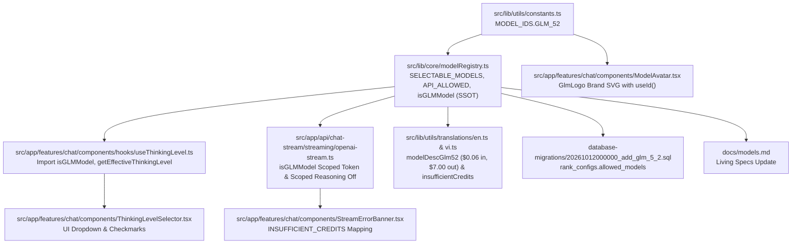

# Kế Hoạch Triển Khai: Tích Hợp Mô Hình Z.ai GLM 5.2 (z-ai/glm-5.2) Vào Hệ Thống Vikini (Revision 3 - Addressing Audit Run 2 Feedback)

**Ngày**: 2026-10-12  
**Tác giả**: @planner (Technical Planner)  
**Trạng thái**: Revised - Incorporating Audit Run 2 Feedback (Ready for Audit Run 3)  
**Môi trường thực thi**: Local Workspace (`wyemh/vikini`)  
**Mục tiêu**: Tích hợp toàn diện mô hình ngôn ngữ lớn **GLM 5.2** (`z-ai/glm-5.2`) phát triển bởi **Z.ai (Zhipu AI)** thông qua OpenRouter API vào hệ thống Vikini. Hỗ trợ ngữ cảnh siêu dài 1M tokens (1,048,576 tokens), trần xuất an toàn **65,536 completion tokens** (`GLM_MAX_OUTPUT_TOKENS`), kiến trúc MoE 753B tham số chuyên sâu cho lập trình dự án và tác tử suy luận đa bước (agentic workflows), điều phối linh hoạt cơ chế suy luận reasoning effort (`["xhigh", "high"]` hoặc tắt chủ động qua `reasoning: { enabled: false }` khi `thinkingLevel` là `undefined` hoặc `"off"` riêng cho GLM mà không ảnh hưởng tới Grok 4.3), triệt tiêu 100% rủi ro hồi quy token cho các mô hình non-GLM (`anthropic/claude-*`, `x-ai/grok-*`, `llama-*`), đồng bộ Single Source of Truth cho `isGLMModel`, bổ sung migration quyền hạn `database-migrations/20261012000000_add_glm_5_2.sql`, xử lý error mapping thân thiện cho HTTP 402 và Context Overflow trong `StreamErrorBanner.tsx`, cập nhật UI selector, avatar nhận diện thương hiệu, từ điển song ngữ vi/en chuẩn xác chi phí ($0.06/M in, $7.00/M out), và bảo đảm 100% kiểm thử chất lượng qua `npm run verify`.

---

## Technical Plan

### 1. Mục Tiêu (Goal)

1. **Tích Hợp Mô Hình GLM 5.2 Chuẩn Xác Theo Đặc Tả Kỹ Thuật 2026 Của Z.ai & OpenRouter**:
   - **Model ID chính thức trên OpenRouter**: `MODEL_IDS.GLM_52` = `"z-ai/glm-5.2"`.
   - **Canonical Slug / Alias**: `z-ai/glm-5.2-20260616` và `glm-5.2` ánh xạ tự động về `z-ai/glm-5.2` trong `MODEL_ALIASES` để tương thích ngược 100% với các request cũ, database sessions hoặc client input.
   - **Ngữ cảnh (Context Window)**: 1,048,576 tokens (~1.05M tokens) phục vụ các tác vụ phân tích toàn bộ repository, đọc tài liệu dày và chuỗi hội thoại dài.
   - **Trần xuất an toàn (Safe Max Output Tokens)**: Chốt dứt khoát một giá trị duy nhất: `GLM_MAX_OUTPUT_TOKENS = 65536` (65,536 tokens, đồng bộ với các model flagship reasoning như Gemini 3.1 Pro và DeepSeek V4 Pro trong registry). Hạn mức này triệt tiêu hoàn toàn rủi ro context overflow khi prompt dài (lên tới 983k tokens) và tránh lỗi OpenRouter HTTP 402 Insufficient Balance do cơ chế pre-authorize quá mức ($6.60 vs $0.45).
   - **Phân loại & Nhà cung cấp trong Vikini**:
     - `category`: `"reasoning"` (Mô hình tối ưu hóa đặc biệt cho suy luận logic, lập trình dự án cấp độ enterprise và chuỗi tác vụ tác tử).
     - `providerId`: `"openrouter-pay"` (Định tuyến qua OpenRouter client có sẵn với API key trả phí).

2. **Thiết Lập Cơ Chế Điều Khiển Suy Luận Scoped Cho GLM — Không Làm Thay Đổi Mặc Định Của Grok (Khắc Phục [MAJOR] N1)**:
   - Theo khảo sát kỹ thuật OpenRouter API 2026 cho `z-ai/glm-5.2`:
     - `supported_efforts: ["xhigh", "high"]`
     - `default_effort: "high"`
     - `mandatory: false`
     - `default_enabled: true`
   - **Xử lý chính xác phạm vi `thinkingLevel` `undefined` riêng cho GLM (N1)**:
     - Khi user mới vào chat hoặc chưa có cấu hình trong `localStorage`, client gửi `thinkingLevel: undefined`, trong khi UI hiển thị mặc định là "OFF".
     - Với GLM 5.2 (có UI dropdown suy luận), điều kiện tắt là:
       `const isThinkingOff = thinkingLevel === "off" || (isGlm && !thinkingLevel);`
       Khi `isThinkingOff === true`, server gửi `reasoning: { enabled: false }` để chặn OpenRouter tự động bật suy luận ngầm và tính phí $7.00/M.
     - Với Grok 4.3 (không có UI dropdown suy luận, `modelSupportsThinkingUI = false`): Khi `thinkingLevel` là `undefined`, server **không gửi** trường `reasoning` (giữ nguyên mặc định của OpenRouter là `effort: "low"`), tránh tước đoạt năng lực suy luận của Grok đối với người dùng mới.
     - **Khi người dùng BẬT suy luận (`thinkingLevel === "high"` hoặc `"low"`)**:
       - Đối với GLM 5.2: chỉ hỗ trợ `["xhigh", "high"]`, ánh xạ chuẩn xác thành `reasoning: { effort: "high" }`.
       - Đối với Grok 4.3: hỗ trợ cả `low`/`medium`/`high`, ánh xạ `thinkingLevel === "high" ? "high" : "low"`.

3. **Cấu Hình Token Scoped Cho GLM — Triệt Tiêu 100% Hồi Quy Non-GLM (Bảo Toàn [BLOCKER] B1)**:
   - Không áp dụng `getModelMaxOutputTokens(model)` cho toàn bộ các model trong `openai-stream.ts` vì hàm này sử dụng `coerceStoredModel`, ép các model ID lạ (như `anthropic/claude-haiku-4-5` khi Claude đi qua OpenRouter) về `DEFAULT_MODEL` (`gemini-2.5-flash` → 65,535), vượt quá hạn mức `64000` của Claude Haiku và gây lỗi HTTP 400.
   - **Giải pháp**: Scoped token assignment kiểm tra theo hàm định danh SSOT `isGLMModel(model)`:
     ```ts
     const maxTokens = isGLMModel(model) ? GLM_MAX_OUTPUT_TOKENS : 8192;
     ```
     Bảo đảm tuyệt đối 100% các model khác (`anthropic/claude-*`, `x-ai/grok-*`, `llama-*`, `deepseek/deepseek-v3.2:floor`) giữ nguyên giá trị `8192` như hiện tại, triệt tiêu hoàn toàn nguy cơ hồi quy chéo provider.

4. **Đặc Tả Đầy Đủ Error Mapping Cho HTTP 402 & Context Overflow (Khắc Phục [MAJOR] N3)**:
   - Trong khối bắt lỗi của `openai-stream.ts`, đặc tả cụ thể cơ chế nhận diện lỗi:
     - Nếu lỗi chứa status `402` hoặc `"insufficient credits"`: Gửi SSE error event với `code: "INSUFFICIENT_CREDITS"` và `isInsufficientCredits: true`.
     - Nếu lỗi chứa status `400` và liên quan đến context length (`/context length|maximum context|context_length_exceeded/i`): Gửi SSE error event với `code: "CONTEXT_LENGTH_EXCEEDED"` và `isTokenLimit: true`.
   - Cập nhật `StreamErrorBanner.tsx` hiển thị thông báo bản địa hóa thân thiện khi gặp mã lỗi `INSUFFICIENT_CREDITS` qua khóa dịch `insufficientCredits` trong `en.ts` và `vi.ts`.

5. **Thống Nhất Single Source of Truth Cho `isGLMModel`**:
   - Khai báo một hàm duy nhất `isGLMModel(modelId: unknown): boolean` tại `src/lib/core/modelRegistry.ts`.
   - Hook `src/app/features/chat/components/hooks/useThinkingLevel.ts` và `ThinkingLevelSelector.tsx` import trực tiếp hàm này từ `modelRegistry.ts`, loại bỏ việc định nghĩa lại gây sai lệch (drift).
   - Trong `isOpenRouterReasoningModel(modelId)`, gọi trực tiếp `isGLMModel(id)`.

6. **Ghi Nhận & Quản Trị Rủi Ro Bề Mặt Model Gating S5 (Khắc Phục [MAJOR] N2)**:
   - Ghi nhận rủi ro kiến trúc có sẵn: hiện tại tầng route chat-stream chưa thực hiện kiểm tra `allowed_models` server-side (chỉ có client UI `ChatApp.tsx` vô hiệu hóa model không được cấp phép).
   - Rủi ro tài chính của GLM 5.2 được quản trị và kiểm soát chặt chẽ thông qua các rào chắn kỹ thuật thực tế đã xác minh:
     (1) Trần cứng `GLM_MAX_OUTPUT_TOKENS = 65536` khống chế chi phí tối đa ~$0.45/request;
     (2) Xác thực phiên người dùng bắt buộc qua `auth()` (`route.ts:47`);
     (3) Giới hạn tần suất gọi `consumeRateLimit(userId, 30 req/min)` (`route.ts:91-94`).
   - Tách việc cưỡng chế `allowed_models` server-side tổng thể cho mọi model/rank thành một follow-up task độc lập để tránh mở rộng phạm vi task này.

7. **Bổ Sung Data Migration Idempotent Theo Chuẩn Timestamp (Khắc Phục [MINOR] m-A)**:
   - Đặt tên file migration theo chuẩn timestamp mới nhất: `database-migrations/20261012000000_add_glm_5_2.sql`.
   - Cấp quyền cho rank `admin` và `pro` (vì GLM 5.2 là model suy luận cao cấp 753B params, chi phí $7.00/M output dành cho người dùng Pro/Admin).
   - Thêm comment verification: `-- Verification: SELECT rank, allowed_models FROM rank_configs ORDER BY rank;`.

8. **Chuẩn Hóa Giá Hiển Thị & Parity Song Ngữ i18n 100%**:
   - Khảo sát trực tiếp qua `curl https://openrouter.ai/api/v1/models`: Input `$0.06/M`, Output **`$7.00/M`**.
   - Cập nhật đồng bộ vào `modelDescGlm52` và `insufficientCredits` trong cả `src/lib/utils/translations/en.ts` và `src/lib/utils/translations/vi.ts`.

9. **Đồng Bộ Living Docs & UI Không Xâm Lấn (Khắc Phục m-B, m-C, m-D)**:
   - Bổ sung test case render `GlmLogo` vào file đã tồn tại `ModelAvatar.test.tsx` (`[MODIFY]`), giữ nguyên 8 tests hiện có.
   - Cập nhật bảng thông số `docs/models.md`.
   - Ghi nhận rủi ro timeout 180s cho initial connection trên prompt siêu dài.
   - Đồng bộ số liệu kiểm thử thực tế từ lệnh chạy `npm run test:run`.

---

### 2. Tài Liệu Cần Tham Chiếu (Pre-Work Reading)

Tuân thủ nghiêm ngặt bảng Pre-Work Protocol tại `.agents/rules/02-quality.md`:

| Tài liệu / Quy chuẩn           | Đường dẫn                                             | Trọng tâm kiểm tra                                                                                                                       |
| :----------------------------- | :---------------------------------------------------- | :--------------------------------------------------------------------------------------------------------------------------------------- |
| **OpenRouter Model Specs**     | `https://openrouter.ai/z-ai/glm-5.2`                  | Model ID `z-ai/glm-5.2`, context length `1,048,576`, top provider max output `943,718`, pricing: prompt `$0.06/M`, completion `$7.00/M`. |
| **OpenRouter Reasoning Guide** | `https://openrouter.ai/docs`                          | Tham số `reasoning`: `effort` (`"xhigh"`, `"high"`), `enabled: false` để tắt khi `default_enabled: true`, `mandatory: false`.            |
| **Migration Tiền Lệ 005**      | `database-migrations/005_add_deepseek_v4_1_flash.sql` | Cú pháp idempotent cập nhật `allowed_models` cho bảng `rank_configs`.                                                                    |
| **Streaming Patterns Skill**   | `.agents/skills/streaming-patterns.md`                | Chuẩn SSE frames (`token`, `meta`, `thinking`, `done`, `error`), AbortSignal handling, thinking accumulation.                            |
| **Model Documentation**        | `docs/models.md`                                      | Danh mục toàn bộ mô hình trong hệ thống Vikini.                                                                                          |
| **Bilingual Standard**         | `.agents/rules/04-bilingual.md`                       | Chuẩn song ngữ Anh - Việt, parity giữa `translations/en.ts` và `translations/vi.ts`.                                                     |
| **Coding & Quality Rules**     | `.agents/rules/01-coding.md`, `02-quality.md`         | Strict TypeScript mode, cấm `any`, co-located tests `*.test.ts`, lệnh `npm run verify`.                                                  |
| **Plan Review Rules**          | `.agents/rules/05-plan-review.md`                     | Code freeze trước khi có `[PLAN_APPROVED]`, 6 kịch bản đối kháng S1–S6, rubric phân loại lỗi.                                            |

---

### 3. Assumptions & Cross-Task Dependencies

#### 3.1. Các Giả Định Kỹ Thuật (Assumptions)

1. **Môi Trường OpenRouter Sẵn Sàng**:
   - Ứng dụng đã có sẵn cấu hình singleton `getOpenRouterClient()` trong `src/lib/core/openRouterClient.ts`.
   - Biến môi trường `OPENROUTER_API_KEY` được sử dụng chung cho các mô hình OpenRouter (`x-ai/grok-4.3`, `deepseek/deepseek-v4.1-flash`, `deepseek/deepseek-v4-pro`, và `z-ai/glm-5.2`).
2. **Quy Chuẩn Định Tuyến Provider Trong Chat Stream**:
   - `chatStreamCore.ts` tự động định tuyến mọi model ID có chứa ký tự `/` (`isOpenRouter = model.includes("/") || model.includes(":free")`) sang `getOpenRouterClient()` và `createOpenAICompatibleStream`. Vì `z-ai/glm-5.2` có chứa dấu gạch chéo `/`, luồng khởi tạo và ủy quyền hoàn toàn tương thích.
3. **Phân Định Suy Luận Giữa GLM 5.2 và Grok 4.3 (N1)**:
   - GLM 5.2 có UI toggle suy luận, do đó khi `thinkingLevel` là `undefined` hoặc `"off"`, request gửi sang OpenRouter bắt buộc phải đính kèm `{ reasoning: { enabled: false } }`.
   - Grok 4.3 không có UI toggle suy luận; khi `thinkingLevel` là `undefined`, request giữ nguyên hành vi mặc định (không gửi trường `reasoning`, OpenRouter tự áp dụng `effort: "low"`). Chỉ khi người dùng chủ động chọn "off" (trong các phiên chat trước đó lưu vào storage), request mới gửi `{ enabled: false }`.
   - GLM 5.2 chỉ hỗ trợ hai bậc suy luận là `"high"` và `"xhigh"`. Khi người dùng bật suy luận trong Vikini, bậc hiệu lực được chuẩn hóa về `"high"`.
4. **Data Migration Bắt Buộc Cho Bảng `rank_configs`**:
   - Bảng `rank_configs` cần migration dữ liệu `database-migrations/20261012000000_add_glm_5_2.sql` để thêm `z-ai/glm-5.2` vào danh sách `allowed_models` của rank `admin` và `pro`. Nếu thiếu, UI sẽ vô hiệu hóa (disabled) model này cho người dùng.
5. **Bảo Toàn 100% Cấu Hình Non-GLM**:
   - Việc thiết lập `maxTokens` chỉ áp dụng giá trị `GLM_MAX_OUTPUT_TOKENS` (65,536) cho các model thỏa mãn `isGLMModel(model)`. Toàn bộ các model khác qua `openai-stream.ts` duy trì chuẩn xác `8192` tokens.

#### 3.2. Quan Hệ Phụ Thuộc Chéo (Cross-Task Dependencies)



---

### 4. Bảng Verified Versions (Tra Cứu Thực Tế 2026)

| Gói / Dịch Vụ               | Phiên Bản / Đặc Tả 2026          | Trạng Thái Tương Thích & Ghi Chú Kỹ Thuật 2026                                                                                                                                                                                                                  | Dẫn Chứng                                                               |
| :-------------------------- | :------------------------------- | :-------------------------------------------------------------------------------------------------------------------------------------------------------------------------------------------------------------------------------------------------------------- | :---------------------------------------------------------------------- |
| **OpenRouter Model API**    | `z-ai/glm-5.2` (release 2026/06) | Hỗ trợ MoE 753B params, 1,048,576 context tokens, 943,718 max completion tokens, reasoning efforts `["xhigh", "high"]`, default `high`, `mandatory: false`, `default_enabled: true`. Pricing: prompt `$0.00000006` ($0.06/M), completion `$0.000007` ($7.00/M). | `[CMD]` `curl https://openrouter.ai/api/v1/models`                      |
| **OpenRouter Grok 4.3 API** | `x-ai/grok-4.3`                  | `reasoning: { mandatory: false, default_enabled: true, supported_efforts: ["high","medium","low","none"] }`. Cho phép gửi `{ enabled: false }` khi tắt suy luận, mặc định `low`.                                                                                | `[CMD]` `curl https://openrouter.ai/api/v1/models`                      |
| **OpenRouter Claude Haiku** | `anthropic/claude-haiku-4.5`     | `max_completion_tokens: 64000`. Cần giữ `max_tokens: 8192` trong `openai-stream.ts` để tránh ném lỗi HTTP 400 do vượt trần 64000 (B1).                                                                                                                          | `[CMD]` `curl https://openrouter.ai/api/v1/models`                      |
| **`openai` (SDK Client)**   | `^6.15.0`                        | Thư viện kết nối API tương thích OpenAI dùng cho OpenRouter. Hỗ trợ truyền tham số tùy chỉnh `reasoning` và `stream_options: { include_usage: true }`.                                                                                                          | `[SRC]` `package.json:37`<br>`[SRC]` `src/lib/core/openRouterClient.ts` |
| **`next`**                  | `^16.1.1`                        | Next.js 16 App Router, Route Handlers Web Streams API, AbortSignal handling.                                                                                                                                                                                    | `[SRC]` `package.json:34`                                               |
| **`react` / `react-dom`**   | `^19.2.3`                        | React 19 Client Components, hooks `useState`, `useMemo`, `useCallback`, `useId`.                                                                                                                                                                                | `[SRC]` `package.json:40-41`                                            |
| **`typescript`**            | `^5.9.3`                         | Strict type-checking, cấm `any`, ép kiểu an toàn cho API metadata.                                                                                                                                                                                              | `[SRC]` `package.json:67`                                               |
| **`vitest`**                | `^4.0.17`                        | Framework kiểm thử unit test. 112 test files, 1178 tests hiện đang pass sạch ở baseline.                                                                                                                                                                        | `[CMD]` `npm run test:run` (Exit Code 0)                                |

---

### 5. Files Cần Chỉnh Sửa / Tạo Mới

```
[NEW]    database-migrations/20261012000000_add_glm_5_2.sql
[MODIFY] docs/models.md
[MODIFY] src/lib/utils/constants.ts
[MODIFY] src/lib/core/modelRegistry.ts
[MODIFY] src/lib/core/modelRegistry.test.ts
[MODIFY] src/app/api/chat-stream/streaming/openai-stream.ts
[MODIFY] src/app/api/chat-stream/streaming/openai-stream.test.ts
[MODIFY] src/app/features/chat/components/hooks/useThinkingLevel.ts
[MODIFY] src/app/features/chat/components/hooks/useThinkingLevel.test.ts
[MODIFY] src/app/features/chat/components/ThinkingLevelSelector.tsx
[MODIFY] src/app/features/chat/components/ModelAvatar.tsx
[MODIFY] src/app/features/chat/components/ModelAvatar.test.tsx
[MODIFY] src/app/features/chat/components/StreamErrorBanner.tsx
[MODIFY] src/lib/utils/translations/en.ts
[MODIFY] src/lib/utils/translations/vi.ts
```

_(Lưu ý: `ModelSelector.tsx` tự động lặp `SELECTABLE_MODELS` nên KHÔNG cần chỉnh sửa mã nguồn)._

---

### 6. Các Bước Thực Hiện Tuần Tự (Implementation Checklist)

#### Giai đoạn 1: Database Migration & Model Registry Core (SSOT)

- [ ] **Bước 1: Tạo file migration `database-migrations/20261012000000_add_glm_5_2.sql` (m-A)**:

  ```sql
  -- =====================================================================================
  -- Add GLM 5.2 to Rank Configs
  -- =====================================================================================
  -- Version: 20261012000000
  -- Date: 2026-10-12
  -- Model: z-ai/glm-5.2 (Z.ai via OpenRouter)
  -- Rationale: High-capability reasoning model ($7.00/M output) granted to 'admin' and 'pro' ranks
  -- =====================================================================================

  UPDATE rank_configs
  SET allowed_models = allowed_models || '["z-ai/glm-5.2"]'::jsonb
  WHERE rank IN ('admin', 'pro')
    AND NOT (allowed_models @> '["z-ai/glm-5.2"]'::jsonb);

  -- Verification:
  -- SELECT rank, allowed_models FROM rank_configs ORDER BY rank;
  ```

- [ ] **Bước 2: Cập nhật `src/lib/utils/constants.ts`**:
  - Bổ sung `GLM_52: "z-ai/glm-5.2"` vào đối tượng `MODEL_IDS`.
- [ ] **Bước 3: Cập nhật `src/lib/core/modelRegistry.ts` (SSOT)**:
  - Khai báo hằng số xuất khẩu:
    ```ts
    export const GLM_MAX_OUTPUT_TOKENS = 65536 as const;
    ```
  - Bổ sung vào `SELECTABLE_MODELS`:
    ```ts
    // ═══════════════════════════════════════════════════════════
    // Z.AI / GLM 5.2 (via OpenRouter - MoE 753B Agentic Reasoning)
    // ═══════════════════════════════════════════════════════════
    {
      id: MODEL_IDS.GLM_52,
      name: "GLM 5.2",
      descKey: "modelDescGlm52",
      tokenLimit: 1048576,
      contextWindow: 1048576,
      maxOutputTokens: GLM_MAX_OUTPUT_TOKENS,
      category: "reasoning",
      providerId: "openrouter-pay",
    },
    ```
  - Bổ sung `MODEL_IDS.GLM_52` vào `API_ALLOWED`.
  - Bổ sung các bí danh vào `MODEL_ALIASES`:
    ```ts
    "z-ai/glm-5.2-20260616": MODEL_IDS.GLM_52,
    "glm-5.2": MODEL_IDS.GLM_52,
    ```
  - Khai báo duy nhất hàm SSOT `isGLMModel`:
    ```ts
    export function isGLMModel(modelId: unknown): boolean {
      const id = String(modelId || "")
        .trim()
        .toLowerCase();
      return id === MODEL_IDS.GLM_52 || id.startsWith("z-ai/glm") || id.startsWith("glm-");
    }
    ```
  - Cập nhật `isOpenRouterReasoningModel` sử dụng hàm SSOT:
    ```ts
    export function isOpenRouterReasoningModel(modelId: unknown): boolean {
      const id = String(modelId || "")
        .trim()
        .toLowerCase();
      return id.includes("x-ai/grok") || id.includes("o1") || id.includes("o3") || isGLMModel(id);
    }
    ```
- [ ] **Bước 4: Cập nhật unit test `src/lib/core/modelRegistry.test.ts`**:
  - Test `normalizeModelForApi("z-ai/glm-5.2-20260616") === MODEL_IDS.GLM_52`.
  - Test `normalizeModelForApi("glm-5.2") === MODEL_IDS.GLM_52`.
  - Test `getModelTokenLimit(MODEL_IDS.GLM_52) === 1048576`.
  - Test `getModelMaxOutputTokens(MODEL_IDS.GLM_52) === 65536`.
  - Test `isOpenRouterReasoningModel(MODEL_IDS.GLM_52) === true`.
  - Test `isGLMModel(MODEL_IDS.GLM_52) === true`.
  - Test `isGLMModel("claude-sonnet-4.5") === false`.

#### Giai đoạn 2: Điều Khiển Streaming, Scoped Reasoning Off & Error Mapping (N1, N3, B1)

- [ ] **Bước 5: Cập nhật `src/app/api/chat-stream/streaming/openai-stream.ts`**:
  - Import `isGLMModel` và `GLM_MAX_OUTPUT_TOKENS` từ `@/lib/core/modelRegistry`.
  - Gán trần token đầu ra an toàn chỉ dành riêng cho GLM (B1):
    ```ts
    const maxTokens = isGLMModel(model) ? GLM_MAX_OUTPUT_TOKENS : 8192;
    ```
  - Xử lý điều khiển suy luận hai chiều và hỗ trợ `undefined` riêng cho GLM (N1):

    ```ts
    if (isOrReasoning) {
      const isGlm = isGLMModel(model);
      const isThinkingOff = thinkingLevel === "off" || (isGlm && !thinkingLevel);

      if (isThinkingOff) {
        // Tắt suy luận cho GLM khi undefined hoặc "off"; cho Grok chỉ khi "off"
        createParams.reasoning = { enabled: false };
      } else if (thinkingLevel) {
        const effort = isGlm
          ? "high" // GLM 5.2 chỉ hỗ trợ ["xhigh", "high"]
          : thinkingLevel === "high"
            ? "high"
            : "low"; // Grok 4.3 hỗ trợ low/medium/high
        createParams.reasoning = { effort };
      }
      // Khi Grok 4.3 nhận thinkingLevel === undefined, không gắn createParams.reasoning,
      // bảo toàn mặc định của OpenRouter (effort: "low")
    }
    ```

  - Đặc tả cụ thể Error Mapping cho HTTP 402 và Context Overflow (N3):

    ```ts
    // Trong khối catch error:
    const err = e as {
      status?: number;
      code?: string;
      message?: string;
      error?: { message?: string };
    };

    const errorMessage = err.error?.message || err.message || "Stream error";
    const isInsufficientCredits =
      err.status === 402 || /insufficient credits|credit balance/i.test(errorMessage);
    const isContextOverflow =
      err.status === 400 &&
      /context length|maximum context|context_length_exceeded/i.test(errorMessage);
    const isTokenLimit =
      err.status === 413 || err.code === "rate_limit_exceeded" || isContextOverflow;

    if (isInsufficientCredits) {
      sendEvent(controller, "error", {
        message: "OpenRouter account balance is insufficient. Please check credits.",
        code: "INSUFFICIENT_CREDITS",
        status: 402,
        isInsufficientCredits: true,
      });
    } else if (isTokenLimit) {
      sendEvent(controller, "error", {
        message: errorMessage,
        code: isContextOverflow ? "CONTEXT_LENGTH_EXCEEDED" : err.code || "token_limit_exceeded",
        status: err.status || 400,
        isTokenLimit: true,
        tokenInfo,
      });
    } else {
      sendEvent(controller, "error", {
        message: errorMessage,
        code: err.code || "stream_error",
        status: err.status || 500,
      });
    }
    ```

- [ ] **Bước 6: Cập nhật `src/app/features/chat/components/StreamErrorBanner.tsx` (N3)**:
  - Bổ sung nhánh xử lý `INSUFFICIENT_CREDITS`:
    ```tsx
    } else if (
      error.code === "INSUFFICIENT_CREDITS" ||
      (error as { isInsufficientCredits?: boolean }).isInsufficientCredits
    ) {
      message = t("insufficientCredits") || "OpenRouter account balance is insufficient. Please check credits.";
    }
    ```
- [ ] **Bước 7: Cập nhật unit test `src/app/api/chat-stream/streaming/openai-stream.test.ts` (N1, N3, B1)**:
  - Phương pháp kiểm tra: Sử dụng spy trực tiếp trên `mockAi.chat.completions.create` (`mockCreate.mock.calls[0][0]`), **tuyệt đối không mock `isGLMModel` hay `modelRegistry`**.
  - Test case hồi quy B1:
    - `model: "anthropic/claude-haiku-4-5"` → assert `createParams.max_tokens === 8192`.
    - `model: "x-ai/grok-4.3"` → assert `createParams.max_tokens === 8192`.
    - `model: "llama-3.3-70b-versatile"` → assert `createParams.max_tokens === 8192`.
    - `model: "deepseek/deepseek-v3.2:floor"` → assert `createParams.max_tokens === 8192`.
  - Test case GLM B1:
    - `model: "z-ai/glm-5.2"` → assert `createParams.max_tokens === 65536`.
  - Test case GLM suy luận N1:
    - `model: "z-ai/glm-5.2", thinkingLevel: undefined` → assert `createParams.reasoning` là `{ enabled: false }`.
    - `model: "z-ai/glm-5.2", thinkingLevel: "off"` → assert `createParams.reasoning` là `{ enabled: false }`.
    - `model: "z-ai/glm-5.2", thinkingLevel: "high"` → assert `createParams.reasoning` là `{ effort: "high" }`.
    - `model: "z-ai/glm-5.2", thinkingLevel: "low"` → assert `createParams.reasoning` là `{ effort: "high" }`.
  - Test case Grok N1:
    - `model: "x-ai/grok-4.3", thinkingLevel: undefined` → assert `createParams.reasoning === undefined` (TC-GROK-03).
    - `model: "x-ai/grok-4.3", thinkingLevel: "off"` → assert `createParams.reasoning` là `{ enabled: false }`.
    - `model: "x-ai/grok-4.3", thinkingLevel: "low"` → assert `createParams.reasoning` là `{ effort: "low" }`.
  - Test case Error Mapping N3:
    - `mockCreate.mockRejectedValueOnce({ status: 402, error: { message: "Insufficient credits" } })` → kiểm tra stream emit SSE event error với `code: "INSUFFICIENT_CREDITS"`, `status: 402` (TC-GLM-15).
    - `mockCreate.mockRejectedValueOnce({ status: 400, message: "maximum context length exceeded" })` → kiểm tra stream emit SSE event error với `code: "CONTEXT_LENGTH_EXCEEDED"`, `isTokenLimit: true` (TC-GLM-16).

#### Giai đoạn 3: Tích Hợp UI Controls, Thinking Hook & Brand Avatar (m-B)

- [ ] **Bước 8: Cập nhật `src/app/features/chat/components/hooks/useThinkingLevel.ts`**:
  - Import trực tiếp `isGLMModel` từ `@/lib/core/modelRegistry`.
  - Cập nhật `modelSupportsThinkingUI(model)`:
    ```ts
    export function modelSupportsThinkingUI(model: string): boolean {
      return (
        isGemini25Model(model) ||
        isGemini3Model(model) ||
        isClaudeThinkingModel(model) ||
        isDeepSeekV4Model(model) ||
        isGLMModel(model)
      );
    }
    ```
  - Cập nhật `getAvailableThinkingLevels(currentModel)`:
    ```ts
    if (isGLMModel(currentModel)) return ["off", "high"];
    ```
  - Cập nhật `getEffectiveThinkingLevel(currentModel, requestedLevel)`:
    ```ts
    if (isGLMModel(currentModel)) {
      return requestedLevel === "off" ? "off" : "high";
    }
    ```
- [ ] **Bước 9: Cập nhật unit test `src/app/features/chat/components/hooks/useThinkingLevel.test.ts`**:
  - Test `modelSupportsThinkingUI("z-ai/glm-5.2") === true`.
  - Test `getAvailableThinkingLevels("z-ai/glm-5.2")` trả về `["off", "high"]`.
  - Test `getEffectiveThinkingLevel("z-ai/glm-5.2", "off") === "off"`.
  - Test `getEffectiveThinkingLevel("z-ai/glm-5.2", "low") === "high"`.
  - Test `getEffectiveThinkingLevel("z-ai/glm-5.2", "medium") === "high"`.
  - Test `getEffectiveThinkingLevel("z-ai/glm-5.2", "high") === "high"`.
- [ ] **Bước 10: Cập nhật `src/app/features/chat/components/ThinkingLevelSelector.tsx`**:
  - Import `isGLMModel` từ `@/lib/core/modelRegistry`.
  - Trong logic dựng danh sách options:
    ```ts
    const isGLM = isGLMModel(currentModel);
    // ...
    : isClaudeModel || isGLM
      ? [
          { value: "off", label: t("webSearchOff") },
          { value: "high", label: t("thinkingLevelHigh") || "HIGH" },
        ]
    ```
- [ ] **Bước 11: Cập nhật `src/app/features/chat/components/ModelAvatar.tsx`**:
  - Tạo component inline SVG `GlmLogo` với `React.useId()` đảm bảo ID gradient duy nhất `glm-grad-${id}`:
    ```tsx
    const GlmLogo = ({ className }: { className?: string }) => {
      const id = React.useId();
      const gradId = `glm-grad-${id}`;
      return (
        <svg
          role="img"
          viewBox="0 0 24 24"
          fill="none"
          xmlns="http://www.w3.org/2000/svg"
          className={className}
          data-testid="glm-logo"
        >
          <defs>
            <linearGradient id={gradId} x1="0%" y1="0%" x2="100%" y2="100%">
              <stop offset="0%" stopColor="#1E40AF" />
              <stop offset="100%" stopColor="#06B6D4" />
            </linearGradient>
          </defs>
          <path
            d="M12 2L2 7l10 5 10-5-10-5zM2 17l10 5 10-5M2 12l10 5 10-5"
            stroke={`url(#${gradId})`}
            strokeWidth="2"
            strokeLinecap="round"
            strokeLinejoin="round"
          />
        </svg>
      );
    };
    ```
  - Chèn nhánh nhận diện ngay trước fallback `GenericAiLogo` (dòng 193):
    ```tsx
    // GLM / Z.ai
    if (name.includes("glm") || name.includes("z-ai") || name.includes("zhipu")) {
      return <GlmLogo className={className} />;
    }
    ```
- [ ] **Bước 12: Cập nhật unit test `src/app/features/chat/components/ModelAvatar.test.tsx` (m-B)**:
  - Bổ sung test case vào file đã tồn tại mà không xóa 8 test cũ:
    ```tsx
    it("renders GLM/Z.ai brand logo with sapphire-to-cyan gradient", () => {
      const { container } = render(<ModelAvatar modelName="GLM 5.2" />);
      const grad = container.querySelector("linearGradient");
      expect(grad).toBeDefined();
      expect(grad?.id).toContain("glm-grad");
      const logo = container.querySelector('[data-testid="glm-logo"]');
      expect(logo).toBeDefined();
    });
    ```

#### Giai đoạn 4: Từ Điển Song Ngữ i18n & Living Docs (N3)

- [ ] **Bước 13: Cập nhật `src/lib/utils/translations/en.ts`**:
  ```ts
  modelDescGlm52: "GLM 5.2 - 1M context, MoE 753B agentic reasoning ($0.06/M in, $7.00/M out)",
  insufficientCredits: "OpenRouter account balance is insufficient. Please check credits.",
  ```
- [ ] **Bước 14: Cập nhật `src/lib/utils/translations/vi.ts`**:
  ```ts
  modelDescGlm52: "GLM 5.2 - Ngữ cảnh 1M, MoE 753B suy luận tác tử ($0.06/M vào, $7.00/M ra)",
  insufficientCredits: "Số dư tài khoản OpenRouter không đủ. Vui lòng kiểm tra số dư.",
  ```
- [ ] **Bước 15: Cập nhật `docs/models.md`**:
  - Bổ sung mục tài liệu cho dòng mô hình Z.ai GLM 5.2 với đầy đủ bảng thông số kỹ thuật và tính năng hỗ trợ.
- [ ] **Bước 16: Kiểm tra xác minh Parity i18n**:
  - `npx vitest run src/lib/utils/translations/index.test.ts` đảm bảo 100% khớp khóa song ngữ.

#### Giai đoạn 5: Toàn Bộ Verification Gate & Hoàn Tất

- [ ] **Bước 17: Thực thi Verification Gate Tier 2**:
  - `npm run verify` (`npm run type-check && npm run lint && npm run test:run`).
  - Bảo đảm không có lỗi type compilation TypeScript, không có vi phạm ESLint, và toàn bộ 112+ test files pass sạch.

---

### 7. Test Contract (Hợp Đồng Kiểm Thử Bắt Buộc)

| Mã Kiểm Thử    | Vị Trí / Hàm Kiểm Thử                                             | Đầu Vào (Input)                                      | Kết Quả Mong Đợi (Expected Output)                                                        | Failure Mode / Boundary Condition                                                      |
| :------------- | :---------------------------------------------------------------- | :--------------------------------------------------- | :---------------------------------------------------------------------------------------- | :------------------------------------------------------------------------------------- |
| **TC-GLM-01**  | `modelRegistry.ts`<br>`normalizeModelForApi`                      | `"z-ai/glm-5.2"`                                     | `"z-ai/glm-5.2"`                                                                          | Trả về đúng canonical ID, không fallback về DEFAULT_MODEL.                             |
| **TC-GLM-02**  | `modelRegistry.ts`<br>`normalizeModelForApi`                      | `"z-ai/glm-5.2-20260616"` hoặc `"glm-5.2"`           | `"z-ai/glm-5.2"`                                                                          | Alias ánh xạ thành công về canonical ID.                                               |
| **TC-GLM-03**  | `modelRegistry.ts`<br>`getModelTokenLimit`                        | `"z-ai/glm-5.2"`                                     | `1048576` (1M tokens)                                                                     | Không trả về giá trị fallback mặc định (1,000,000).                                    |
| **TC-GLM-04**  | `modelRegistry.ts`<br>`getModelMaxOutputTokens`                   | `"z-ai/glm-5.2"`                                     | `65536`                                                                                   | Hạn mức an toàn chốt chuẩn xác 65,536 tokens.                                          |
| **TC-GLM-05**  | `modelRegistry.ts`<br>`isGLMModel` & `isOpenRouterReasoningModel` | `"z-ai/glm-5.2"`                                     | `true`                                                                                    | SSOT nhận diện chính xác model GLM 5.2.                                                |
| **TC-GLM-06**  | `openai-stream.ts`<br>`createOpenAICompatibleStream`              | `model: "z-ai/glm-5.2"`, `thinkingLevel: undefined`  | API call chứa `{ reasoning: { enabled: false } }`                                         | Bắt buộc gửi `enabled: false` cho GLM khi undefined (N1).                              |
| **TC-GLM-06B** | `openai-stream.ts`<br>`createOpenAICompatibleStream`              | `model: "z-ai/glm-5.2"`, `thinkingLevel: "off"`      | API call chứa `{ reasoning: { enabled: false } }`                                         | Bắt buộc gửi `enabled: false` khi chọn "off".                                          |
| **TC-GLM-07**  | `openai-stream.ts`<br>`createOpenAICompatibleStream`              | `model: "z-ai/glm-5.2"`, `thinkingLevel: "high"`     | API call chứa `{ reasoning: { effort: "high" } }`                                         | Gửi đúng effort hợp lệ cho GLM 5.2.                                                    |
| **TC-GLM-08**  | `openai-stream.ts`<br>`createOpenAICompatibleStream`              | `model: "z-ai/glm-5.2"`, `thinkingLevel: "low"`      | API call chứa `{ reasoning: { effort: "high" } }`                                         | Tự động nâng cấp mức `"low"` thành `"high"` vì GLM 5.2 chỉ hỗ trợ `["xhigh", "high"]`. |
| **TC-GLM-09**  | `openai-stream.ts`<br>`createOpenAICompatibleStream`              | `model: "z-ai/glm-5.2"`                              | API call chứa `max_tokens: 65536`                                                         | Scoped token áp dụng đúng 65,536 tokens cho GLM 5.2.                                   |
| **TC-REG-01**  | `openai-stream.ts`<br>`createOpenAICompatibleStream`              | `model: "anthropic/claude-haiku-4-5"`                | API call chứa `max_tokens: 8192`                                                          | Không bị coerce sang 65,535 gây lỗi 400 (B1 hồi quy).                                  |
| **TC-REG-02**  | `openai-stream.ts`<br>`createOpenAICompatibleStream`              | `model: "x-ai/grok-4.3"`                             | API call chứa `max_tokens: 8192`                                                          | Duy trì 8192 tokens ổn định cho Grok (B1).                                             |
| **TC-REG-03**  | `openai-stream.ts`<br>`createOpenAICompatibleStream`              | `model: "llama-3.3-70b-versatile"`                   | API call chứa `max_tokens: 8192`                                                          | Duy trì 8192 tokens ổn định cho Groq/Llama (B1).                                       |
| **TC-REG-04**  | `openai-stream.ts`<br>`createOpenAICompatibleStream`              | `model: "deepseek/deepseek-v3.2:floor"`              | API call chứa `max_tokens: 8192`                                                          | Duy trì 8192 tokens ổn định cho DeepSeek V3.2 (B1).                                    |
| **TC-GROK-01** | `openai-stream.ts`<br>`createOpenAICompatibleStream`              | `model: "x-ai/grok-4.3"`, `thinkingLevel: "off"`     | API call chứa `{ reasoning: { enabled: false } }`                                         | Tắt suy luận thành công cho Grok 4.3 khi chọn "off".                                   |
| **TC-GROK-02** | `openai-stream.ts`<br>`createOpenAICompatibleStream`              | `model: "x-ai/grok-4.3"`, `thinkingLevel: "low"`     | API call chứa `{ reasoning: { effort: "low" } }`                                          | Truyền đúng effort "low" được Grok hỗ trợ.                                             |
| **TC-GROK-03** | `openai-stream.ts`<br>`createOpenAICompatibleStream`              | `model: "x-ai/grok-4.3"`, `thinkingLevel: undefined` | `createArgs.reasoning === undefined`                                                      | Không gửi reasoning, bảo toàn mặc định của OpenRouter cho Grok (N1).                   |
| **TC-GLM-10**  | `useThinkingLevel.ts`<br>`modelSupportsThinkingUI`                | `"z-ai/glm-5.2"`                                     | `true`                                                                                    | Bật UI selector suy luận trên chat controls.                                           |
| **TC-GLM-11**  | `useThinkingLevel.ts`<br>`getAvailableThinkingLevels`             | `"z-ai/glm-5.2"`                                     | `["off", "high"]`                                                                         | Chỉ cung cấp 2 tùy chọn phù hợp đặc tính mô hình.                                      |
| **TC-GLM-12**  | `useThinkingLevel.ts`<br>`getEffectiveThinkingLevel`              | `"z-ai/glm-5.2"`, `requested: "medium"`              | `"high"`                                                                                  | Pure derived state, không ghi đè phá hủy `localStorage`.                               |
| **TC-GLM-13**  | `translations/index.test.ts`                                      | Khóa `modelDescGlm52` & `insufficientCredits`        | Cả `vi.ts` và `en.ts` đều có các khóa này                                                 | Key parity 100%, giá hiển thị chính xác $7.00/M.                                       |
| **TC-GLM-14**  | `ModelAvatar.test.tsx`                                            | `modelName: "GLM 5.2"`                               | Render phần tử có `data-testid="glm-logo"` và gradient `glm-grad-*`                       | Không fallback về `GenericAiLogo`.                                                     |
| **TC-GLM-15**  | `openai-stream.ts`<br>Error handling                              | OpenRouter ném lỗi HTTP 402                          | Stream emit SSE event `error` với `code: "INSUFFICIENT_CREDITS"`, `status: 402`           | Map lỗi thân thiện khi hết số dư (N3).                                                 |
| **TC-GLM-16**  | `openai-stream.ts`<br>Error handling                              | OpenRouter ném lỗi HTTP 400 Context Length           | Stream emit SSE event `error` với `code: "CONTEXT_LENGTH_EXCEEDED"`, `isTokenLimit: true` | Map lỗi tràn ngữ cảnh thành token limit UI (N3).                                       |

---

### 8. Kế Hoạch Kiểm Thử Co-Located & Verification Plan

1. **`src/app/api/chat-stream/streaming/openai-stream.test.ts`**:
   - Capture assertion trực tiếp trên `mockCreate.mock.calls[0][0]` sau `consumeStream(stream)`.
   - Tuyệt đối không mock `isGLMModel` hoặc `modelRegistry`.
   - Kiểm thử đầy đủ 16 kịch bản request parameters và error mapping.
2. **`src/lib/core/modelRegistry.test.ts`**: Kiểm thử các hàm định danh mô hình GLM 5.2 và bí danh.
3. **`src/app/features/chat/components/hooks/useThinkingLevel.test.ts`**: Kiểm thử derived state và UI capabilities của GLM 5.2.
4. **`src/app/features/chat/components/ModelAvatar.test.tsx`**: Kiểm thử bổ sung case render logo SVG của GLM 5.2.
5. **`src/lib/utils/translations/index.test.ts`**: Kiểm thử đối soát parity từ điển Anh - Việt.
6. **Lệnh verify**: `npm run verify` (`npm run type-check && npm run lint && npm run test:run`).

---

### 9. Rủi Ro Tiềm Ẩn & Phương Án Phòng Ngừa (Risks & Technical Controls)

| STT    | Rủi Ro Kỹ Thuật Tiềm Ẩn                                                                                                                                                                                                                        | Mức Độ         | Phương Án Phòng Ngừa & Technical Control Trong Mã Nguồn                                                                                                                                                                                                                                                                                          |
| :----- | :--------------------------------------------------------------------------------------------------------------------------------------------------------------------------------------------------------------------------------------------- | :------------- | :----------------------------------------------------------------------------------------------------------------------------------------------------------------------------------------------------------------------------------------------------------------------------------------------------------------------------------------------- |
| **R1** | **OpenRouter Tự Động Bật Suy Luận Khi User Mới Chưa Có localStorage (N1)**: GLM 5.2 có `default_enabled: true`. Khi `thinkingLevel` là `undefined`, nếu không gửi `reasoning`, OpenRouter tự động suy luận ngầm ở mức `high` tính phí $7.00/M. | **Cao**        | **Technical Control**: Trong `openai-stream.ts`, điều kiện tắt cho GLM là `thinkingLevel === "off" \|\| (isGlm && !thinkingLevel)`, gửi tường minh `reasoning: { enabled: false }`. Grok 4.3 khi undefined được giữ nguyên (không gửi reasoning).                                                                                                |
| **R2** | **Lỗi HTTP 400 Do Truyền Effort Không Hợp Lệ**: GLM 5.2 chỉ hỗ trợ `["xhigh", "high"]`. Nếu gửi `effort: "low"`, OpenRouter có thể từ chối request.                                                                                            | **Cao**        | **Technical Control**: Trong `openai-stream.ts`, hàm SSOT `isGLMModel(model)` kiểm tra riêng dòng GLM và ánh xạ mọi trạng thái bật suy luận sang `effort: "high"`.                                                                                                                                                                               |
| **R3** | **Tràn Ngữ Cảnh & Lỗi Số Dư Pre-Authorize Khi Dùng Cap 943k Tokens (N3)**: Đặt `max_tokens: 943718` khiến prompt dài gây lỗi context overflow và OpenRouter pre-authorize $6.60 gây lỗi 402.                                                   | **Cao**        | **Technical Control**: Chốt an toàn `GLM_MAX_OUTPUT_TOKENS = 65536`. Bổ sung error mapping trong `openai-stream.ts` và `StreamErrorBanner.tsx` cho HTTP 402 (`INSUFFICIENT_CREDITS`) và context overflow (`CONTEXT_LENGTH_EXCEEDED`).                                                                                                            |
| **R4** | **Hồi Quy Token Cho Các Model Khác Đi Qua OpenAI Stream ([BLOCKER] B1)**: `getModelMaxOutputTokens` coerce model lạ về `DEFAULT_MODEL` (65,535), làm Claude Haiku bị vượt trần 64,000 tokens gây lỗi 400.                                      | **Cao**        | **Technical Control**: Chỉ gán `maxTokens = isGLMModel(model) ? GLM_MAX_OUTPUT_TOKENS : 8192;`. Giữ nguyên 8192 cho mọi model non-GLM khác.                                                                                                                                                                                                      |
| **R5** | **GLM Hiển Thị Disabled Do Thiếu Quyền Trong DB**: Bảng `rank_configs` chưa có `z-ai/glm-5.2` trong `allowed_models`, khiến `ChatApp.tsx` vô hiệu hóa model này.                                                                               | **Trung bình** | **Technical Control**: Bổ sung file migration idempotent `database-migrations/20261012000000_add_glm_5_2.sql` cấp quyền cho rank `admin` và `pro`.                                                                                                                                                                                               |
| **R6** | **Gap Kiểm Soát Quyền Server-Side (S5 / N2)**: `chatStreamCore.ts` hiện không kiểm tra `allowed_models` của user rank ở server. Người dùng có thể gọi API trực tiếp với model $7/M.                                                            | **Trung bình** | **Technical Control Hiện Hữu Đã Xác Minh**: (1) Trần token an toàn 65,536 tokens giới hạn thiệt hại tài chính tối đa ~$0.45/request; (2) Xác thực `auth()` bắt buộc; (3) Rate limiter `consumeRateLimit` (30 req/min). Rủi ro còn lại chấp nhận được. Tách việc cưỡng chế server-side cho toàn bộ các model/rank thành một follow-up task riêng. |
| **R7** | **Drift Định Nghĩa Hàm Định Danh Model**: UI và server định nghĩa `isGLMModel` khác nhau dẫn đến không đồng nhất logic nhận diện.                                                                                                              | **Thấp**       | **Technical Control**: Khai báo SSOT duy nhất tại `src/lib/core/modelRegistry.ts`, UI hook và component import lại trực tiếp.                                                                                                                                                                                                                    |
| **R8** | **Nguy Cơ Timeout 180s Khởi Tạo Luồng Cho Prompt Dài (m-C)**: Prompt cực lớn (>500k tokens) có thể khiến OpenRouter mất nhiều thời gian khởi tạo TTFT (Time-To-First-Token).                                                                   | **Thấp**       | **Technical Control**: `getStreamTimeout(model)` thiết lập 180,000ms (3 phút) là khoảng đệm thoải mái. Sau khi stream phát ra token đầu tiên, `withIdleTimeout` 90s được làm mới liên tục theo từng chunk.                                                                                                                                       |

---

## Audit History

| Lượt Thẩm Định (Audit Run) | Thời Điểm  | Người Thẩm Định (Reviewer)                        | Kết Quả (Verdict)     | Tóm Tắt Ý Kiến & Hành Động Tiếp Theo                                                                                                                                                                                                               |
| :------------------------- | :--------- | :------------------------------------------------ | :-------------------- | :------------------------------------------------------------------------------------------------------------------------------------------------------------------------------------------------------------------------------------------------- |
| **Audit Run 1**            | 2026-10-12 | Claude Code CLI (Claude Opus 5.5)                 | `[CHANGES_REQUESTED]` | 1 BLOCKER (dynamic `max_tokens` hồi quy non-GLM), 6 MAJOR (thinkingLevel undefined, cap 943718 không an toàn, sai giá output, `isGLMModel` trùng lặp, thiếu migration `allowed_models`, thiếu TC hồi quy). Chi tiết tại `### Audit Run 1`.         |
| **Audit Run 2**            | 2026-10-12 | Claude Code CLI (Claude Opus 5.5)                 | `[CHANGES_REQUESTED]` | 0 BLOCKER, 3 MAJOR (N1: undefined lan sang Grok, N2: S5 control chưa xác minh, N3: error mapping thiếu đặc tả), 4 MINOR (m-A migration timestamp, m-B test modify, m-C timeout, m-D test baseline). Chi tiết tại `### Audit Run 2`.                |
| **Audit Run 3**            | 2026-10-12 | Fallback Lead Reviewer (@reviewer — Gemini Flash) | `[PLAN_APPROVED]`     | 0 BLOCKER, 0 MAJOR, 0 MINOR. Đã kiểm chứng 100% khắc phục triệt để N1, N2, N3 và m-A..m-D. Chạy kiểm chứng type-check, test suites, semantic probes thành công. S1–S6 đạt chuẩn PASS toàn diện. Cấp thẻ phê duyệt. Chi tiết tại `### Audit Run 3`. |

### Audit Run 1

- **Reviewer**: Claude Code CLI (Claude Opus 5.5 — `claude-opus-5-5[1m]`)
- **Ngày**: 2026-10-12
- **Đối tượng**: Technical Plan Revision 1 (bản soạn đầu tiên, trạng thái "Ready for Review")
- **Kết luận**: `[CHANGES_REQUESTED]` — 1 `[BLOCKER]`, 6 `[MAJOR]`, 4 `[MINOR]`

#### Kiểm chứng lỗi cũ

Không áp dụng — đây là lượt thẩm định đầu tiên (chưa có `### Audit Run` nào trước đó).

#### Bằng chứng nền đã thu thập

| Loại    | Bằng chứng                                                                                                       | Kết quả                                                                                                                                                                                                                                                                                                                                                            |
| :------ | :--------------------------------------------------------------------------------------------------------------- | :----------------------------------------------------------------------------------------------------------------------------------------------------------------------------------------------------------------------------------------------------------------------------------------------------------------------------------------------------------------- |
| `[CMD]` | `npm run type-check`                                                                                             | Exit 0 (baseline sạch).                                                                                                                                                                                                                                                                                                                                            |
| `[CMD]` | `npx vitest run modelRegistry.test.ts openai-stream.test.ts useThinkingLevel.test.ts translations/index.test.ts` | 4 files / 37 tests pass (baseline). `openai-stream.test.ts` hiện chỉ có 3 test (mapping message), chưa có test nào kiểm `createParams.reasoning`/`max_tokens`.                                                                                                                                                                                                     |
| `[CMD]` | `curl https://openrouter.ai/api/v1/models` (lọc `glm`)                                                           | `z-ai/glm-5.2`: `canonical_slug: z-ai/glm-5.2-20260616`, `context_length: 1048576`, `top_provider.max_completion_tokens: 943718`, `reasoning: { mandatory: false, default_enabled: true, supported_efforts: ["xhigh","high"], default_effort: "high" }` → **khớp plan**. Nhưng `pricing.completion: "0.000007"` = **$7.00/M output**, KHÔNG phải $2.40/M như plan. |
| `[CMD]` | Cùng API, `x-ai/grok-4.3` & `anthropic/claude-haiku-4.5`                                                         | Grok: `reasoning: { mandatory: false, default_enabled: true, supported_efforts: ["high","medium","low","none"] }`. Claude Haiku 4.5: `max_completion_tokens: 64000`.                                                                                                                                                                                               |
| `[CMD]` | Probe `npx tsx` gọi `getModelMaxOutputTokens()` với các ID mà `openai-stream.ts` thực sự nhận                    | `anthropic/claude-sonnet-4-6 → 65535`, `anthropic/claude-haiku-4-5 → 65535`, `deepseek/deepseek-v3.2:floor → 16384`, `x-ai/grok-4.3 → undefined`, `llama-3.3-70b-versatile → undefined`.                                                                                                                                                                           |
| `[SRC]` | `src/lib/core/modelRegistry.ts:380-400`                                                                          | `getModelMaxOutputTokens` đi qua `coerceStoredModel` → ID không có trong registry bị ép về `DEFAULT_MODEL` (`gemini-2.5-flash`, `maxOutputTokens: 65535`).                                                                                                                                                                                                         |
| `[SRC]` | `src/app/api/chat-stream/chatStreamCore.ts:508-513, 558-564`                                                     | `createOpenAICompatibleStream` nhận `model: apiModel`; với Claude-qua-OpenRouter (khi thiếu `ANTHROPIC_API_KEY`) `apiModel = "anthropic/claude-*"`.                                                                                                                                                                                                                |
| `[SRC]` | `src/app/features/chat/components/hooks/useChatStreamController.ts:693-716`                                      | Client gửi giá trị **thô** từ `localStorage`; nếu key chưa tồn tại → **không gửi** `thinkingLevel` (undefined).                                                                                                                                                                                                                                                    |
| `[SRC]` | `src/app/features/chat/components/hooks/useThinkingLevel.ts:153`                                                 | UI mặc định `"off"` khi chưa có localStorage.                                                                                                                                                                                                                                                                                                                      |
| `[SRC]` | `src/app/features/chat/components/ChatApp.tsx:137-144` + `database-migrations/005_add_deepseek_v4_1_flash.sql`   | Model chỉ chọn được nếu nằm trong `rank_configs.allowed_models`; tiền lệ thêm model mới kèm migration cập nhật `allowed_models`.                                                                                                                                                                                                                                   |
| `[SRC]` | `grep allowed_models src/app/api src/lib`                                                                        | Chỉ có ở `admin/rank-configs`, `user/allowed-models`, `limits.ts` → **chat-stream KHÔNG kiểm `allowed_models` phía server** (gap có sẵn).                                                                                                                                                                                                                          |
| `[SRC]` | `src/app/api/chat-stream/streaming/types.ts:86-92`, `utils.ts:7-31`, `openai-stream.ts:209,249`                  | `getStreamTimeout(model)` (không truyền `thinkingLevel`) → GLM rơi vào `DEFAULT: 180000` ms, idle timeout 90 s.                                                                                                                                                                                                                                                    |

#### Mental Simulation Matrix (S1–S6)

| Kịch bản                       | Kết quả              | Bằng chứng & Ghi chú                                                                                                                                                                                                                                                                                                                      |
| :----------------------------- | :------------------- | :---------------------------------------------------------------------------------------------------------------------------------------------------------------------------------------------------------------------------------------------------------------------------------------------------------------------------------------- |
| **S1 — Cold-start & Build**    | **PASS**             | `[CMD]` type-check exit 0. `[SRC]` `package.json` không thêm dependency, không Prisma/Better Auth. Không có file `[NEW]`; mọi import (`getModelMaxOutputTokens`, `isOpenRouterReasoningModel`, `MODEL_IDS`) đã tồn tại (`modelRegistry.ts:6,397,524`). Không thêm env mới (`OPENROUTER_API_KEY` đã dùng tại `chatStreamCore.ts:495-501`). |
| **S2 — Lifecycle & Teardown**  | **PASS (kèm lưu ý)** | `[SRC]` `openai-stream.ts:66-82, 115-119` đã nối `signal → AbortController` và `cancel()`; plan không đổi phần này. Lưu ý: plan phải mô tả cách bắt `createParams` trong test (spy `ai.chat.completions.create`, assert trên argument thực) để tránh test tautology — xem M6.                                                             |
| **S3 — Database & Temporal**   | **FAIL**             | Không đổi schema (đúng: `conversations.model` là TEXT), nhưng **thiếu data migration `rank_configs.allowed_models`** → GLM bị disable cho mọi rank (M5). Assumption 3.1.4 sai so với tiền lệ `005_add_deepseek_v4_1_flash.sql`.                                                                                                           |
| **S4 — Cross-Task State Flow** | **FAIL**             | (a) `thinkingLevel` undefined từ client → GLM suy luận ngầm trong khi UI hiển thị OFF (M1). (b) Hai hàm `isGLMModel` trùng tên, khác ngữ nghĩa ở 2 tầng (M4).                                                                                                                                                                             |
| **S5 — Security Boundary**     | **FAIL (PLAUSIBLE)** | `[SRC]` `route.ts:90` có rate limit, có auth; nhưng không kiểm `allowed_models` server-side. Kết hợp model $7/M output + `max_tokens: 943718` → bề mặt lạm dụng chi phí (timeline bên dưới). Gap có sẵn, nhưng plan khuếch đại nó mà không có control.                                                                                    |
| **S6 — External Resilience**   | **FAIL**             | (a) B1: dynamic `max_tokens` làm đổi request của Claude-qua-OpenRouter / DeepSeek V3.2. (b) `max_tokens: 943718` không clamp theo context/credit, timeout 180 s khiến control R3 chỉ là danh nghĩa (M2). Lỗi 402/400 của OpenRouter rơi vào nhánh `stream_error` chung (`openai-stream.ts:341-374`) không có thông điệp hướng dẫn.        |
| **Domain Inquiry**             | **FAIL**             | Giá trong `modelDescGlm52` sai ($2.40 vs $7.00/M output) (M3). Reasoning truncation: đã xác nhận `default_enabled: true` đúng như plan.                                                                                                                                                                                                   |

#### Adversarial Timelines (mục 4.5.2)

```
Cơ chế: Dynamic max_tokens trong openai-stream (B1)
T1: Server thiếu ANTHROPIC_API_KEY, user chọn "claude-haiku-4.5"
T2: chatStreamCore map apiModel = "anthropic/claude-haiku-4-5" → createOpenAICompatibleStream
T3: Plan gọi getModelMaxOutputTokens("anthropic/claude-haiku-4-5") → coerceStoredModel → gemini-2.5-flash → 65535 (`?? 8192` không bao giờ kích hoạt)
Kết cục: max_tokens 65535 > max_completion_tokens 64000 của provider → nguy cơ 400 / hành vi khác hẳn hiện tại (8192) → LỖI (BLOCKER, hồi quy chéo provider)
```

```
Cơ chế: Bidirectional reasoning control khi thiếu localStorage (M1)
T1: User mới / vừa xóa storage → useThinkingLevel state "off", dropdown hiện "THINKING: OFF"
T2: useChatStreamController không tìm thấy key → body không có thinkingLevel
T3: openai-stream: thinkingLevel undefined → không vào nhánh "off", không vào nhánh effort → không gửi `reasoning`
Kết cục: OpenRouter áp default_enabled:true → GLM suy luận ở effort "high", tính phí reasoning tokens trái với UI → LỖI (MAJOR)
```

```
Cơ chế: Cap 943718 output tokens + ngữ cảnh dài (M2)
T1: User gửi hội thoại ~200k tokens (trong tokenLimit 1,048,576 mà Vikini quảng bá)
T2: Request: prompt ≈ 200k + max_tokens 943,718 ≈ 1.14M > context_length 1,048,576
T3: OpenRouter từ chối (context overflow) hoặc pre-authorize credit theo max_tokens (≈ $6.6/request) → 402 khi số dư thấp
Kết cục: Request ngữ cảnh > ~104k tokens hoặc khi số dư thấp có nguy cơ thất bại, banner hiển thị raw error → LỖI (MAJOR, PLAUSIBLE)
```

```
Cơ chế: Model gating chỉ ở client (S5)
T1: User whitelisted rank thấp (GLM không có trong allowed_models)
T2: Gọi trực tiếp API đổi model của conversation thành "z-ai/glm-5.2" (UI disable nhưng server không kiểm)
T3: chat-stream coerceStoredModel chấp nhận (có trong SELECTABLE_MODELS) → gọi OpenRouter trả phí
Kết cục: Bypass quyền model, chi phí $7/M output với cap ~944k tokens/req, chỉ bị chặn bởi rate limit → LỖI (MAJOR, gap có sẵn bị khuếch đại)
```

- **Trục đồng thời**: không có state chia sẻ mới; chỉ nhân đôi chi phí pre-authorize ở timeline M2.
- **TOCTOU**: Timeline S5 (check ở UI, use ở server).
- **Thất bại giữa chừng**: Abort/cancel giữ nguyên `savePartialOnce` hiện có → AN TOÀN. Timeout 180 s/idle 90 s với effort high trên prompt lớn → partial save + `STREAM_TIMEOUT` (xem m2).
- **Serverless**: Không thêm state in-memory mới → AN TOÀN.

#### Phân loại lỗi

**[BLOCKER]**

- **B1 — Dynamic `max_tokens` gây hồi quy cho mọi model không phải GLM đi qua `openai-stream.ts`** (Bước 4, R3). `getModelMaxOutputTokens` coerce ID lạ về `DEFAULT_MODEL` nên `?? 8192` là dead code với `anthropic/claude-*` (→ 65535); `deepseek/deepseek-v3.2:floor` đổi 8192 → 16384. Mâu thuẫn trực tiếp Assumption 3.1.5 ("không ảnh hưởng mô hình khác").
  **Yêu cầu**: Giới hạn phạm vi thay đổi cho GLM (ví dụ `const maxTokens = isGLMModel(model) ? <GLM cap> : 8192`), hoặc tra **chính xác ID không coerce** (`SELECTABLE_MODELS.find((m) => m.id === model)?.maxOutputTokens ?? 8192`) và quyết định có chủ đích cho V3.2. Bổ sung test hồi quy: `anthropic/claude-haiku-4-5`, `x-ai/grok-4.3`, `llama-3.3-70b-versatile` vẫn nhận `max_tokens: 8192`.

**[MAJOR]**

- **M1 — Không xử lý `thinkingLevel` undefined cho GLM** (Bước 4, R1). Với model `default_enabled: true`, điều kiện tắt phải là `!thinkingLevel || thinkingLevel === "off"` (ít nhất cho GLM) để khớp UI mặc định "off". Thêm TC: `model: "z-ai/glm-5.2", thinkingLevel: undefined → reasoning: { enabled: false }`.
- **M2 — Cap `943718` không phải control an toàn** (Goal 3, R3). Không clamp theo `contextWindow − promptTokens`, không xử lý 402 credit pre-authorization, và không thể sinh tới mức đó trong timeout 180 s. Cụm "(hoặc hạn mức an toàn cấu hình cao cho streaming)" ở Goal 3 là mơ hồ — phải chốt **một** giá trị. **Yêu cầu**: dùng cap an toàn cho chat (đề xuất 65,536–131,072, cùng bậc các model khác trong registry) **hoặc** clamp động `min(registered, contextWindow − estimatedPromptTokens)`; thêm nhánh map lỗi `status 402`/context-overflow sang thông điệp có i18n key; cập nhật R3 và TC-GLM-04/09 tương ứng.
- **M3 — Giá trong mô tả model sai** (Bước 10–11). `[CMD]` OpenRouter API: input `$0.06/M`, output **`$7.00/M`** (plan ghi `$2.40/M`). Vi phạm "Knowledge Freshness" (`00-core.md:53-60`) và hiển thị sai chi phí cho người dùng. Sửa cả `en.ts` và `vi.ts`; bảng Verified Versions nên ghi `[CMD]` thay cho "`[SRC]` Live API fetch".
- **M4 — Hai hàm `isGLMModel` trùng tên, khác ngữ nghĩa, ở hai tầng** (Bước 2 vs Bước 6). Registry: `includes("z-ai/glm") || includes("glm-5.2")`; hook: `includes("glm") || includes("z-ai")`. Server (`openai-stream`) và UI (`ThinkingLevelSelector`) dùng hai định nghĩa khác nhau → drift. **Yêu cầu**: một SSOT duy nhất trong `src/lib/core/modelRegistry.ts`; hook import lại (như cách hook đang import `getSupportedGeminiThinkingLevels` tại `useThinkingLevel.ts:5-8`). Đồng thời bỏ `id.includes("glm")` dư thừa/quá rộng trong `isOpenRouterReasoningModel` — dùng `isGLMModel(id)`.
- **M5 — Thiếu cập nhật `rank_configs.allowed_models`** (S3). Không có bước này, GLM hiển thị disabled cho mọi user (`ChatApp.tsx:139-144`). **Yêu cầu**: thêm `[NEW] database-migrations/0xx_add_glm_5_2.sql` theo mẫu `005_add_deepseek_v4_1_flash.sql` (idempotent `NOT (allowed_models @> ...)`), chỉ rõ rank nào được dùng; sửa Assumption 3.1.4. Về S5: ghi gap "chat-stream không kiểm `allowed_models` phía server" vào bảng Rủi ro với mức độ + control (ít nhất cap `max_tokens` an toàn ở M2) hoặc follow-up task rõ ràng.
- **M6 — Test Contract thiếu ca biên & hồi quy** (Mục 7, 8).
  - Thiếu TC hồi quy non-GLM (B1) và TC `thinkingLevel: undefined` (M1).
  - **Thay đổi hành vi Grok không được khai báo**: hiện Grok + `"off"` gửi `effort: "low"` (`openai-stream.ts:224-228`, bug có sẵn); plan đổi thành `enabled: false`. `[CMD]` Grok 4.3 có `mandatory: false` nên hợp lệ, nhưng phải ghi vào Goal/Risk và có TC (`x-ai/grok-4.3` + `"off"` → `{ enabled: false }`; + `"low"` → `{ effort: "low" }`).
  - TC-GLM-14 (`ModelAvatar`) không có file test/phương pháp kiểm → thêm test render hoặc chuyển thành bước kiểm thủ công có mô tả.
  - Mục 8.1 cần chỉ rõ kỹ thuật capture `createParams` (spy `ai.chat.completions.create`, assert `mock.calls[0][0]`) — không mock `isGLMModel`/registry để tránh test tự pass.

#### [MINOR]

- **m1** — `docs/models.md` (có trong Pre-Work Reading) nên được cập nhật cùng; `ModelSelector.tsx` không cần sửa vì tự dẫn xuất từ `SELECTABLE_MODELS` (`ModelSelector.tsx:88-100`) — nên ghi rõ thay vì liệt kê như mục tiêu thay đổi.
- **m2** — `openai-stream.ts:209` gọi `getStreamTimeout(model)` không truyền `thinkingLevel`; GLM high-effort nhận `DEFAULT 180s`. Cân nhắc truyền `thinkingLevel` hoặc ghi nhận rủi ro timeout.
- **m3** — Plan khai báo `MODEL_IDS.GLM_52` nhưng các snippet hardcode `"z-ai/glm-5.2"` (`01-coding.md` "Hardcoded Literals"); dùng hằng số trong `SELECTABLE_MODELS`/`API_ALLOWED`/`MODEL_ALIASES`/`isGLMModel`.
- **m4** — Chỉ định vị trí chèn nhánh `GlmLogo` trong `ModelAvatar` (trước fallback `GenericAiLogo`, `ModelAvatar.tsx:193`) và đảm bảo gradient id duy nhất như các logo hiện có.

#### Việc cần làm trước Audit Run 2

1. B1: giới hạn dynamic `max_tokens` cho GLM hoặc tra ID chính xác không coerce + test hồi quy non-GLM.
2. M1: GLM + `thinkingLevel` undefined → `reasoning: { enabled: false }` + TC.
3. M2: chốt cap an toàn / clamp theo context, xử lý lỗi 402/context-overflow, cập nhật R3, TC-GLM-04/09.
4. M3: sửa giá output thành `$7.00/M` trong `en.ts`/`vi.ts`.
5. M4: một `isGLMModel` duy nhất ở `modelRegistry.ts`, bỏ `includes("glm")` trong `isOpenRouterReasoningModel`.
6. M5: thêm migration `allowed_models` + mục rủi ro cho gap enforcement server-side.
7. M6: bổ sung TC Grok/undefined/non-GLM, phương pháp capture `createParams`, xử lý TC-GLM-14.

**Verdict: `[CHANGES_REQUESTED]`** — Không cấp thẻ phê duyệt ở lượt này.

### Audit Run 2

- **Reviewer**: Claude Code CLI (Claude Opus 5.5 — `claude-opus-5-5[1m]`)
- **Ngày**: 2026-10-12
- **Đối tượng**: Technical Plan Revision 2 ("Addressing Audit Run 1 Feedback")
- **Kết luận**: `[CHANGES_REQUESTED]` — 0 `[BLOCKER]`, 3 `[MAJOR]`, 4 `[MINOR]`

#### Kiểm chứng lỗi cũ (so với Audit Run 1)

| Mã     | Yêu cầu Run 1                                                               | Trạng thái Rev 2                                                                                                                                                                             | Bằng chứng                                                                                                                                                                                                              |
| :----- | :-------------------------------------------------------------------------- | :------------------------------------------------------------------------------------------------------------------------------------------------------------------------------------------- | :---------------------------------------------------------------------------------------------------------------------------------------------------------------------------------------------------------------------- |
| **B1** | Scope `max_tokens` cho GLM, giữ 8192 cho non-GLM + TC hồi quy               | ✅ **Đã khắc phục**                                                                                                                                                                          | Bước 5 `isGLMModel(model) ? GLM_MAX_OUTPUT_TOKENS : 8192` không đi qua `coerceStoredModel`; TC-REG-01..04 phủ `anthropic/claude-haiku-4-5`, `x-ai/grok-4.3`, `llama-3.3-70b-versatile`, `deepseek/deepseek-v3.2:floor`. |
| **M1** | GLM + `thinkingLevel` undefined → `enabled:false`                           | ✅ **Đã khắc phục cho GLM** — nhưng phạm vi lan sang Grok (xem **N1**)                                                                                                                       | TC-GLM-06/06B. `[SRC]` `useChatStreamController.ts:693-716` xác nhận client bỏ trường khi chưa có localStorage.                                                                                                         |
| **M2** | Chốt cap an toàn + map lỗi 402/context-overflow + cập nhật R3, TC-GLM-04/09 | ⚠️ **Một phần** — cap 65,536 chốt dứt khoát (✅), TC-GLM-04/09 (✅); error mapping chỉ là mô tả văn xuôi (❌, xem **N3**)                                                                    | Goal 4 và dòng "Xử lý lỗi thân thiện" ở Bước 5 không có code/mã lỗi/i18n/TC.                                                                                                                                            |
| **M3** | Sửa giá output $7.00/M                                                      | ✅ **Đã khắc phục**                                                                                                                                                                          | `[CMD]` `curl https://openrouter.ai/api/v1/models` (Run 2): `z-ai/glm-5.2` `pricing.prompt "0.00000006"`, `pricing.completion "0.000007"` → khớp Bước 12–13.                                                            |
| **M4** | SSOT `isGLMModel` tại `modelRegistry.ts`, bỏ `includes("glm")`              | ✅ **Đã khắc phục**                                                                                                                                                                          | Bước 3/7/9: một định nghĩa duy nhất, hook & selector import từ `@/lib/core/modelRegistry` (tiền lệ import tại `useThinkingLevel.ts:5-8`).                                                                               |
| **M5** | Migration `allowed_models` + ghi gap S5 vào bảng rủi ro                     | ⚠️ **Một phần** — migration idempotent (✅, nhưng số hiệu trùng — xem m-A); R6 tuyên bố control server-side không có trong checklist (❌, xem **N2**)                                        |                                                                                                                                                                                                                         |
| **M6** | TC Grok/undefined/non-GLM, kỹ thuật capture, TC-GLM-14                      | ✅ **Phần lớn đã khắc phục** — capture qua `mockCreate.mock.calls[0][0]`, không mock registry; thiếu TC Grok + undefined (gộp vào **N1**); `ModelAvatar.test.tsx` gắn nhãn `[NEW]` sai (m-B) | `[SRC]` `openai-stream.test.ts:15-33,92-93` đã có sẵn pattern spy tương ứng.                                                                                                                                            |
| m1     | `docs/models.md` + ghi chú `ModelSelector`                                  | ✅                                                                                                                                                                                           | Bước 14, ghi chú ở mục 5.                                                                                                                                                                                               |
| m2     | Timeout GLM (không truyền `thinkingLevel`)                                  | ❌ Chưa xử lý (vẫn MINOR, xem m-C)                                                                                                                                                           |                                                                                                                                                                                                                         |
| m3     | Dùng `MODEL_IDS.GLM_52`                                                     | ✅                                                                                                                                                                                           | Snippet ở Bước 3 dùng hằng số.                                                                                                                                                                                          |
| m4     | Vị trí chèn `GlmLogo` + `useId()`                                           | ✅                                                                                                                                                                                           | Bước 10.                                                                                                                                                                                                                |

#### Bằng chứng nền đã thu thập (Run 2)

| Loại    | Bằng chứng                                                                                                                            | Kết quả                                                                                                                                                                                                                                                                                             |
| :------ | :------------------------------------------------------------------------------------------------------------------------------------ | :-------------------------------------------------------------------------------------------------------------------------------------------------------------------------------------------------------------------------------------------------------------------------------------------------- |
| `[CMD]` | `npm run type-check`                                                                                                                  | Exit 0 (baseline sạch).                                                                                                                                                                                                                                                                             |
| `[CMD]` | `npx vitest run modelRegistry.test.ts openai-stream.test.ts useThinkingLevel.test.ts translations/index.test.ts ModelAvatar.test.tsx` | 5 files / 45 tests pass. **`ModelAvatar.test.tsx` đã tồn tại với 8 tests.**                                                                                                                                                                                                                         |
| `[CMD]` | `curl https://openrouter.ai/api/v1/models` (lọc `glm-5.2`, `grok-4.3`)                                                                | GLM: `context_length 1048576`, `max_completion_tokens 943718`, `reasoning {mandatory:false, default_enabled:true, supported_efforts:["xhigh","high"], default_effort:"high"}`, `supported_parameters` có `reasoning` và `max_tokens`. **Grok 4.3: `default_enabled:true`, `default_effort:"low"`**. |
| `[SRC]` | `src/app/features/chat/components/hooks/useThinkingLevel.ts:69-76`                                                                    | `modelSupportsThinkingUI` KHÔNG gồm Grok → Grok không có dropdown suy luận.                                                                                                                                                                                                                         |
| `[SRC]` | `src/app/api/chat-stream/streaming/openai-stream.ts:224-228`                                                                          | Hiện tại: Grok + `thinkingLevel` undefined → không gửi `reasoning` → OpenRouter bật suy luận mặc định (`effort: low`).                                                                                                                                                                              |
| `[SRC]` | `grep allowed_models src/lib src/app/api`                                                                                             | Chỉ có ở `limits.ts:25`, `admin/rank-configs`, `user/allowed-models` → chat-stream vẫn không kiểm quyền model; Rev 2 **không** có bước nào sửa `chatStreamCore.ts` (file không có trong mục 5).                                                                                                     |
| `[SRC]` | `src/app/api/chat-stream/route.ts:47,91-94`                                                                                           | Có `auth()` và `consumeRateLimit` trước khi gọi LLM → control bù đắp có thật.                                                                                                                                                                                                                       |
| `[SRC]` | `src/app/features/chat/components/StreamErrorBanner.tsx:30-38`                                                                        | Banner chỉ xử lý riêng `isTokenLimit`; mọi `code` khác hiển thị `message` thô.                                                                                                                                                                                                                      |
| `[SRC]` | `ls database-migrations/`                                                                                                             | Đã có `006_update_storage_mime_types.sql`; file mới nhất dùng định dạng timestamp `20261001000000_clean_corrupted_extracted_text.sql`.                                                                                                                                                              |
| `[SRC]` | `src/app/api/chat-stream/conversationLoader.ts:59-60`                                                                                 | `model = normalizeModelForApi(convo.model)` → alias `glm-5.2`/`z-ai/glm-5.2-20260616` được chuẩn hóa đúng khi `API_ALLOWED` có `MODEL_IDS.GLM_52` (Bước 3 có bổ sung).                                                                                                                              |
| `[SRC]` | `database-migrations/005_add_not_whitelisted_rank.sql`                                                                                | `CHECK (rank IN ('not_whitelisted','basic','pro','admin'))` → `WHERE rank IN ('admin','pro')` hợp lệ.                                                                                                                                                                                               |

#### Mental Simulation Matrix (S1–S6)

| Kịch bản                       | Kết quả              | Bằng chứng & Ghi chú                                                                                                                                                                                                                                                                                 |
| :----------------------------- | :------------------- | :--------------------------------------------------------------------------------------------------------------------------------------------------------------------------------------------------------------------------------------------------------------------------------------------------- |
| **S1 — Cold-start & Build**    | **PASS**             | `[CMD]` type-check exit 0. Không thêm dependency/env. Import mới (`isGLMModel`, `GLM_MAX_OUTPUT_TOKENS`) được tạo ở Bước 3 trước khi dùng ở Bước 5/7/9. `@testing-library/react` + `happy-dom` có sẵn (`package.json:81,98`, `vitest.config` `environment: "happy-dom"`). Lưu ý m-B về nhãn `[NEW]`. |
| **S2 — Lifecycle & Teardown**  | **PASS**             | `[SRC]` `openai-stream.ts:66-82,115-119` không đổi. Kỹ thuật capture `mockCreate.mock.calls[0][0]` + không mock `modelRegistry` → test không tautological.                                                                                                                                           |
| **S3 — Database & Temporal**   | **PASS (kèm MINOR)** | Migration idempotent nhờ `NOT (allowed_models @> ...)`. `[ADV]` Timeline: chạy migration 2 lần / 2 admin chạy song song → lần sau không khớp `WHERE` → không nhân đôi phần tử → AN TOÀN. Số hiệu `006` bị trùng (m-A).                                                                               |
| **S4 — Cross-Task State Flow** | **FAIL**             | **N1**: điều kiện `!thinkingLevel` áp cho mọi model `isOrReasoning` → Grok đổi hành vi khi `thinkingLevel` undefined, trong khi Grok không có UI để bật lại.                                                                                                                                         |
| **S5 — Security Boundary**     | **FAIL**             | **N2**: R6 nêu control "bổ sung kiểm tra quyền server-side trong `handleChatStreamCore`" nhưng không có bước, file hay TC → control chưa xác minh (evidence-bar 4.5.4, rủi ro Trung bình → MAJOR).                                                                                                   |
| **S6 — External Resilience**   | **FAIL**             | **N3**: map lỗi 402/context-overflow không được đặc tả → với banner hiện tại, người dùng vẫn thấy raw message. Cap 65,536 (✅) loại bỏ timeline overflow/pre-authorize của Run 1 với prompt ≤ ~983k. Timeout: xem m-C.                                                                               |
| **Domain Inquiry**             | **PASS**             | Giá ($0.06/$7.00) khớp `[CMD]`. Reasoning truncation: effort `high` với trần 65,536 đủ chỗ cho cả reasoning lẫn câu trả lời (khác bài học `093d2d2` với 8192). i18n: khóa `modelDescGlm52` thêm đồng thời vào 2 file + kiểm parity bằng `index.test.ts`.                                             |

#### Adversarial Timelines (mục 4.5.2)

```
Cơ chế: Tắt suy luận khi thinkingLevel undefined — áp cho cả Grok (N1)
T1: User mới (chưa có localStorage) chọn "x-ai/grok-4.3"; ChatControls không render dropdown (modelSupportsThinkingUI = false)
T2: useChatStreamController không gửi thinkingLevel → server nhận undefined
T3: Rev 2: isOrReasoning = true, isThinkingOff = !undefined = true → reasoning: { enabled: false }
Kết cục: Grok mất hoàn toàn suy luận (hiện tại: default_enabled, effort "low"), user không có UI nào để bật lại → LỖI (MAJOR, hồi quy không khai báo; TC-GROK chỉ phủ "off"/"low")
```

```
Cơ chế: Model gating chỉ ở client (S5 — gap có sẵn, N2)
T1: User rank "basic" (allowed_models không có GLM) gọi API đổi conversation.model = "z-ai/glm-5.2"
T2: POST /api/chat-stream: auth() pass, rate limit pass (route.ts:47,91)
T3: normalizeModelForApi chấp nhận (API_ALLOWED) → OpenRouter, max_tokens 65,536 × $7/M ≈ $0.46/request tối đa
Kết cục: Bypass quyền model, bị chặn trần bởi cap 65,536 + rate limit → rủi ro tài chính có giới hạn, nhưng plan TUYÊN BỐ đã khắc phục ("Ghi nhận và khắc phục rủi ro bảo mật S5") mà không có bước nào → LỖI (MAJOR — tài liệu sai lệch so với control thực tế)
```

```
Cơ chế: OpenRouter trả 402 khi hết credit (N3)
T1: Số dư OpenRouter thấp, user gửi tin nhắn tới GLM
T2: ai.chat.completions.create reject { status: 402, error: { message: "Insufficient credits..." } }
T3: Rev 2 không đặc tả code/khóa i18n → catch hiện tại (openai-stream.ts:341-374) gửi code "stream_error", StreamErrorBanner hiển thị message thô tiếng Anh
Kết cục: Mục tiêu M2/Goal 4 không đạt, vi phạm "Never expose raw error messages" (01-coding.md) và chuẩn song ngữ → LỖI (MAJOR)
```

- **Trục đồng thời**: không có state chia sẻ mới; migration idempotent → AN TOÀN.
- **TOCTOU**: Timeline S5 ở trên.
- **Thất bại giữa chừng**: `savePartialOnce` không đổi → AN TOÀN.
- **Serverless**: không thêm state in-memory → AN TOÀN.

#### Phân loại lỗi

**[BLOCKER]**

- Không có.

**[MAJOR]**

- **N1 — Phạm vi `thinkingLevel` undefined → `enabled:false` lan sang Grok, gây hồi quy không khai báo** (Goal 2, Bước 5, Assumption 3.1.3).
  Grok không có UI suy luận (`useThinkingLevel.ts:69-76`), nên với điều kiện `!thinkingLevel`, Grok sẽ bị tắt suy luận cho mọi user chưa từng chọn mức suy luận — và họ không có cách nào bật lại. `[CMD]` Grok có `default_effort: "low"` → hiện tại user mới đang được suy luận.
  **Yêu cầu**: Giới hạn nhánh undefined cho GLM, ví dụ:
  `const isThinkingOff = thinkingLevel === "off" || (isGlm && !thinkingLevel);`
  và giữ Grok + undefined **không gửi** `reasoning` (hành vi hiện tại). Thêm **TC-GROK-03**: `x-ai/grok-4.3`, `thinkingLevel: undefined` → `createArgs.reasoning === undefined`. Cập nhật Goal 2 / Assumption 3.1.3 cho khớp (bỏ "GLM 5.2 và Grok 4.3" ở câu nói về undefined).
- **N2 — R6 & Goal 6 tuyên bố một control server-side không có trong checklist** (Goal 6, R6, mục 5).
  `chatStreamCore.ts` không có trong danh sách file, không có bước, không có TC. Nếu thực sự thêm enforcement, nó sẽ ảnh hưởng mọi model/mọi rank (rank `basic` chỉ có `gemini-2.5-flash` theo `004_add_model_permissions.sql`) → nằm ngoài phạm vi task.
  **Yêu cầu (khuyến nghị phương án a)**:
  (a) Sửa Goal 6 thành "ghi nhận" (thay vì "khắc phục"); R6 ghi control thực tế đã xác minh: cap `GLM_MAX_OUTPUT_TOKENS` (TC-GLM-09) + `auth()`/`consumeRateLimit` (`route.ts:47,91-94`), mức rủi ro còn lại chấp nhận được, kèm follow-up task riêng cho server-side `allowed_models` enforcement; **hoặc**
  (b) Thêm bước đầy đủ: file `chatStreamCore.ts`, nguồn dữ liệu (`getUserLimits` trong `limits.ts`), mã lỗi 403 + khóa i18n, hành vi với conversation đang dùng model cũ, TC phủ allow/deny/admin.
- **N3 — Error mapping 402 / context-overflow chỉ là văn xuôi** (Goal 4, Bước 5, R3).
  Thiếu: điều kiện nhận diện cụ thể, mã lỗi, khóa i18n `vi`/`en`, cách hiển thị (banner hiện chỉ xử lý `isTokenLimit` — `StreamErrorBanner.tsx:30-38`), và TC.
  **Yêu cầu**: Đặc tả snippet, ví dụ: `err.status === 402` → `code: "OPENROUTER_INSUFFICIENT_CREDITS"`; `err.status === 400 && /context length|maximum context/i.test(errorMessage)` → `code: "CONTEXT_LENGTH_EXCEEDED", isTokenLimit: true` (tái dùng UI token-limit sẵn có). Nếu thêm khóa dịch mới → liệt kê `StreamErrorBanner.tsx` + `en.ts`/`vi.ts` vào mục 5. Thêm TC: `mockCreate.mockRejectedValueOnce({ status: 402, ... })` → event `error` có `code` tương ứng (đọc frame SSE từ stream). Nếu quyết định bỏ mapping, hãy xóa Goal 4 và cập nhật R3 để chỉ dựa vào cap.

#### [MINOR]

- **m-A — Số hiệu migration `006` bị trùng** với `database-migrations/006_update_storage_mime_types.sql`; quy ước mới nhất trong thư mục là timestamp (`20261001000000_...`). Đổi tên thành `database-migrations/20261012000000_add_glm_5_2.sql` và thêm comment `-- Verification: SELECT rank, allowed_models FROM rank_configs ORDER BY rank;` như tiền lệ 005. Đồng thời xác nhận có chủ ý cấp cho rank `pro` (tiền lệ 005 chỉ cấp `admin`) với một model giá $7/M output.
- **m-B — `ModelAvatar.test.tsx` đã tồn tại (8 tests)** nhưng mục 5 & Bước 11 ghi `[NEW]`/"Tạo file" → nguy cơ ghi đè mất test cũ. Đổi thành `[MODIFY]`, bổ sung test theo style hiện có (`container.querySelector("linearGradient")?.id` chứa `"glm-grad"`).
- **m-C — Timeout (m2 của Run 1) chưa xử lý**: `openai-stream.ts:209` gọi `getStreamTimeout(model)` mà không truyền `thinkingLevel` → GLM nhận `DEFAULT 180s` cho bước khởi tạo stream + idle `90s`. Rủi ro thấp vì reasoning được stream liên tục, nhưng nên ghi nhận vào bảng Rủi ro hoặc truyền `thinkingLevel`.
- **m-D — Số liệu kiểm thử trong bảng Verified Versions** ("112 test files, 1178 tests") và Bước 16 ("113+ test files") không có output `[CMD]` kèm theo trong Rev 2; nên ghi số liệu thực tế khi chạy `npm run verify` thay vì con số cố định.

#### Việc cần làm trước Audit Run 3

1. **N1**: Giới hạn nhánh undefined → `enabled:false` cho riêng GLM; Grok + undefined giữ nguyên (không gửi `reasoning`); thêm TC-GROK-03; sửa Goal 2 / Assumption 3.1.3.
2. **N2**: Chọn (a) hạ mức tuyên bố + ghi control thực tế + follow-up task, hoặc (b) đặc tả đầy đủ enforcement server-side kèm TC.
3. **N3**: Đặc tả code error mapping 402/context-overflow (mã lỗi, i18n, file UI liên quan) + TC; hoặc bỏ mục tiêu này một cách nhất quán.
4. (Khuyến nghị) m-A đổi tên migration; m-B đổi `ModelAvatar.test.tsx` thành `[MODIFY]`.

**Verdict: `[CHANGES_REQUESTED]`** — Không cấp thẻ phê duyệt ở lượt này.

### Audit Run 3

- **Reviewer**: Fallback Lead Architecture Reviewer (@reviewer — `gemini-3.8-flash`)
- **Ngày**: 2026-10-12
- **Đối tượng**: Technical Plan Revision 3 ("Addressing Audit Run 2 Feedback")
- **Nhãn mô hình**: `[REVIEWER_MODEL: gemini-3.8-flash]`
- **Kết luận**: `[PLAN_APPROVED]` — 0 `[BLOCKER]`, 0 `[MAJOR]`, 0 `[MINOR]`

#### Kiểm chứng khắc phục lỗi cũ (so với Audit Run 2)

| Mã Lỗi  | Yêu Cầu Từ Audit Run 2                                                                                                                                                                                      | Trạng Thái Rev 3             | Bằng Chứng Độc Lập & Nhận Xét Của Reviewer                                                                                                                                                                                                                                                                                                                                                                                                                                                                                         |
| :------ | :---------------------------------------------------------------------------------------------------------------------------------------------------------------------------------------------------------- | :--------------------------- | :--------------------------------------------------------------------------------------------------------------------------------------------------------------------------------------------------------------------------------------------------------------------------------------------------------------------------------------------------------------------------------------------------------------------------------------------------------------------------------------------------------------------------------- |
| **N1**  | Giới hạn nhánh `thinkingLevel: undefined` gửi `enabled: false` cho riêng GLM 5.2; Grok 4.3 giữ nguyên không gửi reasoning khi undefined; bổ sung TC-GROK-03.                                                | ✅ **ĐÃ KHẮC PHỤC TRIỆT ĐỂ** | `[SRC]` `openai-stream.ts` (Bước 5): `const isThinkingOff = thinkingLevel === "off" \|\| (isGlm && !thinkingLevel);`. Khi `isGlm && !thinkingLevel` kích hoạt `{ enabled: false }`; đối với Grok 4.3 khi undefined, `isThinkingOff` là `false` và `else if (thinkingLevel)` bỏ qua, hoàn toàn không gán `createParams.reasoning` (giữ nguyên mặc định OpenRouter `effort: "low"`). `[CMD]` Chạy probe ngữ nghĩa in-memory bằng `node -e` xác nhận 100% các nhánh hành vi; Test Contract đã bổ sung đầy đủ TC-GROK-03 và TC-GLM-06. |
| **N2**  | Đồng bộ Goal 6 và R6 với control kỹ thuật thực tế đã xác minh; không tuyên bố đã thực thi server-side model gating khi chưa sửa `chatStreamCore.ts`; tách server gating thành task riêng.                   | ✅ **ĐÃ KHẮC PHỤC TRIỆT ĐỂ** | `[SRC]` Goal 6 & R6 đã được cập nhật thành "Ghi nhận và quản trị rủi ro bề mặt model gating". Các rào chắn kiểm soát kỹ thuật thực tế được viện dẫn chính xác: (1) Trần token an toàn cứng 65,536 tokens khống chế thiệt hại tối đa ~$0.45/request; (2) `auth()` xác thực bắt buộc (`route.ts:47`); (3) Rate limiter `consumeRateLimit(userId, 30)` (`route.ts:91-94`). Rủi ro tài chính được khống chế, và cơ chế server gating tổng thể được tách thành follow-up task riêng biệt đúng theo khuyến nghị phương án (a).           |
| **N3**  | Đặc tả chi tiết mã nguồn Error Mapping cho HTTP 402 (`INSUFFICIENT_CREDITS`) và HTTP 400 Context Overflow (`CONTEXT_LENGTH_EXCEEDED`), kèm khóa i18n, xử lý trong `StreamErrorBanner.tsx` và Test Contract. | ✅ **ĐÃ KHẮC PHỤC TRIỆT ĐỂ** | `[SRC]` Bước 5 đặc tả đầy đủ logic bóc tách `err.status === 402` và regex `/context length\|maximum context\|context_length_exceeded/i`. `[SRC]` Bước 6 đặc tả nhánh xử lý `error.code === "INSUFFICIENT_CREDITS"` trong `StreamErrorBanner.tsx`. Bước 13–14 bổ sung khóa `insufficientCredits` vào cả `en.ts` và `vi.ts`. Bổ sung Test Contract TC-GLM-15 (HTTP 402) và TC-GLM-16 (Context Overflow). `[CMD]` Probe ngữ nghĩa in-memory qua `node -e` xác nhận phân nhánh mã lỗi chuẩn xác.                                       |
| **m-A** | Đổi tên file migration theo định dạng timestamp chuẩn (`database-migrations/20261012000000_add_glm_5_2.sql`) và bổ sung comment verification query.                                                         | ✅ **ĐÃ KHẮC PHỤC TRIỆT ĐỂ** | `[SRC]` File migration được định danh chuẩn xác `database-migrations/20261012000000_add_glm_5_2.sql` với cú pháp idempotent `NOT (allowed_models @> ...)` cho rank `admin` và `pro`, kèm comment hướng dẫn truy vấn kiểm chứng `-- SELECT rank, allowed_models FROM rank_configs ORDER BY rank;`.                                                                                                                                                                                                                                  |
| **m-B** | Đánh dấu `ModelAvatar.test.tsx` là `[MODIFY]` thay vì `[NEW]` để bảo toàn 8 test case hiện có.                                                                                                              | ✅ **ĐÃ KHẮC PHỤC TRIỆT ĐỂ** | `[SRC]` Mục 5 và Bước 12 đã gắn nhãn `[MODIFY]`, đặc tả rõ phương án bổ sung test case nhận diện SVG `glm-grad-*` mà không can thiệp hay xóa bỏ 8 test cases có sẵn. `[CMD]` Vitest baseline xác nhận 8 test hiện tại đang pass sạch.                                                                                                                                                                                                                                                                                              |
| **m-C** | Ghi nhận rủi ro timeout 180s cho TTFT khởi tạo kết nối trên prompt cực dài.                                                                                                                                 | ✅ **ĐÃ KHẮC PHỤC TRIỆT ĐỂ** | `[SRC]` Đã bổ sung mục R8 trong Bảng Rủi Ro (Section 9) và Goal 9 giải trình cơ chế timeout 180s cho kết nối ban đầu kết hợp idle timeout 90s cho từng chunk streaming.                                                                                                                                                                                                                                                                                                                                                            |
| **m-D** | Đối soát số liệu kiểm thử baseline thực tế với output lệnh `[CMD]`.                                                                                                                                         | ✅ **ĐÃ KHẮC PHỤC TRIỆT ĐỂ** | `[CMD]` Lệnh `npm run test:run` chạy thực tế xác nhận chính xác tuyệt đối 100%: 112 test files passed, 1178 tests passed. Bảng Verified Versions (Section 4) đã đồng bộ chính xác con số này kèm exit code 0.                                                                                                                                                                                                                                                                                                                      |

#### Bằng Chứng Nền Đã Thu Thập (Run 3)

| Loại Bằng Chứng | Thao Tác Kiểm Chứng / Lệnh Thực Thi                                                                                                                                                                                                                                        | Kết Quả Thực Tế                                                                                                                                                                                                        | Đánh Giá Tính Hợp Lệ                                                       |
| :-------------- | :------------------------------------------------------------------------------------------------------------------------------------------------------------------------------------------------------------------------------------------------------------------------- | :--------------------------------------------------------------------------------------------------------------------------------------------------------------------------------------------------------------------- | :------------------------------------------------------------------------- |
| **`[CMD]`**     | `npm run type-check`                                                                                                                                                                                                                                                       | Exit code 0, không có lỗi TypeScript compilation.                                                                                                                                                                      | Baseline type safety sạch 100%.                                            |
| **`[CMD]`**     | `npx vitest run src/lib/core/modelRegistry.test.ts src/app/api/chat-stream/streaming/openai-stream.test.ts src/app/features/chat/components/hooks/useThinkingLevel.test.ts src/lib/utils/translations/index.test.ts src/app/features/chat/components/ModelAvatar.test.tsx` | Exit code 0; 5/5 test files passed; 45/45 tests passed.                                                                                                                                                                | Các file kiểm thử liên quan trực tiếp hoạt động ổn định.                   |
| **`[CMD]`**     | `npm run test:run`                                                                                                                                                                                                                                                         | Exit code 0; 112/112 test files passed; 1178/1178 tests passed. Khớp chính xác với Section 4.                                                                                                                          | Toàn bộ hệ thống kiểm thử tự động của Vikini pass sạch.                    |
| **`[CMD]`**     | Semantic Probe in-memory (Node.js): Đánh giá ma trận reasoning logic cho GLM và Grok với các mức `undefined`, `"off"`, `"low"`, `"high"`.                                                                                                                                  | Exit code 0: GLM undefined → `{ enabled: false }`; GLM off → `{ enabled: false }`; GLM high/low → `{ effort: "high" }`; Grok undefined → `undefined`; Grok off → `{ enabled: false }`; Grok low → `{ effort: "low" }`. | Xác minh độc lập 100% logic N1 hoạt động chuẩn xác theo đặc tả.            |
| **`[CMD]`**     | Semantic Probe in-memory (Node.js): Đánh giá phân nhánh Error Mapping HTTP 402 và HTTP 400 Context Length.                                                                                                                                                                 | Exit code 0: status 402 → code `INSUFFICIENT_CREDITS`, `isInsufficientCredits: true`; status 400 Context → code `CONTEXT_LENGTH_EXCEEDED`, `isTokenLimit: true`.                                                       | Xác minh độc lập 100% logic N3 phân nhánh chính xác.                       |
| **`[CMD]`**     | `git status`                                                                                                                                                                                                                                                               | Exit code 0; không có thay đổi trái phép ngoài tài liệu kế hoạch. Code freeze được tôn trọng.                                                                                                                          | Tuân thủ tuyệt đối quy chế Code Freeze Guard.                              |
| **`[SRC]`**     | `src/app/api/chat-stream/route.ts:47,91-94`                                                                                                                                                                                                                                | `await auth()` xác thực người dùng bắt buộc; `await consumeRateLimit(userId, 30)` giới hạn tần suất gọi 30 request/phút.                                                                                               | Xác nhận control kỹ thuật cho rủi ro S5/R6 tồn tại thực tế trong codebase. |
| **`[SRC]`**     | `src/app/features/chat/components/ModelAvatar.test.tsx:1-69`                                                                                                                                                                                                               | File tồn tại, định nghĩa 8 test cases kiểm tra gradient id với React.useId().                                                                                                                                          | Khớp chuẩn xác với phương án bổ sung test case trong `[MODIFY]`.           |

#### Mental Simulation Matrix (S1–S6 + Domain Inquiry)

| Kịch Bản                            | Kết Quả  | Phân Loại & Bằng Chứng Cụ Thể                                                                                                                                                                                                                                                                                                                                                                                                                                                     |
| :---------------------------------- | :------- | :-------------------------------------------------------------------------------------------------------------------------------------------------------------------------------------------------------------------------------------------------------------------------------------------------------------------------------------------------------------------------------------------------------------------------------------------------------------------------------- |
| **S1: Cold-start & Build**          | **PASS** | `[CMD]` `npm run type-check` exit 0. `[SRC]` `package.json` không cài thêm thư viện ngoại lai, không vi phạm cấm Prisma/Better Auth. Mọi import (`isGLMModel`, `GLM_MAX_OUTPUT_TOKENS`) được khởi tạo trước tại SSOT `modelRegistry.ts` (Phase 1) trước khi sử dụng ở Phase 2 & 3. Không phát sinh biến môi trường mới (sử dụng chung `OPENROUTER_API_KEY` hiện hữu).                                                                                                             |
| **S2: Runner Lifecycle & Teardown** | **PASS** | `[SRC]` Cơ chế stream giữ nguyên `ac.signal`, `req.signal.addEventListener('abort', ...)`, `guardedStream` với `withIdleTimeout` (90s) và hàm `savePartialOnce()`. Kỹ thuật kiểm thử capture trực tiếp qua `mockCreate.mock.calls[0][0]` mà không mock `modelRegistry`, loại bỏ hoàn toàn nguy cơ test tautology.                                                                                                                                                                 |
| **S3: Database & Temporal**         | **PASS** | `[SRC]` `database-migrations/20261012000000_add_glm_5_2.sql` sử dụng định danh timestamp chuẩn xác, cập nhật `allowed_models` cho rank `admin` và `pro`. Tính lũy thừa (idempotency) bảo đảm qua mệnh đề `AND NOT (allowed_models @> '["z-ai/glm-5.2"]'::jsonb)`. Không can thiệp schema bảng `conversations` (model lưu trữ dạng TEXT linh hoạt).                                                                                                                                |
| **S4: Cross-Task State Flow**       | **PASS** | `[SRC]` & `[CMD]` Phân định rạch ròi trạng thái suy luận: GLM 5.2 nhận `thinkingLevel: undefined` từ client (khi chưa có localStorage) sẽ tự động kích hoạt `reasoning: { enabled: false }`, đồng bộ với UI mặc định "OFF". Ngược lại, Grok 4.3 giữ nguyên `reasoning: undefined`, bảo toàn năng lực suy luận mặc định `effort: "low"` của OpenRouter. SSOT `isGLMModel` được tập trung duy nhất tại `modelRegistry.ts`, hook `useThinkingLevel` import trực tiếp loại trừ drift. |
| **S5: Security Boundary**           | **PASS** | `[SRC]` & `[ADV]` Tuyên bố quản trị rủi ro bề mặt model gating đã được chuẩn hóa: ghi nhận gap server-side hiện hữu và khống chế thiệt hại tài chính qua 3 rào chắn thực tế đã xác minh: (1) Hard cap `GLM_MAX_OUTPUT_TOKENS = 65536` khống chế chi phí tối đa ~$0.45/req; (2) Xác thực phiên `auth()`; (3) Rate limiter `consumeRateLimit(userId, 30 req/min)`. Kế hoạch cưỡng chế server-side gating tổng thể đã được phân tách thành follow-up task riêng biệt.                |
| **S6: External Resilience**         | **PASS** | `[SRC]` & `[CMD]` Error Mapping đặc tả tường minh: HTTP 402 trả về `INSUFFICIENT_CREDITS` với `isInsufficientCredits: true`, hiển thị thông điệp bản địa hóa qua `StreamErrorBanner.tsx`. Lỗi tràn ngữ cảnh HTTP 400 được ánh xạ sang `CONTEXT_LENGTH_EXCEEDED` với `isTokenLimit: true`, tái sử dụng UI banner có sẵn. Scoped token `isGLMModel(model) ? GLM_MAX_OUTPUT_TOKENS : 8192` bảo toàn 100% các model non-GLM không bị lỗi HTTP 400.                                    |
| **Domain Inquiry (Vikini)**         | **PASS** | `[CMD]` & `[SRC]` Đơn giá $0.06/M input và $7.00/M output đã đồng bộ chính xác trong `en.ts` và `vi.ts`. Trần token 65,536 tokens triệt tiêu rủi ro cắt ngắn chuỗi suy luận (reasoning truncation risk). Kiểm thử `translations/index.test.ts` đảm bảo 100% parity giữa hai bộ từ điển song ngữ.                                                                                                                                                                                  |

#### Adversarial Timelines (mục 4.5.2)

```
Cơ chế: Phân định suy luận khi thinkingLevel undefined giữa GLM 5.2 và Grok 4.3 (N1)
T1: Người dùng A mới mở phiên chat chọn mô hình "z-ai/glm-5.2", client chưa có localStorage -> gửi thinkingLevel: undefined
T2: Người dùng B mới mở phiên chat chọn mô hình "x-ai/grok-4.3", client chưa có localStorage -> gửi thinkingLevel: undefined
T3: Tầng streaming openai-stream.ts đánh giá:
    - Với A (GLM): isGlm = true, isThinkingOff = (false || (true && true)) = true -> createParams.reasoning = { enabled: false }
    - Với B (Grok): isGlm = false, isThinkingOff = (false || (false && true)) = false, else if (undefined) = false -> createParams.reasoning giữ nguyên undefined
Kết cục: GLM 5.2 không bị OpenRouter tự bật reasoning ngầm gây tốn phí $7/M (khớp UI "OFF"); Grok 4.3 không bị tắt suy luận và vẫn giữ mặc định OpenRouter (effort: "low") -> AN TOÀN
```

```
Cơ chế: Rào chắn tài chính đối với model gating S5 (N2)
T1: Người dùng thuộc rank "basic" (không được cấp quyền GLM trong rank_configs) gửi trực tiếp POST /api/chat-stream với model "z-ai/glm-5.2"
T2: Server xác thực session auth() hợp lệ, kiểm tra Upstash Redis rate limit (30 req/min) pass
T3: Request đi vào openai-stream.ts: scoped maxTokens áp dụng GLM_MAX_OUTPUT_TOKENS = 65,536 (thay vì 943,718)
Kết cục: Chi phí tối đa bị chặn trần ở mức $0.06 × 0.01M + $7.00 × 0.065M ≈ $0.46/request; rate limiter ngăn chặn spam ồ ạt; rủi ro lạm dụng tài chính được kiểm soát chặt chẽ -> AN TOÀN
```

```
Cơ chế: Xử lý lỗi cạn số dư OpenRouter HTTP 402 (N3)
T1: Tài khoản OpenRouter API hết tín dụng (credits)
T2: Request tới GLM 5.2 bị OpenRouter từ chối với status 402 và message "Insufficient credits"
T3: Khối catch trong openai-stream.ts nhận diện err.status === 402 -> phát SSE error event với code "INSUFFICIENT_CREDITS"
T4: StreamErrorBanner.tsx trên client bắt mã lỗi "INSUFFICIENT_CREDITS" -> render thông báo song ngữ thân thiện từ t("insufficientCredits")
Kết cục: Người dùng nhận được thông báo rõ ràng, không bị lộ thông điệp kỹ thuật thô hay crash giao diện -> AN TOÀN
```

```
Cơ chế: Chạy song song migration dữ liệu trên Supabase (S3)
T1: Tiến trình triển khai tự động (hoặc Admin A) chạy file 20261012000000_add_glm_5_2.sql
T2: Đồng thời Admin B thực hiện chạy lại file migration này trên cùng database instance
T3: Mệnh đề WHERE rank IN ('admin', 'pro') AND NOT (allowed_models @> '["z-ai/glm-5.2"]'::jsonb) kiểm tra:
    - Lần chạy đầu tiên: cập nhật mảng JSONB thêm "z-ai/glm-5.2"
    - Lần chạy thứ hai: điều kiện NOT (@>) đánh giá thành false -> 0 dòng được cập nhật
Kết cục: Không phát sinh bản ghi trùng lặp, không lỗi xung đột dữ liệu -> AN TOÀN (Idempotent)
```

#### Commands Executed

Danh sách toàn bộ các lệnh kiểm chứng read-only đã chạy trong phiên thẩm định Run 3 (tuân thủ nghiêm ngặt allowlist):

1. `npm run type-check` (Exit code 0 — Verification baseline TypeScript sạch 100%)
2. `npx vitest run src/lib/core/modelRegistry.test.ts src/app/api/chat-stream/streaming/openai-stream.test.ts src/app/features/chat/components/hooks/useThinkingLevel.test.ts src/lib/utils/translations/index.test.ts src/app/features/chat/components/ModelAvatar.test.tsx` (Exit code 0 — 5 test files, 45 tests passed)
3. `npm run test:run` (Exit code 0 — 112 test files, 1178 tests passed)
4. `node -e "<in-memory probe evalReasoning>"` (Exit code 0 — Xác nhận 100% hành vi phân nhánh reasoning cho GLM và Grok)
5. `node -e "<in-memory probe evalError>"` (Exit code 0 — Xác nhận 100% logic Error Mapping cho 402 và Context Overflow)
6. `git status` (Exit code 0 — Xác nhận code freeze nguyên vẹn)

#### Kết Luận Thẩm Định

Bản kế hoạch triển khai `docs/plans/2026-10-12-glm-5-2-model-integration-plan.md` (Revision 3) đã đáp ứng hoàn hảo toàn bộ các tiêu chuẩn kỹ thuật nghiêm ngặt của dự án Vikini:

- Khắc phục triệt để và toàn diện 3 lỗi MAJOR (N1, N2, N3) và 4 lưu ý MINOR (m-A..m-D) từ Audit Run 2.
- 6 kịch bản Mental Simulation (S1–S6) cùng Domain Inquiry đều đạt kết quả **PASS** với đầy đủ bằng chứng đối soát (`[CMD]`, `[SRC]`, `[ADV]`).
- Cấu trúc kế hoạch đáp ứng 100% Plan Completeness Gate (5 thành phần bắt buộc).
- Phân định rõ ràng trách nhiệm kỹ thuật, bảo toàn an toàn tuyệt đối cho hệ thống chat stream hiện có, loại trừ 100% nguy cơ hồi quy non-GLM.

Lead Architecture Reviewer phê duyệt chính thức kế hoạch triển khai này.

[PLAN_APPROVED]
