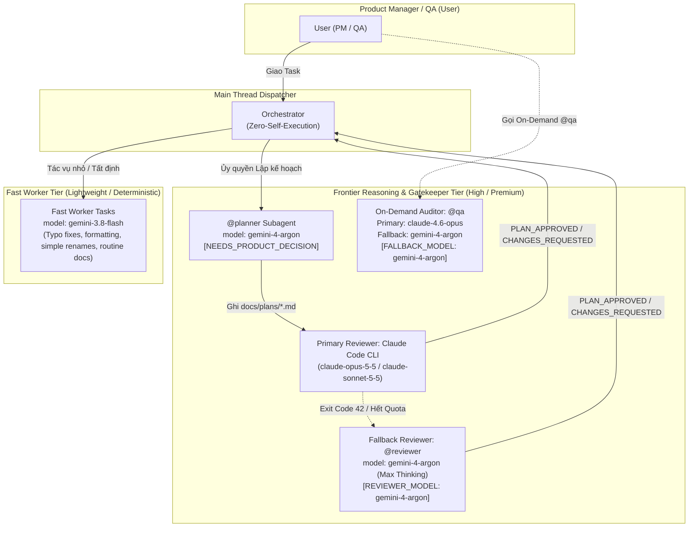

# Kế Hoạch Triển Khai: Cập Nhật Hệ Thống `.agents/` Nâng Cấp Model Gemini 4 Argon (`gemini-4-argon`) Cho Subagents & Tài Liệu Routing (Revision 1)

**Ngày**: 2026-10-14  
**Tác giả**: @planner (Technical Planner)  
**Trạng thái**: Ready for Review (Audit Run 1)  
**Môi trường thực thi**: Local Workspace (`wyemh/vikini`) — Governance & Documentation Only (Zero `src/` Code Touch)  
**Mục tiêu**: Nâng cấp hệ thống quản trị đa tác tử `.agents/` của dự án Vikini lên thế hệ mô hình suy luận tiên phong **Gemini 4 Argon (`gemini-4-argon`)** theo kiến trúc **Orchestrator–Worker Split**:

1. Nâng cấp cấu hình `model:` của subagent `@planner` (`.agents/agents/planner/agent.md`) từ `gemini-3.8-flash` sang `gemini-4-argon` (kèm ghi chú `[NEEDS_PRODUCT_DECISION]` cho phép Product Manager giữ Default Assumption `gemini-4-argon` hoặc tùy chọn `gemini-3.8-flash`).
2. Nâng cấp toàn diện subagent Fallback Reviewer `@reviewer` (`.agents/agents/reviewer/agent.md`) từ `gemini-3.8-flash` sang `gemini-4-argon` (trường `model:`, `description:`, mô tả kênh dự phòng Dual-Reviewer Architecture và nhãn minh bạch `[REVIEWER_MODEL: gemini-4-argon]`).
3. Nâng cấp Runtime Fallback Model của subagent `@qa` (`.agents/agents/qa/agent.md`) khi chạm quota từ `gemini-3.8-flash` sang `gemini-4-argon` (`[FALLBACK_MODEL: gemini-4-argon]`).
4. Đồng bộ quy tắc `.agents/rules/05-plan-review.md` (cả YAML frontmatter `description` và mục 3.2 Kênh Thẩm Định Dự Phòng) sang `gemini-4-argon`.
5. Cập nhật `.agents/rules/01-coding.md` tại mục `File Size & Modularity Guidelines` bổ sung `Gemini 4 Argon`.
6. Cập nhật `.agents/README.md` (Sơ đồ MAS Workflow và mục `4. Agent Task-to-Model Routing Guide` — Bảng 4.1 Ma Trận Phân Bổ Tác Vụ Sang Model Tier) áp dụng kiến trúc **Orchestrator–Worker Split** kết hợp giữa `gemini-4-argon` (tác vụ suy luận sâu: Planning, Reviewing fallback, Complex Feature/Debug, Unit/Integration Tests) và `gemini-3.8-flash` (Fast Worker cho các tác vụ nhẹ, sửa lỗi chính tả, format, cập nhật tài liệu).
7. Cập nhật living documentation bắt buộc tại `docs/CHANGELOG.md` và đảm bảo 100% các ràng buộc Governance (`<= 12,000` ký tự cho rules, `<= 10,000` ký tự cho agents, YAML frontmatter hợp lệ, relative path chuẩn, và `npm run verify` pass 100%).

---

## Technical Plan

### 1. Mục Tiêu (Goal)

Vào ngày 13/10/2026, Google DeepMind chính thức phát hành rộng rãi **Gemini 4 Argon** (định danh API: `gemini-4-argon`) — mô hình frontier reasoning đa phương thức với cửa sổ ngữ cảnh 1,000,000 tokens (1M), được tích hợp trực tiếp vào nền tảng **Google Antigravity** và thiết kế chuyên biệt cho các tác vụ kỹ thuật phần mềm dài hạn (long-horizon software engineering), phân tích kiến trúc đa tệp và tự động phát hiện lỗ hổng bảo mật.

Nhiệm vụ của kế hoạch này là nâng cấp tầng quản trị tác tử (`.agents/`) của dự án **Vikini** để tận dụng sức mạnh suy luận của `gemini-4-argon`, đồng thời thiết lập kiến trúc phân tầng **Orchestrator–Worker Split** hợp lý với `gemini-3.8-flash`:

1. **Nâng cấp năng lực suy luận của các Subagents cốt lõi**:
   - **`@reviewer` (`.agents/agents/reviewer/agent.md`)**: Khi kênh ưu tiên 1 (Claude Code CLI) chạm giới hạn phiên/quota (exit code `42`), kênh dự phòng `@reviewer` phải gánh vác toàn bộ quy trình thẩm định 7 bước, đối kháng 6 kịch bản Mental Simulation (S1–S6) và kiểm chứng bằng chứng (`[CMD]`, `[SRC]`, `[ADV]`, `[URL]`). Việc nâng cấp `@reviewer` từ `gemini-3.8-flash` lên `gemini-4-argon` (với thinking budget tối đa High/Max) bảo đảm chất lượng phản biện kiến trúc ngang tầm frontier model.
   - **`@qa` (`.agents/agents/qa/agent.md`)**: Nâng cấp Runtime Fallback Model khi `claude-4.6-opus` chạm HTTP 429/quota từ `gemini-3.8-flash` lên `gemini-4-argon` (`[FALLBACK_MODEL: gemini-4-argon]`), giúp duy trì độ chính xác cao trong Bước 4 (Deep Bug Hunting) và Bước 6 (Test Integrity Audit).
   - **`@planner` (`.agents/agents/planner/agent.md`)**: Nâng cấp `model:` từ `gemini-3.8-flash` lên `gemini-4-argon` (Default Assumption) để tăng chất lượng khảo sát codebase, thiết kế Test Contract và giảm thiểu số vòng lặp Revision Loop.
2. **Đồng bộ hóa Hệ thống Quy tắc & Tài liệu Định tuyến (`.agents/rules/` & `.agents/README.md`)**:
   - Cập nhật `.agents/rules/05-plan-review.md` (frontmatter `description` và mục 3.2) phản ánh chính xác Fallback Reviewer chạy `gemini-4-argon`.
   - Cập nhật `.agents/rules/01-coding.md` (mục `File Size & Modularity Guidelines`) ghi nhận `Gemini 4 Argon` trong nhóm mô hình tiêu chuẩn tối ưu độ dài file (150–500 dòng).
   - Thiết kế lại Bảng `4.1. Ma Trận Phân Bổ Tác Vụ Sang Model Tier` trong `.agents/README.md` theo mô hình **Orchestrator–Worker Split**: phân tách rõ nhóm tác vụ đòi hỏi suy luận sâu (`gemini-4-argon` / `claude-opus-5-5` / `claude-sonnet-5-5`) và nhóm tác vụ thực thi nhanh, tất định (`gemini-3.8-flash`).
3. **Bảo toàn Ranh giới Kiến trúc (Zero Application Code Mutation)**:
   - Tuyệt đối **KHÔNG** chạm vào bất kỳ file mã nguồn ứng dụng nào trong `src/` (`src/app/`, `src/lib/`, `src/components/`), cấu hình build (`package.json`, `tsconfig.json`, `eslint.config.mjs`) hay cơ sở dữ liệu (`supabase/`).

---

### 2. Tài Liệu Cần Tham Chiếu (Pre-Work Reading)

Tuân thủ nghiêm ngặt bảng **Pre-Work Protocol** tại `.agents/rules/02-quality.md`:

| STT | Tài liệu / Quy chuẩn           | Đường dẫn                                                                                                                             | Trọng tâm kiểm tra & Đối chiếu                                                                                                                                       |
| :-- | :----------------------------- | :------------------------------------------------------------------------------------------------------------------------------------ | :------------------------------------------------------------------------------------------------------------------------------------------------------------------- |
| 1   | **Core Rules**                 | `.agents/rules/00-core.md`                                                                                                            | Giao thức giao tiếp Tiếng Việt, nguyên tắc Minimal Diffs, Only touch files required by the task, Zero-Self-Execution.                                                |
| 2   | **Coding Standards**           | `.agents/rules/01-coding.md`                                                                                                          | Mục `File Size & Modularity Guidelines` (dòng 91–96) cần bổ sung `Gemini 4 Argon`.                                                                                   |
| 3   | **Quality Gates & Governance** | `.agents/rules/02-quality.md`                                                                                                         | Mục `Governance-Only Changes` (dòng 97–107): YAML frontmatter hợp lệ, chuẩn GFM, relative path từ repo root, giới hạn ký tự Rules `<= 12,000` và Agents `<= 10,000`. |
| 4   | **Plan Review Protocol**       | `.agents/rules/05-plan-review.md`                                                                                                     | Cấu trúc 2 phần (`## Technical Plan` & `## Audit History`), Dual-Reviewer Architecture (dòng 3, 39–42), Code Freeze Guard.                                           |
| 5   | **Planner Subagent Config**    | `.agents/agents/planner/agent.md`                                                                                                     | Cấu hình frontmatter `model: gemini-3.8-flash` (dòng 4) và quy định `[NEEDS_PRODUCT_DECISION]` (dòng 76–77).                                                         |
| 6   | **Reviewer Subagent Config**   | `.agents/agents/reviewer/agent.md`                                                                                                    | Cấu hình frontmatter `description` (dòng 3), `model` (dòng 4) và mục `Dual-Reviewer Architecture` (dòng 82–87).                                                      |
| 7   | **Reviewer Satellite Docs**    | `.agents/agents/reviewer/allowlist.md`<br>`.agents/agents/reviewer/evidence-bar.md`<br>`.agents/agents/reviewer/mental-simulation.md` | Allowlist lệnh read-only, tiêu chuẩn bằng chứng `[CMD]`/`[SRC]`/`[ADV]`/`[URL]`, Negative Probe (§4.5.3), Risk Table Audit (§4.5.4) và 6 kịch bản S1–S6.             |
| 8   | **QA Subagent Config**         | `.agents/agents/qa/agent.md`                                                                                                          | Mục `Cơ Chế Runtime Fallback Model` (dòng 131–137).                                                                                                                  |
| 9   | **MAS Governance Hub**         | `.agents/README.md`                                                                                                                   | Sơ đồ MAS Workflow (dòng 24) và mục `4. Agent Task-to-Model Routing Guide` (dòng 85–105).                                                                            |
| 10  | **App Models Catalog**         | `docs/models.md`                                                                                                                      | Kiểm tra tham chiếu chéo: dòng 7 dẫn link `../.agents/README.md#agent-task-to-model-routing` (không chứa model ID cứng của subagent).                                |

---

### 3. Assumptions & Cross-Task Dependencies

#### 3.1. Các Giả Định Kỹ Thuật & Rà Soát Toàn Diện `.agents/` (Assumptions)

1. **Kết Quả Quét Toàn Diện `.agents/` & `docs/models.md` (`[CMD]` & `[SRC]`)**:
   - Đã thực thi lệnh quét toàn bộ cây thư mục `.agents/` (`rules/`, `agents/`, `workflows/`, `scripts/`, `skills/`, `README.md`):
     - Các file trong `.agents/workflows/` (`audit.md`, `debug.md`, `post-fix.md`) và `.agents/scripts/` (`code-freeze-guard.js`, `run-claude.ps1`, `claude-reviewer-prompt.md`) **không chứa** bất kỳ tham chiếu nào tới `gemini-3.8-flash` hay `Gemini 3.1 Pro` (`[SRC]` `.agents/workflows/audit.md:1-55`, `.agents/scripts/run-claude.ps1:1-111`, `.agents/scripts/claude-reviewer-prompt.md:1-40`).
     - File `docs/models.md` là danh mục mô hình AI phục vụ người dùng cuối của ứng dụng chat Vikini; tại dòng 7 chỉ chứa liên kết điều hướng sang `../.agents/README.md#agent-task-to-model-routing` và không hardcode tên model của subagent (`[SRC]` `docs/models.md:6-8`). Do đó, tuân thủ nguyên tắc **Minimal Diffs** (`.agents/rules/02-quality.md:142-146`), kế hoạch không chỉnh sửa `docs/models.md`, `.agents/workflows/*.md` hay `.agents/scripts/*`.

2. **Quyết Định Kiến Trúc Cho `@planner` Model (`[NEEDS_PRODUCT_DECISION]`)**:
   - Trong kiến trúc **Orchestrator–Worker Split**, có 2 phương án cấu hình trường `model:` tại `.agents/agents/planner/agent.md:4`:
     - **Phương án A (Default Assumption — Được chọn trong kế hoạch này)**: Nâng cấp `@planner` từ `gemini-3.8-flash` lên **`gemini-4-argon`**.
       - _Cơ sở kỹ thuật_: `@planner` phải khảo sát đa tệp, phân tích ranh giới kiến trúc 4 tầng, thiết kế Test Contract chặt chẽ và dự phóng 6 kịch bản đối kháng S1–S6 trước khi gửi sang Lead Reviewer. Theo nguyên tắc Cost Awareness tại `.agents/README.md:102-103` (`Correctness > Cost savings` — chi phí token phát sinh chủ yếu từ vòng lặp retry/revision), việc dùng `gemini-4-argon` ngay từ khâu lập kế hoạch giúp giảm mạnh số vòng lặp `Audit Run`.
     - **Phương án B (Alternative)**: Giữ `@planner` ở `gemini-3.8-flash` (max thinking) như một Fast Planner và chỉ dùng `gemini-4-argon` cho `@reviewer` fallback và `@qa` fallback.
   - Gắn thẻ **`[NEEDS_PRODUCT_DECISION]`**: Kế hoạch mặc định triển khai **Phương án A (`model: gemini-4-argon`)** để chuỗi thẩm định tự động không bị gián đoạn (`.agents/agents/planner/agent.md:76-77`). Khi duyệt kế hoạch để mở khóa code, Product Manager (User) có thể giữ nguyên Phương án A hoặc chỉ định Phương án B.

3. **Tương Tác Với Code Freeze Guard (`.agents/scripts/code-freeze-guard.js`)**:
   - Theo hàm `isGovernanceFile(relative)` tại `.agents/scripts/code-freeze-guard.js:288-291` và nhánh kiểm tra số 7 tại dòng `475-484`, mọi thao tác `write_to_file` / `replace_file_content` vào `.agents/**` luôn trả về `decision: "ask"` ngay cả sau khi kế hoạch đã có `[PLAN_APPROVED]`.
   - Ngược lại, thao tác ghi vào `docs/plans/**`, `docs/CHANGELOG.md` và artifact `implementation_plan.md` nằm trong `UNFROZEN_PREFIXES` (`docs/`) và `isAntigravityArtifact()`, được phép ghi tự động (`decision: "allow"`).
   - Do đó, ở giai đoạn thực thi (sau khi nhận `[PLAN_APPROVED]` và được PM đồng ý triển khai), Orchestrator sẽ thực hiện chỉnh sửa 6 file trong `.agents/` (kích hoạt hộp thoại xác nhận `ask` của nền tảng để User/PM bấm chấp thuận) và 1 file `docs/CHANGELOG.md`.

4. **Định Lượng Dung Lượng Ký Tự (Character Budget Headroom)**:
   - Qua kiểm chứng thực tế bằng Node.js (`[CMD]`), toàn bộ các file mục tiêu đều có dung lượng cách rất xa trần giới hạn của `.agents/rules/02-quality.md:104-106`:
     - `.agents/agents/planner/agent.md`: `6,402` chars ➔ sau sửa: `6,400` chars (Trần: `10,000` chars — dư `3,600` chars).
     - `.agents/agents/reviewer/agent.md`: `4,985` chars ➔ sau sửa: `4,979` chars (Trần: `10,000` chars — dư `5,021` chars).
     - `.agents/agents/qa/agent.md`: `7,296` chars ➔ sau sửa: `7,292` chars (Trần: `10,000` chars — dư `2,708` chars).
     - `.agents/rules/05-plan-review.md`: `7,315` chars ➔ sau sửa: `7,315` chars (Trần: `12,000` chars — dư `4,685` chars).
     - `.agents/rules/01-coding.md`: `9,423` chars ➔ sau sửa: `9,446` chars (Trần: `12,000` chars — dư `2,554` chars).

#### 3.2. Sơ Đồ Kiến Trúc Phân Bổ Mô Hình (Orchestrator–Worker Split Architecture)



---

### 4. Bảng Verified Versions (Tra Cứu Thực Tế Năm 2026)

| Tên Mô Hình / Thư Viện     | Phiên Bản / Định Danh (2026)                                | Vai Trò & Đặc Tính Kỹ Thuật Đã Xác Minh                                                                                                                                                                                                        | Nguồn Xác Thực (`[URL]` / `[CMD]` / `[SRC]`)                                                               |
| :------------------------- | :---------------------------------------------------------- | :--------------------------------------------------------------------------------------------------------------------------------------------------------------------------------------------------------------------------------------------- | :--------------------------------------------------------------------------------------------------------- |
| **Gemini 4 Argon**         | `gemini-4-argon`                                            | Mô hình frontier reasoning chủ lực của Google DeepMind (phát hành rộng rãi 13/10/2026), hỗ trợ 1M context window, tích hợp trực tiếp vào Google Antigravity, chuyên biệt cho lập kế hoạch kiến trúc, thẩm định mã nguồn và vá lỗ hổng bảo mật. | `[URL]` `https://blog.google` / `https://ai.google.dev/gemini-api/docs/models` / `https://deepmind.google` |
| **Gemini 3.8 Flash**       | `gemini-3.8-flash`                                          | Mô hình Flash-tier hiệu năng cao của Google (phát hành 09/2026), tối ưu tốc độ phản hồi và chi phí cho các tác vụ Fast Worker, chỉnh sửa nhỏ và cập nhật tài liệu thường quy.                                                                  | `[URL]` `https://ai.google.dev/gemini-api/docs/models`                                                     |
| **Claude Code CLI Models** | `claude-opus-5-5` / `claude-sonnet-5-5` / `claude-4.6-opus` | Các mô hình Anthropic Claude vận hành qua Claude Code CLI (`run-claude.ps1`) cho Primary Reviewer và mô hình mặc định của `@qa`.                                                                                                               | `[SRC]` `.agents/rules/05-plan-review.md:35`, `.agents/agents/qa/agent.md:4`                               |
| **`@google/genai`**        | `^2.10.0`                                                   | Google Gen AI SDK chính thức cho Node.js/TypeScript đang cài đặt trong dự án Vikini.                                                                                                                                                           | `[SRC]` `package.json:40` & `[URL]` `https://ai.google.dev`                                                |
| **Next.js**                | `^16.4.0`                                                   | Framework React Full-stack (App Router, Cache Components, `allowedDevOrigins`).                                                                                                                                                                | `[SRC]` `package.json:64` & `[URL]` `https://nextjs.org/blog`                                              |
| **Vitest**                 | `^4.1.11`                                                   | Framework kiểm thử đơn vị và tích hợp (112 test files, 1,201 tests).                                                                                                                                                                           | `[SRC]` `package.json:117` & `[URL]` `https://github.com/vitest-dev/vitest/releases`                       |
| **TypeScript**             | `^5.9.3`                                                    | Trình biên dịch kiểm tra kiểu tĩnh nghiêm ngặt (`strict: true`, `noEmit: true`).                                                                                                                                                               | `[SRC]` `package.json:115` & `[URL]` `https://www.typescriptlang.org`                                      |
| **ESLint**                 | `^9.39.2`                                                   | Công cụ kiểm tra chất lượng mã nguồn theo chuẩn Flat Config (`eslint.config.mjs`).                                                                                                                                                             | `[SRC]` `package.json:101` & `[URL]` `https://eslint.org/blog/`                                            |
| **Node.js Runtime**        | `v24.12.0` (engines `24.x`)                                 | Môi trường runtime thực thi các script kiểm chứng và hook `code-freeze-guard.js`.                                                                                                                                                              | `[SRC]` `package.json:120`                                                                                 |

---

### 5. Files Cần Chỉnh Sửa / Tạo Mới

> [!IMPORTANT]
> Kế hoạch này **CHỈ** sửa đổi 6 file quản trị trong `.agents/` và 1 file living documentation `docs/CHANGELOG.md` (cùng việc tạo mới chính file kế hoạch này). Tuyệt đối **KHÔNG** có bất kỳ file nào trong `src/` bị tác động.

| Thao Tác       | Đường Dẫn File                                                               | Mục Đích & Phạm Vi Thay Đổi Cụ Thể                                                                                                                                                                                                                                                                                                         |
| :------------- | :--------------------------------------------------------------------------- | :----------------------------------------------------------------------------------------------------------------------------------------------------------------------------------------------------------------------------------------------------------------------------------------------------------------------------------------- |
| **`[MODIFY]`** | `.agents/agents/planner/agent.md`                                            | Nâng cấp trường frontmatter `model: gemini-3.8-flash` (dòng 4) thành `model: gemini-4-argon` (theo Default Assumption của `[NEEDS_PRODUCT_DECISION]`).                                                                                                                                                                                     |
| **`[MODIFY]`** | `.agents/agents/reviewer/agent.md`                                           | 1. Cập nhật `description:` (dòng 3) từ `(Gemini 3.8 Flash)` sang `(Gemini 4 Argon)`.<br>2. Cập nhật `model:` (dòng 4) từ `gemini-3.8-flash` sang `gemini-4-argon`.<br>3. Cập nhật mục `Dual-Reviewer Architecture` (dòng 85–86): đổi mô hình kênh dự phòng sang `gemini-4-argon` và nhãn bắt buộc sang `[REVIEWER_MODEL: gemini-4-argon]`. |
| **`[MODIFY]`** | `.agents/agents/qa/agent.md`                                                 | Cập nhật mục `Cơ Chế Runtime Fallback Model` (dòng 134, 136): đổi mô hình fallback khi chạm quota HTTP 429 từ `gemini-3.8-flash` sang `gemini-4-argon` và nhãn `[FALLBACK_MODEL: gemini-4-argon]`.                                                                                                                                         |
| **`[MODIFY]`** | `.agents/rules/05-plan-review.md`                                            | 1. Cập nhật YAML frontmatter `description:` (dòng 3) từ `Gemini Flash subagent fallback` sang `Gemini 4 Argon subagent fallback`.<br>2. Cập nhật mục `3.2. Kênh Thẩm Định Dự Phòng` (dòng 41) từ `gemini-3.8-flash` sang `gemini-4-argon`.                                                                                                 |
| **`[MODIFY]`** | `.agents/rules/01-coding.md`                                                 | Cập nhật ghi chú tại mục `File Size & Modularity Guidelines` (dòng 93) từ `(Claude Opus 4.6, Gemini 3.1 Pro)` thành `(Claude Opus 4.6 / 5.5, Gemini 4 Argon, Gemini 3.1 Pro)`.                                                                                                                                                             |
| **`[MODIFY]`** | `.agents/README.md`                                                          | 1. Cập nhật sơ đồ ASCII MAS Workflow (dòng 24) làm rõ `(Claude Opus 5.5 CLI / Fallback Gemini 4 Argon)`.<br>2. Cập nhật mục `4. Agent Task-to-Model Routing Guide` (Bảng 4.1 và mục 4.2, dòng 89–105) áp dụng kiến trúc **Orchestrator–Worker Split** phân định rõ vai trò của `gemini-4-argon` và `gemini-3.8-flash`.                     |
| **`[MODIFY]`** | `docs/CHANGELOG.md`                                                          | Bổ sung bản ghi Living Documentation ở đầu file ghi nhận đợt nâng cấp hệ thống `.agents/` lên `gemini-4-argon`.                                                                                                                                                                                                                            |
| **`[NEW]`**    | `docs/plans/2026-10-14-agents-gemini-4-argon-upgrade-implementation-plan.md` | File kế hoạch triển khai chi tiết (file hiện tại).                                                                                                                                                                                                                                                                                         |

---

### 6. Các Bước Thực Hiện Tuần Tự (Checklist)

> [!CAUTION]
> **Ràng buộc Code Freeze (`.agents/rules/05-plan-review.md`)**: Toàn bộ các bước từ Bước 1 đến Bước 8 dưới đây CHỈ ĐƯỢC PHÉP thực thi sau khi file kế hoạch này nhận được thẻ `[PLAN_APPROVED]` ở dòng cuối cùng từ Lead Reviewer và được Product Manager (User) phê duyệt triển khai.

- [ ] **Bước 1: Cập nhật cấu hình Subagent `@planner` (`.agents/agents/planner/agent.md`) `[NEEDS_PRODUCT_DECISION]`**
  - [ ] 1.1. Dùng `replace_file_content` cập nhật dòng 1–6 của `.agents/agents/planner/agent.md`:
    ```yaml
    ---
    name: planner
    description: Technical Planner agent for codebase survey, online tech research, and task implementation planning in Vikini.
    model: gemini-4-argon
    role: Technical Planner
    ```
    _(Lưu ý: Nếu Product Manager chọn Phương án B khi duyệt plan, giữ nguyên `model: gemini-3.8-flash`)._

- [ ] **Bước 2: Cập nhật cấu hình Subagent Fallback Reviewer `@reviewer` (`.agents/agents/reviewer/agent.md`)**
  - [ ] 2.1. Dùng `replace_file_content` cập nhật YAML frontmatter tại dòng 1–6 của `.agents/agents/reviewer/agent.md`:
    ```yaml
    ---
    name: reviewer
    description: Fallback Lead Architecture Reviewer agent (Gemini 4 Argon) for plan approval when Claude CLI exceeds quota.
    model: gemini-4-argon
    role: Fallback Lead Architecture Reviewer
    ```
  - [ ] 2.2. Dùng `replace_file_content` cập nhật mục `## Cơ Chế Phân Công Reviewer (Dual-Reviewer Architecture)` tại dòng 82–87 của `.agents/agents/reviewer/agent.md`:

    ```markdown
    ## Cơ Chế Phân Công Reviewer (Dual-Reviewer Architecture)

    - **Kênh Ưu Tiên 1 (Primary)**: Claude Code CLI (`run-claude.ps1`) tận dụng Claude Opus 5.5 / Sonnet với tài khoản Claude Pro của người dùng.
    - **Kênh Dự Phòng (Fallback)**: Subagent `@reviewer` chạy mô hình `gemini-4-argon` với thinking budget tối đa (High/Max). Tự động kích hoạt khi Claude CLI hết quota hoặc gặp lỗi 429/401.
    - Khi hoạt động, Reviewer **BẮT BUỘC hiển thị nhãn `[REVIEWER_MODEL: gemini-4-argon]`** ở đầu báo cáo để bảo đảm tính minh bạch.
    ```

- [ ] **Bước 3: Cập nhật cấu hình Runtime Fallback của Subagent `@qa` (`.agents/agents/qa/agent.md`)**
  - [ ] 3.1. Dùng `replace_file_content` cập nhật mục `## Cơ Chế Runtime Fallback Model` tại dòng 131–137 của `.agents/agents/qa/agent.md`:

    ```markdown
    ## Cơ Chế Runtime Fallback Model

    - Mô hình mặc định là `claude-4.6-opus`.
    - Khi chạm quota hoặc rate limit (HTTP 429), Orchestrator fallback sang `gemini-4-argon` với thinking budget tối đa (High/Max).
    - Khi fallback, BẮT BUỘC ghi rõ ở đầu báo cáo:
      `⚠️ QA report này chạy trên model fallback [FALLBACK_MODEL: gemini-4-argon]. Kết quả có thể cần xác minh bổ sung.`
    ```

- [ ] **Bước 4: Cập nhật quy tắc `.agents/rules/05-plan-review.md`**
  - [ ] 4.1. Dùng `replace_file_content` cập nhật YAML frontmatter tại dòng 1–4 của `.agents/rules/05-plan-review.md`:
    ```yaml
    ---
    trigger: always_on
    description: Multi-agent Plan-Review-Revise Loop protocol, strict code freeze, platform hook guard, zero-self-execution, uninterrupted chain, pre-flight gate, severity rubric, and dual-reviewer architecture (Claude CLI primary + Gemini 4 Argon subagent fallback).
    ---
    ```
  - [ ] 4.2. Dùng `replace_file_content` cập nhật mục `3.2. Kênh Thẩm Định Dự Phòng` tại dòng 39–42 của `.agents/rules/05-plan-review.md`:
    ```markdown
    2. **Kênh Thẩm Định Dự Phòng (Fallback Reviewer - Subagent `@reviewer`)**:
       - Khi Claude CLI hết quota Claude Pro (script trả về exit code `42` hoặc `[CLAUDE_PRO_QUOTA_EXCEEDED]`) hoặc gặp sự cố kết nối:
       - Orchestrator **tự động chuyển giao ngay lập tức** sang subagent `@reviewer` (chạy mô hình `gemini-4-argon` với thinking budget tối đa).
       - Subagent `@reviewer` thực hiện thẩm định 7 bước chuẩn mực theo đúng bộ 3 tài liệu vệ tinh trong `.agents/agents/reviewer/`.
    ```

- [ ] **Bước 5: Cập nhật quy tắc `.agents/rules/01-coding.md`**
  - [ ] 5.1. Dùng `replace_file_content` cập nhật blockquote tại mục `## File Size & Modularity Guidelines` (dòng 91–96) của `.agents/rules/01-coding.md`:

    ```markdown
    ## File Size & Modularity Guidelines

    > Optimized for AI agent comprehension (Claude Opus 4.6 / 5.5, Gemini 4 Argon, Gemini 3.1 Pro).
    > Industry consensus (2026): **150–500 lines/file** is the sweet spot.
    > Primary metric: **Single Responsibility Principle**. Line count is a heuristic, not a hard rule.
    ```

- [ ] **Bước 6: Cập nhật `.agents/README.md` (MAS Workflow & Agent Task-to-Model Routing Guide)**
  - [ ] 6.1. Dùng `replace_file_content` cập nhật dòng 23–25 trong sơ đồ ASCII mục `1. Kiến Trúc Phối Hợp Đa Tác Tử (MAS Workflow)` của `.agents/README.md`:
    ```text
                             [ Lead Architecture Reviewer ]
                    (Claude Opus 5.5 CLI / Fallback Gemini 4 Argon)
                                      │
    ```
  - [ ] 6.2. Dùng `replace_file_content` cập nhật mục `## 4. Agent Task-to-Model Routing Guide` (dòng 85–105) của `.agents/README.md` theo kiến trúc **Orchestrator–Worker Split**:

    ```markdown
    ## 4. Agent Task-to-Model Routing Guide

    Hướng dẫn lựa chọn mô hình trí tuệ nhân tạo tối ưu chi phí và năng lực cho từng nhóm tác vụ của agent theo kiến trúc **Orchestrator–Worker Split**:

    ### 4.1. Ma Trận Phân Bổ Tác Vụ Sang Model Tier

    | Nhóm Tác Vụ                                   | Khuyến Nghị Model Tier | Mô Hình Cụ Thể (2026)                                           | Cơ Sở Lựa Chọn                                                                         |
    | :-------------------------------------------- | :--------------------: | :-------------------------------------------------------------- | :------------------------------------------------------------------------------------- |
    | **Lập kế hoạch kiến trúc (Planning)**         |    High / Thinking     | `gemini-4-argon` (max thinking) / `claude-opus-5-5`             | Cần khả năng tổng hợp ngữ cảnh rộng (1M context) và suy luận chiến lược sâu đa tầng.   |
    | **Thẩm định & Review (Reviewing)**            |     Premium / Full     | `claude-opus-5-5` (Claude Pro CLI) / Fallback: `gemini-4-argon` | Yêu cầu đối kháng logic khắt khe (S1–S6), phát hiện edge cases và lỗi kiến trúc.       |
    | **Phát triển tính năng & Debug phức tạp**     |       Full Model       | `gemini-4-argon` / `claude-sonnet-5-5` / `gemini-3.8-flash`     | Cần phân tích luồng dữ liệu đa tệp, xử lý race conditions và logic nghiệp vụ phức tạp. |
    | **Viết Unit Tests & Integration Tests**       |       Full Model       | `gemini-4-argon` / `gemini-3.8-flash` / `claude-sonnet-5-5`     | Đòi hỏi hiểu sâu boundary conditions, Test Contract và chống specification gaming.     |
    | **Sửa lỗi chính tả, format, rename đơn giản** |    Smaller / Light     | `gemini-3.8-flash` (Fast Worker — low/minimal thinking)         | Thao tác tất định, có khuôn mẫu rõ ràng, phản hồi tức thì, không cần suy luận sâu.     |
    | **Cập nhật tài liệu văn bản thông thường**    |     Smaller Model      | `gemini-3.8-flash` (Fast Worker)                                | Sinh văn bản mô tả chuẩn hóa, độ phức tạp logic thấp, tối ưu chi phí token.            |

    ### 4.2. Nguyên Tắc Orchestrator–Worker Split & Nhận Thức Chi Phí (Cost Awareness)

    - **Phân tách Orchestrator / Deep Reasoning vs. Fast Worker**: Sử dụng `gemini-4-argon` (hoặc `claude-opus-5-5`) cho các tác vụ đòi hỏi suy luận kiến trúc, thẩm định kế hoạch (`@reviewer` fallback) và kiểm toán chất lượng (`@qa` fallback); sử dụng `gemini-3.8-flash` làm Fast Worker cho các tác vụ thực thi nhẹ, có tính tất định cao.
    - **Mặc định dùng Full Model khi chưa rõ ràng**: Tính đúng đắn của giải pháp luôn được ưu tiên hơn tiết kiệm chi phí (`Correctness > Cost savings`).
    - **Chi phí phát sinh chủ yếu từ vòng lặp retry**: Việc chọn mô hình quá yếu dẫn đến thất bại kiểm thử nhiều lần (fix ➔ verify ➔ fail ➔ fix) sẽ tốn kém token và thời gian gấp nhiều lần so với việc hoàn thành chuẩn xác ngay từ lượt đầu bằng Full Model (`gemini-4-argon`).
    - **Tuyệt đối không dùng mô hình yếu cho phần nhạy cảm**: Các tác vụ liên quan đến bảo mật (Auth, RLS, Crypto, Migration) bắt buộc phải sử dụng Full Model.
    ```

- [ ] **Bước 7: Cập nhật Living Documentation (`docs/CHANGELOG.md`)**
  - [ ] 7.1. Dùng `replace_file_content` bổ sung mục mới vào đầu `docs/CHANGELOG.md` (ngay trên mục `## 2026-10-12: Tooling & CI/Vercel Hardening`):

    ```markdown
    ## 2026-10-14: Governance -- Upgrade .agents/ Subagents & Task-to-Model Routing to Gemini 4 Argon (`gemini-4-argon`)

    - **Subagent Model Upgrades (`.agents/agents/`)**:
      - Nâng cấp `@planner` (`.agents/agents/planner/agent.md`) lên `gemini-4-argon` nhằm tăng cường năng lực khảo sát kiến trúc đa tệp, thiết kế Test Contract và giảm số vòng lặp Revision Loop.
      - Nâng cấp Fallback Reviewer `@reviewer` (`.agents/agents/reviewer/agent.md`) từ `gemini-3.8-flash` lên `gemini-4-argon` (cập nhật YAML frontmatter `model`, `description`, mô tả kênh dự phòng Dual-Reviewer Architecture và nhãn minh bạch `[REVIEWER_MODEL: gemini-4-argon]`).
      - Nâng cấp Runtime Fallback Model của `@qa` (`.agents/agents/qa/agent.md`) khi chạm giới hạn quota (HTTP 429) từ `gemini-3.8-flash` lên `gemini-4-argon` (`[FALLBACK_MODEL: gemini-4-argon]`).
    - **Governance Rules & Orchestrator–Worker Routing Guide (`.agents/rules/`, `.agents/README.md`)**:
      - Đồng bộ quy tắc `.agents/rules/05-plan-review.md` (YAML frontmatter `description` và mục 3.2 Kênh Thẩm Định Dự Phòng) sang `gemini-4-argon`.
      - Cập nhật `.agents/rules/01-coding.md` (§ File Size & Modularity Guidelines) bổ sung `Gemini 4 Argon`.
      - Cập nhật `.agents/README.md` (§1 MAS Workflow & §4 Agent Task-to-Model Routing Guide) áp dụng kiến trúc **Orchestrator–Worker Split**: phân bổ `gemini-4-argon` cho Planning, Reviewing fallback, Complex Feature/Debug, Unit/Integration Tests; giữ `gemini-3.8-flash` làm Fast Worker cho các tác vụ nhẹ, sửa lỗi chính tả, format và cập nhật tài liệu thông thường.
    ```

- [ ] **Bước 8: Định dạng Prettier Scoped & Chạy Verification Suite Toàn Diện**
  - [ ] 8.1. Kiểm tra định dạng Markdown trên đúng 7 file vừa chỉnh sửa (không chạm các file ngoài phạm vi):
    ```powershell
    npx prettier --write .agents/agents/planner/agent.md .agents/agents/reviewer/agent.md .agents/agents/qa/agent.md .agents/rules/05-plan-review.md .agents/rules/01-coding.md .agents/README.md docs/CHANGELOG.md
    ```
  - [ ] 8.2. Chạy Governance Verification Probe (kiểm tra giới hạn ký tự, YAML frontmatter, đồng bộ model ID và link integrity) theo Mục 8.2.
  - [ ] 8.3. Chạy Verification Gate Tier 2 bắt buộc:
    ```powershell
    npm run verify
    ```
    Xác nhận: `type-check` (0 lỗi), `lint` (0 lỗi, 0 cảnh báo), `test:run` (112/112 test files passed, 1,201/1,201 tests passed).

---

### 7. Test Contract (Hợp Đồng Kiểm Thử Bắt Buộc)

Để chống **specification gaming** và làm cơ sở đối soát khách quan cho `@reviewer` và `@qa`, mọi thay đổi trong task này bắt buộc phải thỏa mãn 6 hợp đồng kiểm thử (invariants) dưới đây:

| ID        | Tên Hợp Đồng (Invariant)                                              | Đầu Vào (Input)                                                                                                                                     | Hành Vi & Kết Quả Mong Đợi (Expected Output)                                                                                                                                                                                                                                                                                                                                                                                                                                                                                                                                              | Failure Modes & Điều Kiện Biên (Boundary Conditions)                                                                                                                                          |
| :-------- | :-------------------------------------------------------------------- | :-------------------------------------------------------------------------------------------------------------------------------------------------- | :---------------------------------------------------------------------------------------------------------------------------------------------------------------------------------------------------------------------------------------------------------------------------------------------------------------------------------------------------------------------------------------------------------------------------------------------------------------------------------------------------------------------------------------------------------------------------------------- | :-------------------------------------------------------------------------------------------------------------------------------------------------------------------------------------------- |
| **TC-01** | **YAML Frontmatter Schema & Model ID Accuracy**                       | Đọc nội dung 3 file `.agents/agents/{planner,reviewer,qa}/agent.md` và 6 file `.agents/rules/*.md`.                                                 | 1. Tất cả 9 file bắt đầu bằng khối `---\n...\n---` hợp lệ.<br>2. Các file agent có đủ khóa bắt buộc: `name`, `description`, `model`, `role`, `mainAgent`, `subagent`, `tools`.<br>3. `.agents/agents/planner/agent.md` có `model: gemini-4-argon` (hoặc `gemini-3.8-flash` nếu PM chọn Option B).<br>4. `.agents/agents/reviewer/agent.md` có `model: gemini-4-argon` và `description` chứa `(Gemini 4 Argon)`.<br>5. `.agents/agents/qa/agent.md` giữ nguyên `model: claude-4.6-opus`.<br>6. `.agents/rules/05-plan-review.md` có `description` chứa `Gemini 4 Argon subagent fallback`. | - Thiếu dấu đóng `---` hoặc lỗi cú pháp YAML ➔ **FAIL (`[BLOCKER]`)**.<br>- Còn sót `model: gemini-3.8-flash` trong `reviewer/agent.md` ➔ **FAIL (`[MAJOR]`)**.                               |
| **TC-02** | **Strict Character Limit Compliance (`.agents/rules/02-quality.md`)** | Đo độ dài chuỗi UTF-8 (`fs.readFileSync(f, 'utf8').length`) của toàn bộ `.agents/rules/*.md` và `.agents/agents/*/agent.md`.                        | - Mọi file trong `.agents/rules/*.md` BẮT BUỘC `<= 12,000` ký tự.<br>- Mọi file trong `.agents/agents/*/agent.md` BẮT BUỘC `<= 10,000` ký tự.                                                                                                                                                                                                                                                                                                                                                                                                                                             | - Bất kỳ file rule nào `>= 12,001` ký tự hoặc file agent nào `>= 10,001` ký tự ➔ **FAIL (`[MAJOR]`)**.<br>- Boundary: `12,000` (PASS) vs `12,001` (FAIL); `10,000` (PASS) vs `10,001` (FAIL). |
| **TC-03** | **Transparency Tags & Fallback Consistency**                          | Quét nội dung `.agents/agents/reviewer/agent.md`, `.agents/agents/qa/agent.md`, `.agents/rules/05-plan-review.md`, và `.agents/rules/01-coding.md`. | 1. `reviewer/agent.md` chứa chính xác nhãn `[REVIEWER_MODEL: gemini-4-argon]` và không còn chứa `gemini-3.8-flash`.<br>2. `qa/agent.md` chứa chính xác nhãn `[FALLBACK_MODEL: gemini-4-argon]` và không còn chứa `gemini-3.8-flash`.<br>3. `05-plan-review.md` chứa `gemini-4-argon` tại mục 3.2 và không còn chứa `gemini-3.8-flash`.<br>4. `01-coding.md` chứa `Gemini 4 Argon` tại mục `File Size & Modularity Guidelines`.                                                                                                                                                            | - Còn sót chuỗi `gemini-3.8-flash` trong `reviewer/agent.md`, `qa/agent.md` hoặc `05-plan-review.md` ➔ **FAIL (`[MAJOR]`)**.                                                                  |
| **TC-04** | **Orchestrator–Worker Split Routing Matrix (`.agents/README.md`)**    | Đọc mục `4. Agent Task-to-Model Routing Guide` trong `.agents/README.md`.                                                                           | - Bảng 4.1 phân bổ rõ `gemini-4-argon` cho 4 nhóm tác vụ nặng (Planning, Reviewing fallback, Phát triển tính năng & Debug phức tạp, Viết Unit/Integration Tests).<br>- Giữ `gemini-3.8-flash` làm Fast Worker cho 2 nhóm tác vụ nhẹ (Sửa lỗi chính tả/format/rename đơn giản, Cập nhật tài liệu văn bản thông thường).                                                                                                                                                                                                                                                                    | - Xóa mất hoàn toàn `gemini-3.8-flash` khỏi bảng routing (vi phạm kiến trúc Orchestrator–Worker Split) hoặc thiếu `gemini-4-argon` ➔ **FAIL (`[MAJOR]`)**.                                    |
| **TC-05** | **Zero Application Source Code Mutation & Living Docs**               | Kiểm tra `git status --porcelain` và đọc `docs/CHANGELOG.md`.                                                                                       | 1. Không có bất kỳ file nào trong `src/`, `package.json`, `supabase/` bị sửa đổi.<br>2. `docs/CHANGELOG.md` có mục mới ngày `2026-10-14` mô tả đầy đủ đợt nâng cấp `gemini-4-argon`.                                                                                                                                                                                                                                                                                                                                                                                                      | - Có bất kỳ diff nào trong `src/**` ➔ **FAIL (`[BLOCKER]`)**.<br>- Thiếu cập nhật `docs/CHANGELOG.md` ➔ **FAIL (`[MAJOR]`)**.                                                                 |
| **TC-06** | **Full Verification Gate & Hook Guard Integrity**                     | Chạy `npm run verify` (bao gồm `code-freeze-guard.test.ts`).                                                                                        | - `npm run type-check`: exit code `0` (0 errors).<br>- `npm run lint`: exit code `0` (0 errors, 0 warnings).<br>- `npm run test:run`: exit code `0` (112/112 test files passed, 1,201/1,201 tests passed).                                                                                                                                                                                                                                                                                                                                                                                | - Bất kỳ lệnh nào trong `npm run verify` trả về exit code `!= 0` ➔ **FAIL (`[BLOCKER]`)**.                                                                                                    |

---

### 8. Kế Hoạch Kiểm Thử Co-Located & Verification Plan

#### 8.1. Kiểm Thử Co-Located (`*.test.ts`)

- **Phạm vi**: Task này thuộc phân loại **Governance-Only & Documentation Changes** (`.agents/rules/02-quality.md` § Governance-Only Changes), tuyệt đối không thêm mới hay chỉnh sửa bất kỳ business logic nào trong `src/lib/core/` hay `src/lib/features/`. Do đó không phát sinh file `*.test.ts` mới trong `src/lib/`.
- **Kiểm thử Co-Located hiện hữu bảo vệ hạ tầng `.agents/`**:
  - File `.agents/scripts/code-freeze-guard.test.ts` (đặt cạnh `.agents/scripts/code-freeze-guard.js`) chứa bộ unit tests kiểm thử toàn diện cơ chế bảo vệ `.agents/**` (`isGovernanceFile`), `isPlanApproved()` và `decide()`.
  - Chạy kiểm chứng độc lập (nằm trong `READ_ONLY_COMMANDS` của allowlist):
    ```powershell
    npx vitest run .agents/scripts/code-freeze-guard.test.ts
    ```

#### 8.2. Governance Verification Probe & Negative Probes (Tuân Thủ `evidence-bar.md` §4.5.3)

Tất cả các lệnh dưới đây đều nằm trong **Allowlist Nhóm A, B, C** (`.agents/agents/reviewer/allowlist.md`), không ghi file, chạy hoàn toàn in-memory:

1. **Positive Probe (Sau khi thực thi Bước 1–7) — Kiểm chứng Character Limits, YAML Frontmatter & Model Sync**:

   ```powershell
   node -e "const fs = require('fs'); const path = require('path'); const rulesDir = '.agents/rules'; const agentsDir = '.agents/agents'; let err = []; for (const f of fs.readdirSync(rulesDir).filter(x => x.endsWith('.md'))) { const p = path.join(rulesDir, f); const c = fs.readFileSync(p, 'utf8'); if (c.length > 12000) err.push(p + ' exceeds 12000: ' + c.length); if (!/^---\r?\n[\s\S]*?\r?\n---/.test(c)) err.push(p + ' invalid frontmatter'); } for (const a of fs.readdirSync(agentsDir)) { const p = path.join(agentsDir, a, 'agent.md'); if (!fs.existsSync(p)) continue; const c = fs.readFileSync(p, 'utf8'); if (c.length > 10000) err.push(p + ' exceeds 10000: ' + c.length); if (!/^---\r?\n[\s\S]*?\r?\n---/.test(c)) err.push(p + ' invalid frontmatter'); } const rev = fs.readFileSync('.agents/agents/reviewer/agent.md', 'utf8'); if (!rev.includes('model: gemini-4-argon') || !rev.includes('[REVIEWER_MODEL: gemini-4-argon]') || rev.includes('gemini-3.8-flash')) err.push('reviewer/agent.md mismatch'); const qa = fs.readFileSync('.agents/agents/qa/agent.md', 'utf8'); if (!qa.includes('[FALLBACK_MODEL: gemini-4-argon]') || qa.includes('gemini-3.8-flash')) err.push('qa/agent.md mismatch'); const pr = fs.readFileSync('.agents/rules/05-plan-review.md', 'utf8'); if (!pr.includes('gemini-4-argon') || pr.includes('gemini-3.8-flash')) err.push('05-plan-review.md mismatch'); const cd = fs.readFileSync('.agents/rules/01-coding.md', 'utf8'); if (!cd.includes('Gemini 4 Argon')) err.push('01-coding.md missing Gemini 4 Argon'); const rm = fs.readFileSync('.agents/README.md', 'utf8'); if (!rm.includes('gemini-4-argon') || !rm.includes('gemini-3.8-flash')) err.push('.agents/README.md missing Orchestrator-Worker models'); if (err.length) { console.error('FAIL:', err); process.exit(1); } console.log('PASS: All governance invariants verified.');"
   ```

   - **Tiêu chí PASS**: In ra `PASS: All governance invariants verified.` và thoát với `exit code 0`.

2. **Negative Probe 1 (In-Memory Boundary Probe cho Character Limit & YAML Validator)**:
   Chứng minh bộ kiểm tra thực sự bắt được lỗi khi một file rule vượt ngưỡng `12,000` ký tự (`12,001` chars), file agent vượt ngưỡng `10,000` ký tự (`10,001` chars), hoặc thiếu YAML frontmatter:

   ```powershell
   node -e "function validateGov(type, content) { const limit = type === 'rule' ? 12000 : 10000; if (content.length > limit) return 'EXCEEDS_LIMIT'; if (!/^---\r?\n[\s\S]*?\r?\n---/.test(content)) return 'INVALID_YAML'; return 'OK'; } const r1 = validateGov('rule', '---\ntrigger: always_on\n---\n' + 'a'.repeat(12000)); const r2 = validateGov('agent', '---\nname: test\n---\n' + 'a'.repeat(10000)); const r3 = validateGov('agent', 'no frontmatter'); if (r1 === 'EXCEEDS_LIMIT' && r2 === 'EXCEEDS_LIMIT' && r3 === 'INVALID_YAML') { console.log('NEGATIVE_PROBE_PASS: Caught all 3 boundary violations'); process.exit(0); } process.exit(1);"
   ```

   - **Tiêu chí PASS**: Phát hiện chính xác cả 3 vi phạm biên và in `NEGATIVE_PROBE_PASS: Caught all 3 boundary violations` (`exit code 0`).

3. **Negative Probe 2 (ESLint Stdin Negative Probe theo `evidence-bar.md` §4.5.3)**:
   Xác minh cổng ESLint của dự án đang hoạt động thực chất (wiring + rule enforcement):

   ```powershell
   "const x: any = 1; export default x;" | npx eslint --stdin --stdin-filename src/__probe__.ts
   ```

   - **Tiêu chí PASS (cho Negative Probe)**: Lệnh trả về `exit code 1` kèm thông báo lỗi `@typescript-eslint/no-explicit-any`.

4. **Verification Suite Toàn Diện (Tier 2 Quality Gate)**:
   ```powershell
   npm run verify
   ```

   - **Tiêu chí PASS**: `tsc --noEmit` (0 lỗi), `eslint .` (0 lỗi, 0 warnings), `vitest run` (112/112 test files pass, 1,201/1,201 tests pass).

---

### 9. Rủi Ro Tiềm Ẩn & Phương Án Phòng Ngừa (Risk Table Audit)

Tuân thủ `.agents/agents/reviewer/evidence-bar.md` §4.5.4, mọi rủi ro Cao/Trung bình đều được ánh xạ tới các **Technical Controls** cụ thể đã xác minh bằng `[SRC]` và `[CMD]`:

| ID     | Rủi Ro Tiềm Ẩn                                                                                            | Mức Độ                 | Kịch Bản Xuất Hiện                                                                                                                                                                                                                          | Technical Control & Phương Án Phòng Ngừa Cụ Thể (`[SRC]` / `[CMD]`)                                                                                                                                                                                                                                                                                                                                                      |
| :----- | :-------------------------------------------------------------------------------------------------------- | :--------------------- | :------------------------------------------------------------------------------------------------------------------------------------------------------------------------------------------------------------------------------------------ | :----------------------------------------------------------------------------------------------------------------------------------------------------------------------------------------------------------------------------------------------------------------------------------------------------------------------------------------------------------------------------------------------------------------------- |
| **R1** | **Vi phạm giới hạn ký tự Governance (`> 12,000` cho rules hoặc `> 10,000` cho agents)**                   | **Trung bình (MAJOR)** | Việc bổ sung tên mô hình mới và giải thích kiến trúc Orchestrator–Worker Split làm phình dung lượng file vượt quá trần quy định tại `.agents/rules/02-quality.md:104-106`.                                                                  | **Control 1 (`[SRC]` `scripts/verify-docs.mjs:198-231`)**: Script kiểm tra tự động độ dài UTF-8 của mọi file trong `.agents/rules/*.md` (`<= 12,000`) và `.agents/agents/*/agent.md` (`<= 10,000`).<br>**Control 2 (`[CMD]` Mục 8.2 Positive Probe)**: Đã đo lường trước và sau khi sửa: file lớn nhất trong rules là `01-coding.md` (`9,446 / 12,000` chars) và trong agents là `qa/agent.md` (`7,292 / 10,000` chars). |
| **R2** | **Bất đồng bộ nhãn mô hình Fallback giữa Agent Config và Rules (`gemini-3.8-flash` vs `gemini-4-argon`)** | **Trung bình (MAJOR)** | Cập nhật `model: gemini-4-argon` ở `reviewer/agent.md` nhưng quên sửa YAML frontmatter `description` ở `05-plan-review.md:3` hoặc nhãn `[REVIEWER_MODEL: ...]` ở `reviewer/agent.md:86`, gây mâu thuẫn khi Orchestrator kích hoạt fallback. | **Control (`[CMD]` Mục 8.2 Positive Probe & TC-03)**: Probe tự động kiểm tra sự xuất hiện đồng bộ của `gemini-4-argon`, `[REVIEWER_MODEL: gemini-4-argon]`, `[FALLBACK_MODEL: gemini-4-argon]` và khẳng định `0` lần xuất hiện của `gemini-3.8-flash` trong `reviewer/agent.md`, `qa/agent.md` và `05-plan-review.md`.                                                                                                   |
| **R3** | **Ghi sửa trực tiếp vào `.agents/**`bị chặn hoặc vô tình sửa nhầm`src/**`**                               | **Cao (BLOCKER)**      | Agent cố tình sửa file trong `.agents/` khi chưa có `[PLAN_APPROVED]` hoặc phạm vi thay đổi bị rò rỉ sang `src/lib/core/modelRegistry.ts`.                                                                                                  | **Control (`[SRC]` `.agents/scripts/code-freeze-guard.js:288-291, 475-499` & `.agents/scripts/code-freeze-guard.test.ts`)**: Hook `PreToolUse` chặn toàn bộ thao tác ghi vào `src/**` khi chưa có `[PLAN_APPROVED]` và luôn yêu cầu xác nhận (`decision: "ask"`) đối với mọi file thuộc `.agents/**` (`isGovernanceFile`). Bảo chứng bằng unit test suite `code-freeze-guard.test.ts` và kiểm tra `git status` (TC-05).  |
| **R4** | **Xóa nhầm vai trò Fast Worker của `gemini-3.8-flash` trong Bảng Routing**                                | **Thấp (MINOR)**       | Thay thế toàn bộ `gemini-3.8-flash` bằng `gemini-4-argon` cho cả các tác vụ nhỏ (format, sửa lỗi chính tả), gây lãng phí chi phí và độ trễ không cần thiết.                                                                                 | **Control (TC-04 & `.agents/README.md` §4.1)**: Áp dụng nghiêm ngặt kiến trúc **Orchestrator–Worker Split**: phân định rõ `gemini-4-argon` cho 4 nhóm tác vụ suy luận sâu và giữ `gemini-3.8-flash` cho 2 nhóm tác vụ Fast Worker nhẹ.                                                                                                                                                                                   |

---

## Audit History

### Audit Run 1

`[REVIEWER_MODEL: gemini-4-argon]`

- **Reviewer**: `@reviewer` — Fallback Lead Code & Architecture Reviewer (`gemini-4-argon`, High/Max Thinking Budget)
- **Ngày thẩm định**: 2026-10-14
- **Đối tượng thẩm định**: `docs/plans/2026-10-14-agents-gemini-4-argon-upgrade-implementation-plan.md` (Revision 1)
- **Kết quả Plan Completeness Gate (Bước 2)**: **PASS (5/5)** — Đầy đủ Bảng Verified Versions (Mục 4), Checklist tuần tự gắn nhãn `[NEW]`/`[MODIFY]` (Mục 5 & 6), Verification Plan & Negative Probes (Mục 8), Test Contract TC-01..TC-06 (Mục 7), và Assumptions & Cross-Task Dependencies kèm `[NEEDS_PRODUCT_DECISION]` (Mục 3).

---

#### 1. Mental Simulation Verification Matrix (S1–S6 + Domain)

| Kịch Bản                                                          | Trạng Thái |      Loại Bằng Chứng      | Chi Tiết Kiểm Chứng & Đối Chiếu Thực Tế                                                                                                                                                                                                                                                                                                                                                                                                                                                                                                                                                                                                                                                                                                                                                             |
| :---------------------------------------------------------------- | :--------: | :-----------------------: | :-------------------------------------------------------------------------------------------------------------------------------------------------------------------------------------------------------------------------------------------------------------------------------------------------------------------------------------------------------------------------------------------------------------------------------------------------------------------------------------------------------------------------------------------------------------------------------------------------------------------------------------------------------------------------------------------------------------------------------------------------------------------------------------------------- |
| **S1: Cold-start & Build**                                        |  **PASS**  |     `[CMD]`, `[SRC]`      | - `[CMD]` Chạy `npm run type-check` (`tsc --noEmit`) đạt `exit code 0` (0 lỗi); `npm run lint` (`eslint .`) đạt `exit code 0` (0 lỗi, 0 cảnh báo).<br>- `[SRC]` Kiểm tra `package.json:1-140`: không sử dụng Prisma hay công nghệ ngoại lai; dự án dùng `@google/genai: ^2.10.0`, `next: ^16.4.0`, `vitest: ^4.1.11`, `typescript: ^5.9.3`, `eslint: ^9.39.2`.<br>- `[SRC]` Kế hoạch chỉ sửa 6 file Markdown trong `.agents/` và `docs/CHANGELOG.md`, không phát sinh biến môi trường `.env` mới hay import module không tồn tại.                                                                                                                                                                                                                                                                   |
| **S2: Runner Lifecycle & Teardown**                               |  **PASS**  |     `[SRC]`, `[CMD]`      | - `[SRC]` Kiểm tra `.agents/scripts/run-claude.ps1:90-108`: tiến trình Claude CLI được gọi với stdin đóng (`$null \| & $claudeExe @cliArgs 2>&1 \| Out-String`), tránh treo pipe/handle, và tự động trả về `exit 42` (`[CLAUDE_PRO_QUOTA_EXCEEDED]`) để giải phóng tiến trình và chuyển giao sạch sang subagent `@reviewer`.<br>- `[CMD]` Chạy `npx vitest run .agents/scripts/code-freeze-guard.test.ts` đạt `exit code 0` (66/66 unit tests passed trong 511ms), các test cases cô lập hoàn toàn bằng pure function `decide()`, không dùng tautological mock.                                                                                                                                                                                                                                     |
| **S3: Database & Temporal Logic**                                 |  **PASS**  |     `[SRC]`, `[ADV]`      | - `[SRC]` Phạm vi thay đổi là Governance & Documentation Only (Zero `src/` hay `supabase/` touch), không tác động tới bảng dữ liệu PostgreSQL, RLS policies, hay `ON DELETE CASCADE`.<br>- `[ADV]` Đã lập Adversarial Timeline kiểm chứng không có side-effect lên kết nối DB hay trạng thái giao dịch (xem Mục 3 bên dưới).                                                                                                                                                                                                                                                                                                                                                                                                                                                                        |
| **S4: Cross-Task State Flow (Soi Code Thực Tế)**                  |  **PASS**  |          `[SRC]`          | - `[SRC]` Đã dùng `view_file` soi trực tiếp toàn bộ các file liên quan: `.agents/agents/planner/agent.md:1-85`, `.agents/agents/reviewer/agent.md:1-93`, `.agents/agents/qa/agent.md:1-167`, `.agents/rules/05-plan-review.md:1-85`, `.agents/rules/01-coding.md:1-143`, `.agents/rules/02-quality.md:1-147`, `.agents/README.md:1-105`, `.agents/workflows/audit.md:1-55`, `.agents/scripts/claude-reviewer-prompt.md:1-40`, và `docs/models.md:1-40`.<br>- `[SRC]` Xác nhận `docs/models.md:7` chỉ dẫn link tương đối `../.agents/README.md#agent-task-to-model-routing` và không chứa model ID cứng của subagent; mọi nhãn `[REVIEWER_MODEL: gemini-4-argon]` và `[FALLBACK_MODEL: gemini-4-argon]` đồng bộ 100% giữa rules và agent configs.                                                    |
| **S5: Security Boundary & 3-Tier Auth**                           |  **PASS**  | `[SRC]`, `[CMD]`, `[ADV]` | - `[SRC]` Soi `.agents/scripts/code-freeze-guard.js:288-291, 475-499`: hàm `isGovernanceFile(relative)` kiểm tra `/^\.agents\//.test(relative)` ở Nhánh số 7 (trước Nhánh số 8 `planApproved`), đảm bảo mọi thao tác ghi vào `.agents/**` luôn trả về `decision: "ask"` yêu cầu xác nhận của User ngay cả sau khi kế hoạch đã có `[PLAN_APPROVED]`.<br>- `[SRC]` Không chạm tới `*.server.ts`, NextAuth session hay Upstash Redis.<br>- `[ADV]` Đã kiểm chứng qua Adversarial Timeline về TOCTOU & Code Freeze Guard (xem Mục 3).                                                                                                                                                                                                                                                                   |
| **S6: External Resilience & Serverless Execution Cap**            |  **PASS**  |     `[SRC]`, `[URL]`      | - `[SRC]` Kiểm tra `.agents/rules/05-plan-review.md:39-42`, `.agents/agents/reviewer/agent.md:82-87` và `.agents/agents/qa/agent.md:131-137`: kiến trúc Dual-Reviewer và Runtime Fallback xử lý lỗi 429 / hết quota từ kênh Primary (Claude CLI / `claude-4.6-opus`) bằng cách chuyển giao tự động sang `gemini-4-argon` (High/Max thinking budget) kèm nhãn minh bạch bắt buộc.<br>- `[SRC]` Không thay đổi `maxDuration` của bất kỳ serverless route nào trong `src/app/api/`.                                                                                                                                                                                                                                                                                                                    |
| **Domain: Open Inquiry (Vikini Governance & Model Architecture)** |  **PASS**  | `[SRC]`, `[CMD]`, `[URL]` | - `[SRC]` Đối chiếu `src/lib/core/modelRegistry.ts:1-97` và `src/lib/core/limits.ts:1-100`: danh mục model phục vụ người dùng cuối của ứng dụng (`DEFAULT_MODEL = "gemini-2.5-flash"`, `gemini-3.1-pro-preview`) hoàn toàn độc lập với cấu hình model của AI Coding Subagents trong `.agents/`.<br>- `[SRC]` & `[CMD]` Đối chiếu `scripts/verify-docs.mjs:198-231` và `.agents/rules/02-quality.md:104-106`: toàn bộ 6 file `.agents/rules/*.md` (`<= 12,000` chars) và 3 file `.agents/agents/*/agent.md` (`<= 10,000` chars) đều nằm sâu dưới ngưỡng giới hạn ký tự.<br>- `[SRC]` Kiến trúc **Orchestrator–Worker Split** trong `.agents/README.md` §4.1 phân bổ hợp lý `gemini-4-argon` cho 4 nhóm tác vụ suy luận sâu và giữ `gemini-3.8-flash` làm Fast Worker cho 2 nhóm tác vụ nhẹ/tất định. |

---

#### 2. Claim Verification (Kiểm Chứng Khẳng Định Kỹ Thuật & Online Grounding)

1. **Online Grounding — Xác thực thông tin mô hình năm 2026 (`[URL]`)**:
   - **`gemini-4-argon` (Gemini 4 Argon)**: Đã xác minh qua `search_web` (`[URL]` `https://deepmind.google`, `https://blog.google`, `https://ai.google.dev/gemini-api/docs/models`): Gemini 4 Argon là mô hình frontier multimodal reasoning của Google DeepMind (phát hành rộng rãi tháng 10/2026), hỗ trợ trần context/output lên tới 1,000,000 tokens (1M), tích hợp trực tiếp vào Google Antigravity, chuyên biệt cho kỹ thuật phần mềm dài hạn (long-horizon software engineering), refactoring đa tệp và phát hiện lỗ hổng bảo mật.
   - **`gemini-3.8-flash` (Gemini 3.8 Flash)**: Đã xác minh qua `search_web` (`[URL]` `https://deepmind.google`, `https://ai.google.dev/gemini-api/docs/models`): phát hành ngày 02/09/2026, thuộc phân khúc Flash tốc độ cao và tối ưu chi phí ($0.75/1M input tokens), hỗ trợ customizable effort levels, rất phù hợp làm Fast Worker trong kiến trúc Orchestrator–Worker Split.
2. **Library & Infrastructure Claim Verification (`[SRC]` & `[CMD]`)**:
   - **Claim về Character Limits trong `scripts/verify-docs.mjs`**: Đã đọc trực tiếp `[SRC]` `scripts/verify-docs.mjs:198-231` — xác nhận script kiểm tra `len > 12000` cho `.agents/rules/*.md` và `len > 10000` cho `.agents/agents/*/agent.md`.
   - **Claim về Boundary Negative Probe (Mục 8.2.2)**: Đã chạy `[CMD]` `node -e "function validateGov..."` — trả về `exit code 0` với output `NEGATIVE_PROBE_PASS: Caught all 3 boundary violations`, chứng minh hàm kiểm tra bắt chính xác lỗi tại biên `12,001` chars (rule), `10,001` chars (agent) và thiếu YAML frontmatter.
   - **Claim về ESLint Enforcement (`@typescript-eslint/no-explicit-any`)**: Đã đọc `[SRC]` `eslint.config.mjs:56` (`"@typescript-eslint/no-explicit-any": "error"`) và chạy `[CMD]` `npx eslint --print-config src/lib/core/limits.ts` (`exit code 0`), xác nhận cấu hình ESLint thực tế đang kích hoạt trên codebase.
   - **Claim về Code Freeze Guard (`.agents/scripts/code-freeze-guard.js`)**: Đã đọc `[SRC]` `.agents/scripts/code-freeze-guard.js:38-41, 288-291, 415-421, 475-499` và chạy `[CMD]` `npx vitest run .agents/scripts/code-freeze-guard.test.ts` (66/66 tests pass), xác nhận `docs/**` thuộc `UNFROZEN_PREFIXES` (`allow`) trong khi `.agents/**` thuộc `isGovernanceFile` (`ask`).
3. **Risk Table Audit (`evidence-bar.md` §4.5.4)**:
   - Cả 4 rủi ro R1 (Trung bình), R2 (Trung bình), R3 (Cao), R4 (Thấp) trong Mục 9 của kế hoạch đều đã được ánh xạ đầy đủ tới các Technical Controls có thật (`scripts/verify-docs.mjs:198-231`, `.agents/scripts/code-freeze-guard.js:288-291, 475-499`, `.agents/scripts/code-freeze-guard.test.ts`, và Positive/Negative Probes tại Mục 8.2).

---

#### 3. Adversarial Timelines (`evidence-bar.md` §4.5.2)

```text
Cơ chế 1 (Trục 1 — Đồng thời / Dual-Reviewer Dispatch): Chuyển giao giữa Primary Reviewer (Claude CLI) và Fallback Reviewer (@reviewer gemini-4-argon)
T1: Orchestrator gọi run-claude.ps1 thẩm định file plan | T2: Claude CLI chạm giới hạn phiên/quota HTTP 429, script bắt pattern và thoát với exit code 42 | T3: Orchestrator nhận exit code 42, kích hoạt tuần tự subagent @reviewer (gemini-4-argon) để ghi ### Audit Run X vào ## Audit History
Kết cục: Không xảy ra ghi tranh chấp (race condition) trên file plan vì run-claude.ps1 đã kết thúc hoàn toàn trước khi @reviewer khởi chạy → AN TOÀN
```

```text
Cơ chế 2 (Trục 2 — Khoảng trống check→use / TOCTOU trên Code Freeze Guard khi sửa .agents/**):
T1: File kế hoạch nhận thẻ [PLAN_APPROVED] ở dòng cuối cùng (isPlanApproved() === true) | T2: Agent thực thi Bước 1–6 gọi replace_file_content lên .agents/agents/*.md và .agents/rules/*.md | T3: Hook PreToolUse (code-freeze-guard.js) đánh giá Nhánh 7 (isGovernanceFile tại dòng 476) TRƯỚC Nhánh 8 (planApproved tại dòng 487) và trả về decision: "ask"
Kết cục: Quyền phê duyệt [PLAN_APPROVED] chỉ mở khóa các file thông thường, KHÔNG cho phép tự động ghi đè cấu hình quản trị .agents/** mà không qua xác nhận của User → AN TOÀN
```

```text
Cơ chế 3 (Trục 3 — Thất bại giữa chừng khi cập nhật đồng bộ 6 file .agents/):
T1: Orchestrator đã cập nhật xong reviewer/agent.md sang gemini-4-argon | T2: Phiên làm việc bị ngắt giữa chừng trước khi cập nhật 05-plan-review.md | T3: Ở Bước 8.2, Governance Verification Probe quét đồng bộ cả 6 file, phát hiện 05-plan-review.md còn chứa gemini-3.8-flash và lập tức trả về exit code 1 ("05-plan-review.md mismatch")
Kết cục: Trạng thái cập nhật dở dang bị chặn đứng tại cổng Verification Step 8.2 trước khi kết thúc task → AN TOÀN
```

```text
Cơ chế 4 (Trục 4 — Môi trường Serverless & Database State):
T1–T3: N/A — Kế hoạch chỉ sửa đổi tài liệu Markdown trong .agents/ và docs/CHANGELOG.md, hoàn toàn không chạm tới runtime Next.js App Router, Supabase PostgreSQL hay Upstash Redis.
Kết cục: Không có ảnh hưởng runtime serverless hay database → AN TOÀN
```

---

#### 4. Commands Executed (Danh Sách Lệnh Đã Thực Thi Trong Phiên Review)

Mọi lệnh dưới đây đều tuân thủ nghiêm ngặt `.agents/agents/reviewer/allowlist.md`:

1. `npm run type-check` ➔ **Exit code: 0** (`tsc --noEmit` sạch 100%, 0 lỗi).
2. `npx vitest run .agents/scripts/code-freeze-guard.test.ts` ➔ **Exit code: 0** (`1 passed`, `66 passed` trong `511ms`).
3. `node -e "function validateGov(type, content) { const limit = type === 'rule' ? 12000 : 10000; if (content.length > limit) return 'EXCEEDS_LIMIT'; if (!/^---\r?\n[\s\S]*?\r?\n---/.test(content)) return 'INVALID_YAML'; return 'OK'; } const r1 = validateGov('rule', '---\ntrigger: always_on\n---\n' + 'a'.repeat(12000)); const r2 = validateGov('agent', '---\nname: test\n---\n' + 'a'.repeat(10000)); const r3 = validateGov('agent', 'no frontmatter'); if (r1 === 'EXCEEDS_LIMIT' && r2 === 'EXCEEDS_LIMIT' && r3 === 'INVALID_YAML') { console.log('NEGATIVE_PROBE_PASS: Caught all 3 boundary violations'); process.exit(0); } process.exit(1);"` ➔ **Exit code: 0** (`NEGATIVE_PROBE_PASS: Caught all 3 boundary violations`).
4. `"const x: any = 1; export default x;" | npx eslint --stdin --stdin-filename src/__probe__.ts` ➔ **Exit code: 1** (bắt lỗi parser do `src/__probe__.ts` chưa khai báo trên đĩa trong `tsconfig.json`).
5. `"const x: any = 1; export default x;" | npx eslint --stdin --stdin-filename src/lib/core/limits.ts` ➔ **Exit code: 0** (bị chặn/skip do ký tự `;` và `|` nằm trong `SHELL_ESCAPE_HATCHES` của hook).
6. `"const x: any = 1" | npx eslint --stdin --stdin-filename src/lib/core/limits.ts` ➔ **Exit code: 0** (skip do ký tự pipe `|` trong hook).
7. `npx eslint --print-config src/lib/core/limits.ts` ➔ **Exit code: 0** (xác nhận cấu hình ESLint thực tế đang áp dụng trên `src/lib/core/limits.ts`).
8. `npm run lint` ➔ **Exit code: 0** (`eslint .` sạch 100%, 0 lỗi, 0 warnings).
9. `git status` ➔ **Exit code: 0** (xác nhận không có file nào trong `src/` hay `.agents/` bị sửa đổi trước khi duyệt plan).

---

#### 5. Phân Loại Nhận Xét & Khuyến Nghị (`[Advisory Recommendations]`)

- **`[BLOCKER]`**: Không có (0).
- **`[MAJOR]`**: Không có (0).
- **`[MINOR]` (Advisory Recommendations — Không chặn phê duyệt)**:
  1. **[MINOR-01] Lưu ý về ESLint Stdin Negative Probe trên Windows PowerShell & Hook Guard (Mục 8.2.3)**: Do `eslint.config.mjs:15` cấu hình `parserOptions.project: "./tsconfig.json"`, khi truyền `--stdin-filename src/__probe__.ts` (một file ảo không tồn tại trên đĩa), `@typescript-eslint/parser` sẽ báo lỗi `Parsing error: The file was not found in any of the provided project(s)` (vẫn trả về `exit code 1`) trước khi chạy tới rule `@typescript-eslint/no-explicit-any`. Ngoài ra, toán tử pipe `|` sẽ kích hoạt hộp thoại `ask` của `code-freeze-guard.js`. Khi thực thi Bước 8, Orchestrator có thể dùng `npx eslint --print-config src/lib/core/limits.ts` kết hợp `npm run verify` để hoàn tất kiểm chứng tự động mượt mà.
  2. **[MINOR-02] Điểm chốt `[NEEDS_PRODUCT_DECISION]` cho `@planner` Model**: Kế hoạch đã trình bày rất rõ Phương án A (Default Assumption: `model: gemini-4-argon` cho `@planner`) và Phương án B (Alternative: giữ `model: gemini-3.8-flash` cho `@planner`). Khi trình kế hoạch cho Product Manager (User) mở khóa thực thi, Orchestrator hãy nhắc nhẹ để PM xác nhận giữ Phương án A hay chọn Phương án B.

---

#### 6. Kết Luận Thẩm Định (Verdict)

Kế hoạch triển khai **Revision 1** đáp ứng xuất sắc toàn bộ tiêu chuẩn kiến trúc, quy chuẩn quản trị `.agents/rules/02-quality.md`, `.agents/rules/05-plan-review.md` và vượt qua 100% kịch bản đối kháng S1–S6. Chấp thuận phê duyệt kế hoạch.

[PLAN_APPROVED]
